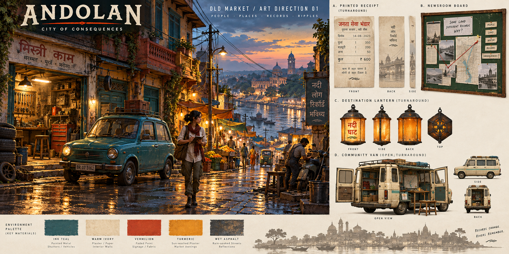
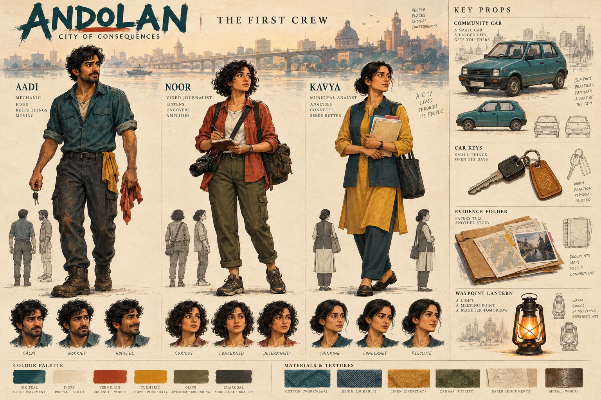

# Original visual concepts and production decisions

Two original images were generated for this project using the available image-generation tool. They are design concepts, not captures of the playable game. The runtime uses original procedural PlayCanvas meshes and canvas textures; the image pixels are not packaged as environment geometry or claimed as achieved visual fidelity.

## Old Market art direction

The concept establishes a monsoon dusk palette, warm workshops against teal shutters, overhead cables, the fictional community car and the physical records board. Accepted production elements: amber destination lantern, layered workshop fixtures, teal compact car, warm ivory paper and a board that only gains records after discovery. Generated small signage is concept texture, not approved final localization.

## The first crew

Aadi’s teal workwear, Noor’s rust overshirt/camera/notebook, and Kavya’s mustard/teal clothing and document folder establish distinct readable roles. The runtime contains simplified original figures with role-specific clothing and props, not these illustrated faces or fully rigged production characters. Expression turnarounds are a later animation/modeling brief.

## Asset organization

| Asset | Status | Production use | Verification |
| --- | --- | --- | --- |
| `old-market-art-direction.png` | Generated original concept | Palette, landmark language, prop reference | Visually inspected in chat |
| `first-crew-character-direction.png` | Generated original concept | Character silhouettes and material reference | Visually inspected in chat |
| `apps/client/src/world/index.ts` | Original procedural game art | Actual runtime city, people, vehicles, board, lantern | Browser screenshots and gameplay checks |
| `apps/client/src/audio.ts` | Original synthesis | Optional rain/engine ambience | Explicit user start; browser audio compatibility remains device-dependent |

The concept paintings intentionally set a longer-term art target. Their detail does not establish browser performance or production animation readiness. Future modeled assets should retain creator/source/license/export settings in `tools/asset-pipeline`, then undergo glTF validation and measured payload/rendering tests before replacing procedural geometry.
