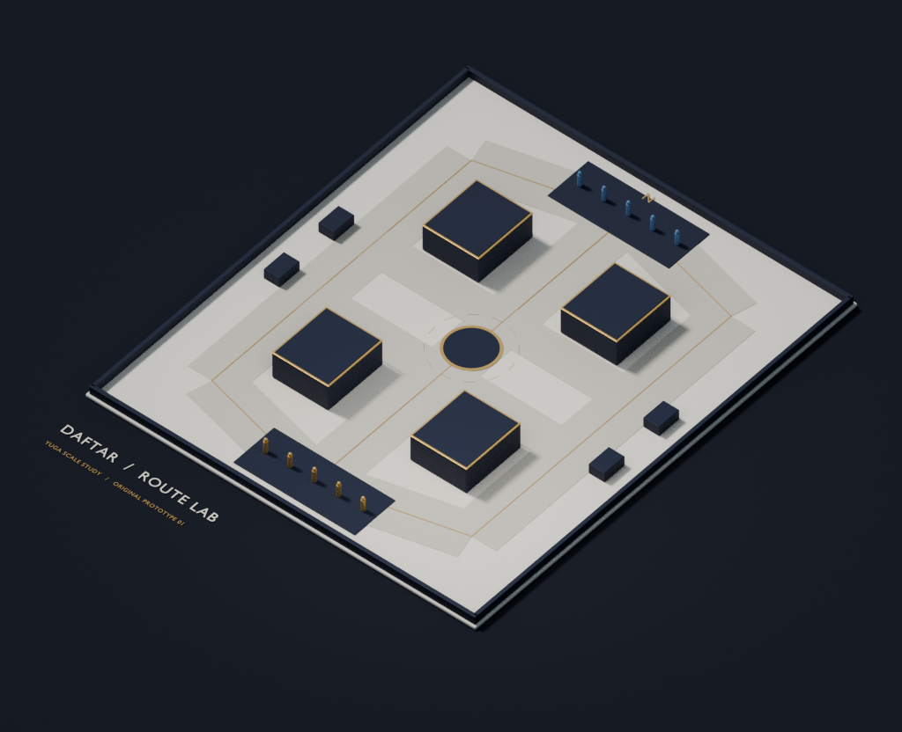

# Daftar Route Lab — original Yuga blockout prototype

This is an original **48 × 56 metre** Blender/GLB route and scale sandbox, prepared for the ANDOLAN/Yuga development workflow. It is a separate prototype. It does not replace the existing authored Mandala, Lanka, Ayodhya or Kurukshetra maps and is not an accepted gameplay level.



The generated scene has five spawn-scale markers per side, a central objective ring, three six-metre route corridors, two crosslinks, four tall structures and four low-cover blocks. All geometry and materials come from the included procedural recipe. No models, textures, HDR environments or fonts were downloaded.

## Assets and evidence

| File | Purpose |
| --- | --- |
| [daftar-route-lab.blend](daftar-route-lab.blend) | Editable scene, original geometry, preview camera and CPU lighting setup. |
| [daftar-route-lab.glb](daftar-route-lab.glb) | Portable geometry/materials with node names and `daftar_role`/spawn extras; excludes preview camera, lights, backdrop and text. |
| [route-lab-preview.png](route-lab-preview.png) | Actual 1024 × 832 Cycles CPU render, not an Unreal screenshot. |
| [manifest.json](manifest.json) | Dimensions, spawns, obstacles, axes, route calculations, source revision, render settings and asset hashes. |
| [geometry-acceptance.json](geometry-acceptance.json) | Actual Blender reopen and GLB reimport checks; distinct from gameplay acceptance. |
| [build_route_lab.py](build_route_lab.py) | Reproducible original geometry/export/render recipe. |
| [verify_route_lab.py](verify_route_lab.py) | Reimport, dimensions, finite geometry, spawn positions, resource and PNG checks. |

## Conventions and design decisions

The reference is `occult-kranti/ANDOLAN`, branch `game/yuga-hanuman-trial`, pinned at **`9e59880f31452ce0df8d326cd4f1291b700dc228`**. The native project declares Godot 4.6 Forward Plus; the broader active branch also includes Rust/WASM development. An Unreal project is not presumed to exist. See the pinned [native project](https://github.com/occult-kranti/ANDOLAN/blob/9e59880f31452ce0df8d326cd4f1291b700dc228/games/yuga-native/project.godot).

The [atlas convention](https://github.com/occult-kranti/ANDOLAN/blob/9e59880f31452ce0df8d326cd4f1291b700dc228/games/yuga-native/docs/design/ember-rite-5v5/atlas/README.md) uses plan +X east/+Z north. This recipe uses Blender +X east/+Y north/+Z up; exported glTF uses +X east/+Y up/−Z north. Units are metres throughout. Keep this axis distinction explicit when translating authored plan coordinates into an engine world.

The central ring has **3 m radius**, with a **4.5 m clearance radius from its centre**. The latter includes a 1.5 m apron; it is not 4.5 m beyond the ring. These conventions are explicit in the pinned [massing recipe](https://github.com/occult-kranti/ANDOLAN/blob/9e59880f31452ce0df8d326cd4f1291b700dc228/games/yuga-native/docs/design/ember-rite-5v5/atlas/massing.py) and [atlas audit](https://github.com/occult-kranti/ANDOLAN/blob/9e59880f31452ce0df8d326cd4f1291b700dc228/games/yuga-native/docs/design/ember-rite-5v5/atlas/audit.py). The lab uses one objective to isolate scale and routing, whereas the authored competitive maps have their own rules and topology.

The indigo `#0c1222`, slate `#172039`, ivory `#f6eddc` and worked gold `#e2bb70` palette follows the pinned [Yuga design identity](https://github.com/occult-kranti/ANDOLAN/blob/9e59880f31452ce0df8d326cd4f1291b700dc228/games/yuga-native/DESIGN.md). The blocks and scale markers are deliberately schematic; they are not accepted landmarks, hero art or faction designs.

| Route | Centre-line length | Ideal time at 5 m/s |
| --- | ---: | ---: |
| Central | 46.000 m | 9.200 s |
| West flank | 70.985 m | 14.197 s |
| East flank | 70.985 m | 14.197 s |

These are geometric route estimates without acceleration, combat, abilities or water. No balance conclusion is implied. The deterministic layout check samples route centre lines at intervals no greater than 0.25 m and checks their distance to known solid box footprints. It also checks objective clearance and spawn positions. This does not establish engine navigation or collision behavior.

## Rebuild and inspect

From the ANDOLAN repository root, with Blender installed:

```sh
blender --background --factory-startup --disable-autoexec --threads 2 \
  --python-exit-code 1 \
  --python games/yuga-native/art/daftar-route-lab/build_route_lab.py \
  -- --samples 64

blender --background --factory-startup --disable-autoexec --threads 2 \
  --python-exit-code 1 \
  --python games/yuga-native/art/daftar-route-lab/verify_route_lab.py
```

Both scripts are self-contained and resolve files next to themselves. After copying the package into another repository, change only the script path in these commands. The generator overwrites its own named generated assets. Use `--output-dir /absolute/new-directory` for a separate generation; place the verifier beside those generated files before running it.

The observed build uses **Blender 4.3.2**, Cycles **CPU**, two threads, 64 samples, no denoising and a 60-second render time limit. This installed Blender build has no OpenImageDenoise support, so the recipe does not require it. GLB export is uncompressed and does not require Draco. The manifest records the actual completed render duration and hashes; the verification receipt records real reimported dimensions and counts.

## Engine handoff and remaining acceptance

For Godot or the web renderer, first import the GLB into a new lab scene and verify the **48 × 56 m** ground and all ten named spawn markers against the manifest. Create collision only for the ground, boundaries and intended solid cover. Route inlays, objective markings and spawn mannequins are visual markers and should not become collision obstacles. Configure the controller, spawn height, navigation, camera and lighting in that host engine, then test walking each corridor in both directions. glTF extras document roles; they do not automatically create gameplay semantics.

For Unreal, **the engine is absent here and no import or render is claimed**. In a new, explicitly separate UE5 sandbox, use **File → Import Into Level** with the GLB and the Interchange scene pipeline. Import the whole scene so node transforms are preserved. Verify the ground spans approximately **4,800 × 5,600 Unreal centimetres** and compare north orientation with the manifest. Then add reviewed collision, a player start/controller and a camera. Save a lab map and produce an actual screenshot/render before marking Unreal acceptance. Do not add this file to the Donna studio's pinned one-time import script, which intentionally accepts only its original approved sculpture.

In the Daftar checkout, `projects/donna-creative-studio/unreal/README.md` describes engine installation prerequisites and the separate render gate. Epic documents the scene import workflow in [Importing Assets Using Interchange](https://dev.epicgames.com/documentation/en-us/unreal-engine/importing-assets-using-interchange-in-unreal-engine).

Human playtesting, line-of-sight review, competitive balance, production art, engine collision/navigation, frame-time measurements and multiplayer behavior remain pending. The current deliverable establishes an editable original scene, a portable export, an actual CPU preview and checked geometry.

## Provenance and licensing

The geometry and procedural scripts are project-authored original work with no
external asset inputs. This package makes no new license declaration; use the
repository owner's existing licensing policy. The separate Donna studio
artwork's license declaration does not apply to this map package.
