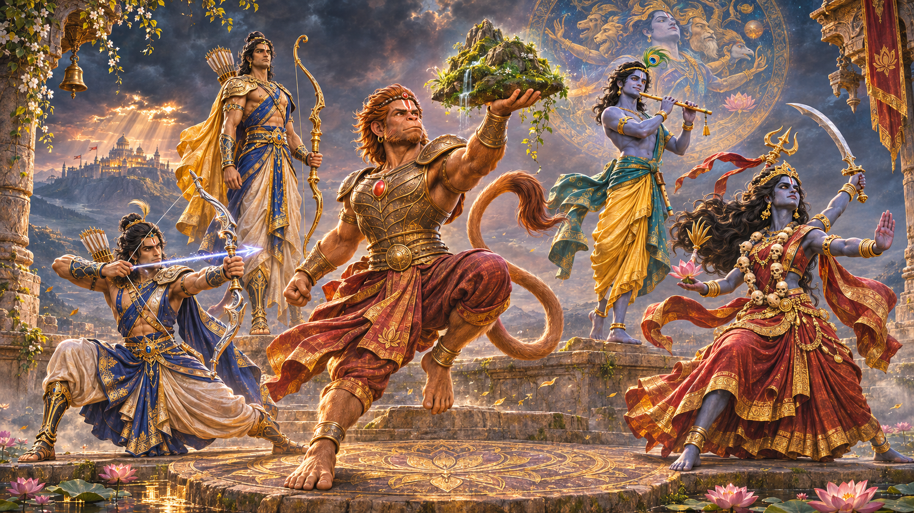

# Dharmic heroes · ensemble key-art study

This is a generated **concept image** for the user's five-hero brief, made on 25 November 2026. It is a single flattened **1672 × 941, 8-bit RGB PNG**, with no embedded ICC profile or editable layers. It is not a 4K master, a rendered Blender scene, a model, an animation or a gameplay screenshot. Its SHA-256 is `1e63161bd0cc588163e0c65ff6ec0c7b6e42fea8869a5e0791cc9b4850d62f03`.

[Improved brief and reusable prompts](../../docs/design/dharmic-heroes-key-visual-2026/ART_BRIEF.md) · [Production roadmap](../../docs/design/dharmic-heroes-key-visual-2026/ROADMAP.md) · [Current playable game](../../../yuga-rust/README.md)

## Reference inputs

The image generator received these three existing YUGA concept sheets as visual references, not as game geometry. Each is an earlier generated reference, with its own project handoff:

| Input | SHA-256 |
| --- | --- |
| [Hanuman](../four-hero-motion/media/art/hanuman.png) | `19cf1f52953c0286ff71826e1bfd0fba0009145b8ba5156d83068568ee85298d` |
| [Rama](../four-hero-motion/media/art/rama.png) | `ecee98b1b139c0b2d0732391af52fed8331cb7f6675693acc7beae3afefbd6ec` |
| [Krishna](../four-hero-motion/media/art/krishna.webp) | `2868d95d172cc596aba21fbeac9da8a40b0cf8c763020afb79bbb84c62fd20aa` |

The exact prompt is recorded below. No seed or reproducible model version was provided by the image tool; identical outputs should not be expected from rerunning it.

## Initial art review

- The five figures, lotus water, stone mandala, palace silhouette and Hanuman's mountain are present. Hanuman, Rama and Krishna borrow recognizable color and silhouette cues from their supplied sheets.
- Arjuna and Rama are still close in palette and archery silhouette. Krishna is smaller and his cosmic backdrop has more symbolic faces than the supplied three-face idea. Kali's foot is not shown on the requested demon skull. These are direction changes to review, not completed requirements.
- Treat the image as a composition and lighting reference only. Review each hand, bow, four-arm attachment, foot and prop in separate front, side, rear and moving views before a sculpt or rig is accepted. Do not infer exact anatomy, geometry or a real animation from this painting.
- The distant palace and plain form a fictional composite, not a historical claim about Ayodhya and Kurukshetra sharing a view. Geometric decoration is used instead of invented readable Sanskrit.

## Image-generation prompt

> Transform the three supplied YUGA character turnaround sheets into one original polished widescreen ensemble key-art concept for an Indian-mythology inspired competitive game, respecting their recognizable Hanuman, Rama, and Krishna character designs. This is a single coherent illustration, not a turnaround sheet, no separate panels. Camera at a dramatic but readable low three-quarter angle: five distinct full-body heroes arranged along a broad crescent/mandala on a weathered sandstone temple platform above a lotus pond at dusk. Center foreground, the copper-maned, expressive vanara Hanuman from reference 1, saffron-red drape and worked brass armor, protective face, coiled tail counterbalancing a light leap, carefully holding a small jewel-green mountain with living herbs on one open palm. Left foreground, Arjuna, a lean Indian archer with deep-lapis clothing and brushed-silver bow fittings, high asymmetric quiver and a single unobtrusive feather on his helmet, draws a luminous white-blue arrow; clearly distinguish his silhouette from Rama. Right foreground, Kali as a dignified and fierce dark-blue-skinned goddess with exactly four clearly separated arms, flowing black hair, red-and-gold sari, a stylized skull garland and raised curved sword, balanced in a dynamic protective dance stance; no graphic gore. Back left, Rama recognizably inspired by reference 2, composed vertical silhouette, long gold bow lowered, blue and ivory attire with a golden-yellow drape. Back right, Krishna recognizably inspired by reference 3, dark blue skin, prominent peacock feather, yellow dhoti and teal sash, holding a flute naturally with two hands; a subtle circular cosmic painted aureole behind him suggests multiple symbolic faces and arms as artwork, not extra people. Rama and Arjuna must be clearly different from each other. Avoid overlapping weapons and hands, preserve clear poses, expressive faces and large readable silhouettes for all five, and make the five heroes feel equally alive. Behind them, a distant Indian palace silhouette and a stormy plain are separated by warm sunbeams; lotus flowers, subtle golden reflections, floating dust, quiet gold-leaf-like accents, and luminous mist. Indian miniature painting composition and mural color harmonies meet richly lit realistic 3D game-concept painting. Refined physical anatomy, thoughtful textile detail, cinematic depth, painterly realism, warm saffron-gold against blue-green shadows, no UI, text, logos, watermarks, characters from other games, or pretend readable inscriptions. This image is concept art and must not imply it is an in-engine screenshot.
