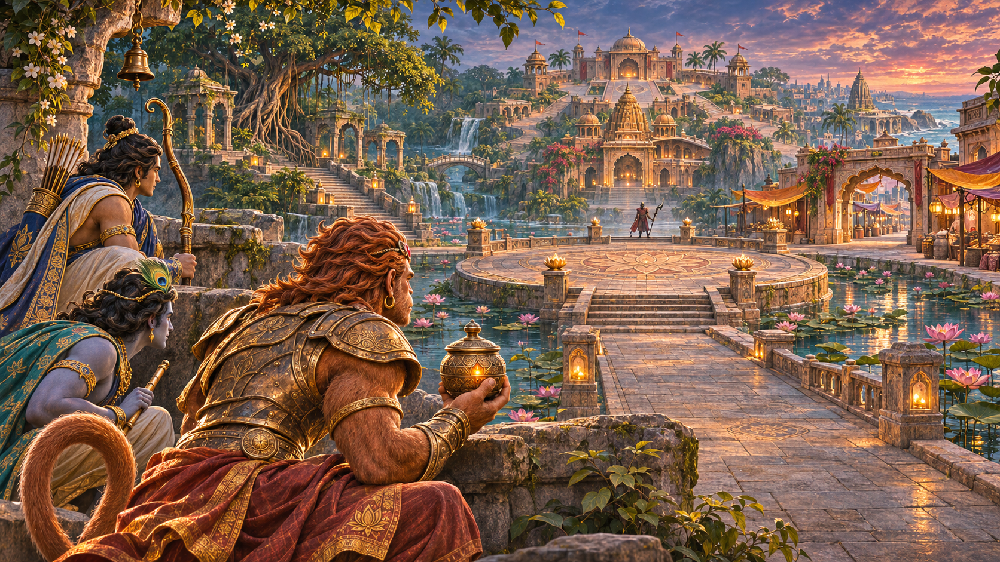

# Ember Rite · objective-site concept

This generated image is an original **concept study**, not a screenshot, model, level, route or playable mechanic. It shows a carried ember vessel, a circular sanctuary, a waterside approach and two distant visual routes. The full map design, playable geometry, two objective sites, characters and server interactions require separate creation and testing. The picture includes atmospheric fires for composition; they do not imply damaging objective fire.

The file is a flattened **1672 × 941 RGB PNG**, without an embedded ICC profile. SHA-256: `30f530991fc86a958340b344847640e9233f5fda554a217880f490bbcd3c0903`. It was generated on 25 November 2026 from these previously generated YUGA images:

- [Mandala Rift map concept](../../docs/design/mandala-rift-5v5/concept-sketch.png) — SHA-256 `a5dba84da83c92f31da84529b5ac6d98f451eb3a25d2ef1ed10502c871c7fb3a`.
- [Five-hero key art](../dharmic-heroes-key-visual-2026/key-visual.png) — SHA-256 `1e63161bd0cc588163e0c65ff6ec0c7b6e42fea8869a5e0791cc9b4850d62f03`.

The reference files themselves are illustrated concepts, not authored 3D meshes. No model version or seed was provided by the image tool, so the exact output is not reproducible from this text alone. [Objective design and implementation status](../../docs/design/ember-rite-5v5/README.md)

## Visual review and limitations

The carrier and brass vessel read clearly in the foreground, and the open platform and water establish a setting. The distant opponent is small and the side approaches are atmospheric rather than measured, so the image does not demonstrate competitive visibility, fair sightlines, collision, accessibility or actual route choices. Review hand-to-vessel contact, the long bridge exposure and hero scale separately in a graybox and actual camera captures. The image is not a 4K layered master, and generated imagery cannot establish game physics or performance.

## Exact image-generation prompt

> Transform the supplied YUGA Mandala Rift environment illustration and five-hero key art into a single original cinematic tactical-game objective concept, preserving their Indian-inspired architecture and the established copper-maned Hanuman character design. A third-person over-the-shoulder composition at dusk: Hanuman, expressive copper-furred vanara warrior wearing saffron-red cloth and worn worked brass armor, carries a clearly visible small closed engraved brass vessel with a single contained golden ember. Ahead is a low circular stone sanctuary platform in a lotus-water garden, with a safe walkable stone approach and two visually distinct routes visible in the distance: a stepped ghat with trees to the left and a terracotta bazaar arch to the right. A calm Rama-like archer in blue and ivory clothing and a second distinct ally observe from cover, while a distant opposing silhouette waits across the open court. Show a tactical pause before a possible plant, not an explosion, battle gore, army, guaranteed outcome or recreation of another game's characters. The vessel and the circular stone site must be visually readable, and the open site should remain clearly visible without an overwhelming flame. Warm amber rim light and lotus reflections against cool teal dusk shadows, Indian miniature painting compositional rhythms combined with richly detailed realistic 3D game-concept painting, high-quality natural materials, coherent anatomy, practical architecture, clear spatial depth and readable silhouettes. No HUD, numbers, letters, inscriptions, logos, watermark, fake map labels, smoke obscuring the objective or text of any kind. This is concept art rather than a screenshot of a playable level.
