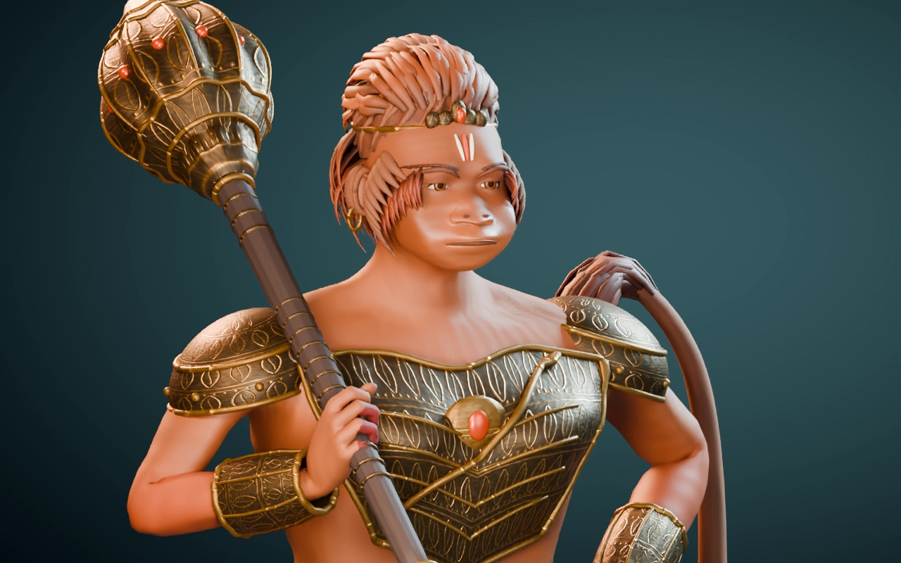

# Hanuman · hero studio

[Single-file game](https://github.com/occult-kranti/ANDOLAN/releases/download/yuga-four-hero-motion-studio-2026-11-25/yuga-rust.html) · [Game and room host](https://github.com/occult-kranti/ANDOLAN/releases/download/yuga-four-hero-motion-studio-2026-11-25/yuga-rust-confluence.zip) · [Download the art, editable scene and game](https://github.com/occult-kranti/ANDOLAN/releases/download/yuga-four-hero-motion-studio-2026-11-25/YUGA-Hanuman-Hero-Studio.zip) · [Watch the Blender performance](media/video/hanuman-showcase.mp4?raw=true)

Hanuman fights with a gada, protects allies in front of him, and punishes enemies who pursue him. In this edition his shortened muzzle opens the profile around his eyes. A swept copper mane follows the head and neck, and the brush of his tail catches the rim light as it settles after Mountain Pulse. The same skinned character appears in practice, lane play and private rooms. [Matched before and after views](media/images/matched-studies.webp) · [Art direction and generated portrait](design/PORTRAIT.md)

**To play solo**, open the single-file download in a WebGL2 desktop browser, choose **Hanuman · Gada** and select **Hanuman practice**. A drill recognizes five techniques in any order. Aim Mountain Pulse from the action bar to inspect its landing area, or press X for a quick cast. For multiplayer, extract the game ZIP and start its Node room host. The standalone HTML was tested offline from an empty folder, including movement and shielding an ally. [Offline check](evidence/standalone-file.json) [Mountain Pulse in a live lane match](media/playable-casts/mountain_pulse.png) · [Controls, cast timings and hosting](GAMEPLAY.md)

**To edit**, open the full character and courtyard in Blender. One animated camera covers six timeline shots across 163 frames. Ten effect objects can be edited in the scene. For a hair or silhouette pass, open the separate groom with its five editable regions. The game engine imports one GLB with eleven actions, four-influence skinning and embedded PBR textures. [Full Blender scene](blender/hanuman.blend?raw=true) · [Groom source](models/hanuman-groom.blend?raw=true) · [Facial action library for animators](expressions/README.md) · [Engine-ready GLB](models/hanuman-enhanced.glb?raw=true) · [Reopened scene receipt](evidence/editable-scene.json)

**For the next artist or programmer**, the handoff gives source paths, rebuild commands and known visual limits. The roadmap defines the camera-matched facial and cloth work, a physical GPU benchmark and a multiplayer playtest. [Handoff](HANDOFF.md) · [Roadmap](ROADMAP.md) · [Panel decisions and sources](design/PANEL.md) · [Companion four-hero studio](../four-hero-motion/README.md)
