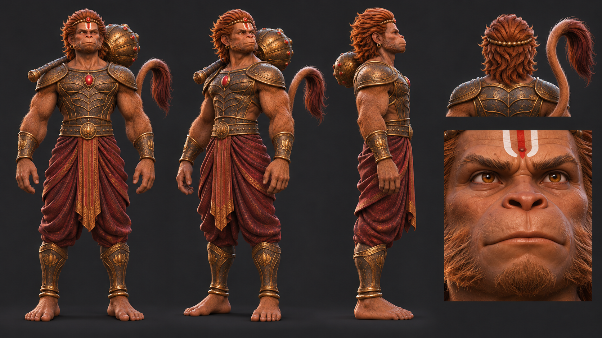

# Hanuman · multi-view art reference

This image was generated on 25 November 2026 as an **artist's reference**, using the [previous Hanuman portrait](../hanuman-hero-finish/design/hanuman-portrait-target.webp) as the supplied visual input. It is not a render of the current model, a 3D scan, or a game asset. The three full-figure views and two detail panels suggest volumes, material hierarchy and a target for sculpt review; their poses, projected proportions and costume details are not guaranteed to correspond exactly between views. Do not treat them as calibrated orthographic measurements.

Image SHA-256: `598ea10b62954eff68b10afd96c5bf9d8c6b1142428406078be69c98231ced60`.
The pinned `awesome-gamedev-agent-skills` raster checker confirmed an opaque 1672 × 941 RGB image; [report](evidence/raster-check.json) and [source/version notes](../../docs/research/gamedev-agent-skills-2026/README.md). It does not validate the depicted anatomy or 3D mesh.

## Generation brief

> Using the supplied Hanuman concept as the visual identity reference, produce an original high-quality professional 3D character artist's turnaround and anatomical detail concept sheet for YUGA. Preserve his recognizable vanara face, copper swept-back mane, white-and-red tilak, gold and dark engraved armor, ruby accents, red lower garment, gada and long expressive tail. Show the same consistent heroic figure at equal scale in neutral game-ready stance from front, three-quarter and side views, plus a small posterior head-and-tail detail view and one close crop of the eyes, nose and closed lips. Anatomical volumes should be natural and sculptable, with balanced paired eyes and facial landmarks, readable separation of materials, realistic surface detail and layered hair. Clear neutral deep charcoal studio background, soft neutral light from the same direction, no action, no text or watermarks, no scenery. This is a concept-reference sheet, not a screenshot of an existing game or evidence of a finished 3D model.

Use the [current editable/model handoff](../hanuman-hero-finish/HANDOFF.md) and measured comparison renders to decide actual mesh changes. Source geometry and topology remain necessary for the hidden side, deformation and in-engine rendering.
