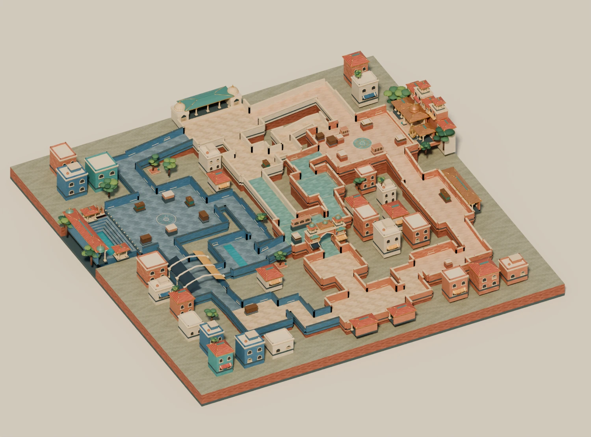

# Monsoon Exchange

Monsoon Exchange is a two-site YUGA district built from the team's study of two reconstructed Dust II maps. A caravan enters a trading district at its southern scales. At the loom it can commit to a copper exchange above street level or descend below a row of dyehouses to a cistern. Guards can change sites behind the northern archive. Open the browser atlas to trace that decision on the surveyed plan, then walk an approach at eye height or orbit the exported model. [Explore the district](https://occult-kranti.github.io/ANDOLAN/production/monsoon-exchange/) · [Illustrated design atlas and four architectural sheets](monsoon-exchange-atlas.pdf) · [Editable Blender scene](scene/monsoon-exchange.blend) · [Portable GLB](scene/monsoon-exchange.glb) · [Watch the model tour](film/district-tour.mp4)



Compare three views of the same district. The measured plan locates each threshold. The overhead illustration shows how the trades and roofs might read from the air. The north-up Blender photograph shows the geometry that ships. [Survey drawing](plan/floorplan.png) · [Generated overhead painting](concepts/painted-plan.webp) · [North-up Blender render](renders/north-up.webp)

## What to keep from Dust

The durable part of Dust is the choice offered by a junction. At the western vaulted entry the attackers have largely disclosed which site they want. At mid they still threaten two sites, so a defender must decide whether to hold or rotate. We kept those decisions and gave the two destinations different elevations, materials and working histories. One visible doorway can be a piece of scenery, a collision opening, an audio boundary or an actual moving door. The two source editions demonstrate all four cases. [Functional inventory of both rebuilds](../../docs/research/dust2-map-lab/inventory/README.md) · [Component-by-component reuse decisions](design/transfer-register.md)

| Dust observation | Foundation kept in YUGA | What changes in Monsoon Exchange |
|---|---|---|
| Long A and Catwalk offer two commitments to the same site | Long outside approach and a shorter central climb | Copper Arcade and Ledger Balcony open onto the 27 × 21 m Sun Court at +3.0 m. A third guard return and the Witness Gate make four physical entries. |
| Upper and Lower Tunnels meet different decisions on the way to B | A sheltered committed route and an alternative from mid | Dyers’ Passage and Sluice Walk enter the 29 × 25 m Indigo Cistern at −1.4 m. A northern return is its third entrance. The 12 m water strip has dry margins. |
| Mid Doors, Top of Mid and CT Mid split sight and movement | A central transfer and a visible clue to its direction | Weavers’ Gate uses a working loom and layered openings. The archive carries the safer site-to-site return. |
| Spawn spaces, objective volumes and visible props serve different jobs | Separate starts, legal objective surfaces, assigned cover and decorative geometry | Ten deployment pads serve the two five-player starts. Each rite uses a level disk of 3 m radius. Seven entrances have two distinct standing shelters apiece. |
| The Source BSP has 37 visibility portals, 57 soundscape entities and zero moving-door entities. Hanzo’s editable remake defines 12 doors. | Treat drawing, collision, sound and game rules as separate things to test | Static portals and arches shape the district today. The proposed server adapter owns the objective, player filtering, sound events and dynamic abilities. |

The source index covers 375 entities and all 32 classes in the Valve level, 3,158 placed static props, their collision modes and materials, and 1,118 bot navigation areas. The second index covers 298 editable entities in 58 classes, 507 curved patches and mode-specific doors, flags and jail logic. Every named native place has a corresponding transfer decision, including labels with no one-to-one room equivalent. [Dust callouts and YUGA destinations](design/dust-callouts.csv) · [Native entity and prop inventory](../../docs/research/dust2-map-lab/inventory/source.json) · [Navigation graph](../../docs/research/dust2-map-lab/inventory/nav.json) · [Editable remake inventory](../../docs/research/dust2-map-lab/inventory/hanzo.json)

## Drawing, modeling and art

One Blender unit represents one metre. North is +Y and east is +X. Start with the survey to change a wall, opening, elevation or objective. It defines 13 rooms, 18 connections and 20 cover solids over a 96.5 × 113 m footprint. The district plan shows both starts, forks and courts. The site enlargements mark each entrance and its two shelters. The sections show the grade of the eastern climb and the depth and margins of the western water. [Survey and route measurements](plan/README.md) · [Four printable A3 drawings](plan/floorplans.pdf) · [Dimensioned source](plan/survey.json)

The district reuses ten existing Mandala kit models across 24 registered placements. The new surroundings use copper weighing gear, masonry pavilions, sunken steps, water channels, jali screens and indigo drying shades. The visual research traces individual design choices to Rani-ki-Vav, Hampi, Dholavira and museum textile records. The generated district painting and its north-up companion guide colour and massing. The third generated image, an indigo resist print, is mapped directly onto the cloth in three groups of built structures. [Architectural sources and building details](design/architecture.md) · [Image prompts, masters and file receipts](concepts/direction.md) · [Object, camera, material and reuse register](scene/scene-register.json)

| Open this | Use it for |
|---|---|
| [Documented Blender scene](scene/) and [editable model](scene/monsoon-exchange.blend) | Select a named floor, envelope, solid, dressing group or saved camera. Inspect packed textures and turn off dressing to see the survey beneath it. |
| [Runtime model](scene/monsoon-exchange.glb) and [viewer](viewer/README.md) | Import the exported Z-to-Y-up model or inspect the shipped browser lighting, orbit and guided routes. |
| [Two-site design register](design/transfer-register.md) | Trace keeping, transforming, reusing or retiring a component to evidence. Find the existing project meshes and original map/source terms. |
| [Independent drawing and geometry checks](qa/README.md) | Recheck the floor seams, cross-sections, pad-to-site routes, gate apertures and mapped shelters against the actual exported geometry. |

The portable scene stores 333,148 mesh triangles and weighs 22.53 MB. Instancing the repeated pieces brings the full district to 381,356 placed triangles. A second Blender build produced the same GLB byte for byte. The Khronos validator recorded zero errors and zero warnings. The browser fetches the model on the first 3D request, so the drawings and film can be used independently on a smaller device. [Format verification](scene/format-verification.json) · [Blender source notes](scene/README.md)

## Rebuild the district

Run from this directory. Plan compilation and route measurements use Python's standard library. The plan illustrator uses PyMuPDF and Inkscape. The atlas assembler uses ReportLab, Pillow and PyMuPDF. The scene was built in Blender 4.3.2. The Blender render script uses Pillow and supports Intel Open Image Denoise. Scene dressing pulls the existing Mandala kit from the same checkout. [Plan rebuild details](plan/README.md) · [Source input checks](design/verify_register.py) · [Browser verification](viewer/README.md)

```sh
python3 plan/geometry.py
python3 plan/measure.py
python3 plan/draw.py
blender -b -t 3 --python-exit-code 1 -P scene/build.py
blender -b -t 3 --python-exit-code 1 -P scene/render.py
python3 build_fieldguide.py
python3 design/verify_register.py
python3 qa/check_drawings.py --check
blender -b -t 3 --python-exit-code 1 -P qa/check_meshes.py -- --check
python3 check_delivery.py
```

## Next playable milestone

The browser release is a map study with a guided eye-height camera, a measured plan and the actual exported scene. Its four attacker approaches take 19.24–21.45 s in the survey's 5 m/s walking model. A human test should ask whether two equally informed teams can recognise the preparation at Sun Court, hear a cistern rotation in time and find the assigned second shelter while carrying the vessel. The next implementation step is to bind the solids, spawn pads, seven thresholds and two objective disks to Ember Rite’s authoritative round rules. Then test ten clients, swap sides, and record first contact, plant/pour interruption and retake times. The existing four solo map rehearsals remain available separately. [Round rules and existing rehearsals](../../docs/design/ember-rite-5v5/atlas/README.md) · [Production roadmap](../../docs/ROADMAP_BACKLOG.json)
