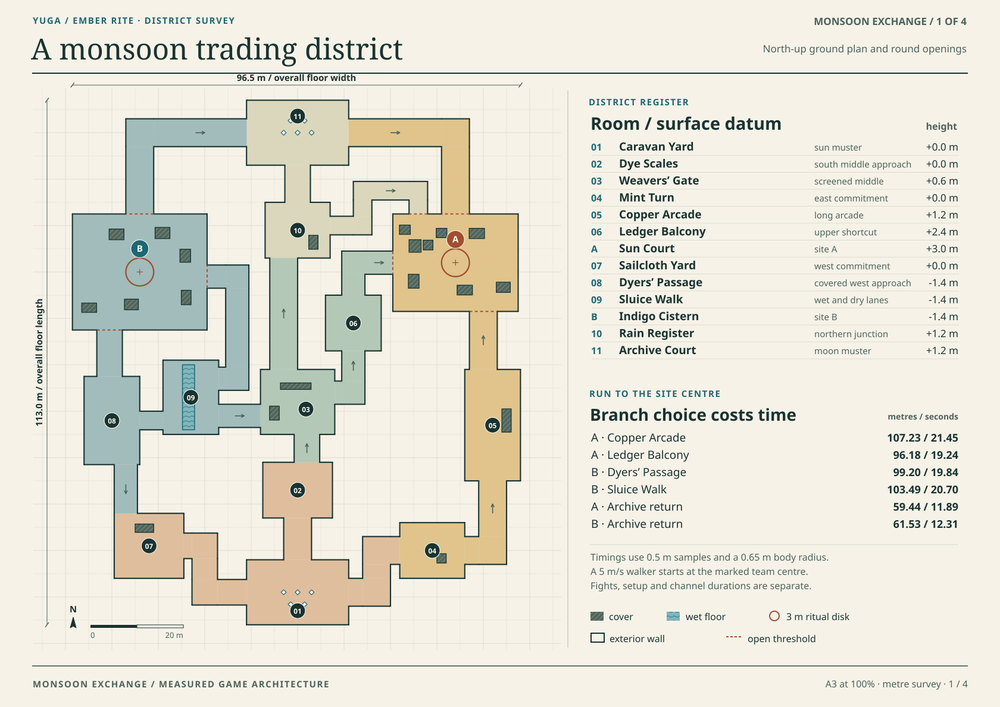

# Monsoon Exchange · measured district plan

A five-player caravan team starts south of the exchange. Two roads leave its yard for the raised Sun Court and the sunken Indigo Cistern. A third road reaches Weavers’ Gate, where a team can trade the certainty of an outer route for a later choice of site. Archive Court gives five defenders a return behind either court. The central loom breaks the straight sightline between the team centres. A sheltered route costs time at Sun Court, while the shortest western route reaches Indigo Cistern through a single vault. [Printable four-sheet survey](floorplans.pdf) · [North-up overview](floorplan.png) · [Editable survey](survey.json)

| Drawing | Use it to answer |
| --- | --- |
| [District floorplan](floorplan.svg) | Where are the two musters, three approaches, seven site thresholds, continuous ramps and short cross-link? The register gives names and levels for all thirteen rooms. |
| [Sun Court](sun-court.svg) | How do the Copper Arcade, Seal Gallery, northern return and Witness Gate converge on the elevated 27 × 21 m court? The enlargement identifies eight distinct standing-height shelters. |
| [Indigo Cistern](indigo-cistern.svg) | Where do the western vault, east Dye Gate and northern return meet the 29 × 25 m lower court? The enlargement identifies six distinct standing-height shelters. |
| [Grade and water sections](sections.svg) | How does the Copper approach rise into A? What lies underfoot when a walker crosses from Weavers’ Gate into the Sluice? Both cuts sample the same floor geometry as the model. |



## What the district keeps

The Dust study supplied a design relationship. At an outer approach the opposing team can predict a destination, while the central transfer keeps two destinations viable. Monsoon Exchange assigns each decision a different architectural reason. Copper Arcade follows the high line of a brass processional street. Ledger Balcony reaches the same court by two climbs. Dyers’ Passage shelters a western commitment. The Sluice passes below the central gate and offers a water lane and two dry margins. Repeated plaster, screens, ledges and weighing equipment serve a fictional trading district. The coordinate plan, route dimensions and cover solids are original to this district. [Dust reconstruction and measured editions](../../../docs/research/dust2-map-lab/README.md) · [Ember Rite round rules](../../../docs/design/ember-rite-5v5/ROUND_AND_TECH.md)

## Registration and architecture

One Blender unit is one metre. X increases east, Y north, Z up. A glTF consumer interprets the converted axes as X east, Y up, negative Z north. Floor limits span X −48.5 to +48.0 m, Y −56.0 to +57.0 m. The 5,524.75 m² plan area includes the floor under placed cover. Sun Court sits at +3.0 m and Indigo Cistern at −1.4 m. Both 3 m-radius kindle disks have a level surface. Each five-pad team array is a rehearsal staging choice. The ten pads do not imply the presence of a multiplayer adapter. [Floor solids and wall runs](geometry.json) · [Source pads, covers and ritual disks](survey.json)

The architect can trace every floor panel to one room, run or turn. All 18 connections start and end at actual room thresholds. Each right-angle turn has a level square landing. The 59 disjoint rectangular panels share 64 continuous floor seams. Splitting and comparing adjacent edges yields 179 oriented exterior wall runs. The `outward` vector on each run points away from player floor. The walking graph does not cross the walls. Changing a room elevation requires updating the adjoining ramp endpoints. The geometry compiler reports overlapping patches, vertical seams and slopes over the district’s 30% design ceiling. Its steepest accepted panel is the last part of Ledger Climb at 27.69%. [Floor development](geometry.py) · [Measured slope and area register](metrics.json)

| Room or connector family | Built function and reuse |
| --- | --- |
| Caravan Yard, Archive Court | Separate five-pad musters; pads mark deployable team spots, while the centre marker supplies a stable route-test start. Decorative spawn art can change independently of pad positions. |
| Dye Scales, Weavers’ Gate, Rain Register | The approach reaches a screened junction, then the central return. A loom and wicket vary the walk around each side. The body model uses the inventoried cover prism. The renderer can instance a more elaborate loom outside its movement opening. |
| Mint Turn, Copper Arcade, Sun Court | A committed east approach gains height. The final 12.5 m graded run rises from +1.2 to +3.0 m. The court supports two attacking routes and two northern responses. A rotated version can keep the climb and choice while changing the arcade’s shape and identity. |
| Ledger Balcony, Witness Gate | Ledger Climb and Seal Gallery form a raised inner route. Witness Gate enters separately from Rain Register. Both provide distinct entrances, a level turning place and cover keyed to that entrance. |
| Sailcloth Yard, Dyers’ Passage, Indigo Cistern | The outer western route descends, passes through a sheltered threshold, then enters the lower court on level stone. The northern return and eastern gate remain physically separate. |
| Sluice Walk, Stone Spillway, Dye Gate, Loom Door | The wet strip can be bypassed along either margin. Loom Door is a short physical connection between the western passage and the sluice. It preserves a transfer opportunity even after an early western commitment. Water has a floor, width, length and depth separate from the material on top. |
| Both ritual markers and their seven entries | A 3 m disk governs where a carrier may kindle. A subsequent quench reaches the vessel’s placed position from within 1.5 m. Each entrance has its own inward normal, width and two standing shelters. A bright ring remains visible with alternate paving. |

## Movement and concealment

An 8-neighbour Dijkstra search on a 0.5 m grid compares routes between fixed spawn and site centres. A 0.65 m radius must clear perimeter segments and the twenty cover footprints. Diagonals require both neighbouring axial samples to be clear. Travel cost accounts for the true grade and the 0.85 water speed factor used in the existing atlas. A dry 5 m/s walk sets the clock. The first four comparisons restrict each search to the named itinerary, so a short western cross-link cannot silently substitute for an eastern test. The metric file includes the witnesses for all nine comparisons. These are sampled planning times. Ability use, acceleration, opponents and network delay belong in the playable trial. [Route metric source](measure.py) · [Nine measured paths](metrics.json) · [Prior atlas speed assumptions](../../../docs/design/ember-rite-5v5/atlas/audit.py)

| Centre-to-centre itinerary | 3D path | Ordinary walk |
| --- | ---: | ---: |
| Caravan → Sun through Copper Arcade | 107.23 m | 21.45 s |
| Caravan → Sun through Ledger Balcony | 96.18 m | 19.24 s |
| Caravan → Indigo through Dyers’ Passage | 99.20 m | 19.84 s |
| Caravan → Indigo through Sluice Walk | 103.49 m | 20.70 s |
| Archive → Sun by northern return | 59.44 m | 11.89 s |
| Archive → Indigo by northern return | 61.53 m | 12.31 s |
| Archive → Sun through Witness Gate | 65.29 m | 13.06 s |
| Indigo → Sun by northern return | 119.32 m | 23.86 s |
| Indigo → Sun through Weavers’ Gate | 126.79 m | 25.36 s |

The 2.6 m-wide runnel occupies a 14 m run inside Sluice Walk. The comparison marks two transverse datum lines 12 m apart. Staying in the 0.12 m-deep water takes 2.82 s. The west and east dry lines each take 2.40 s. From the wet centre marks a walker allowed to leave the water finds a 13.24 m path in 2.77 s. The result preserves an ordinary route for a grounded hero and a meaningful choice of footstep sound. [Surface and route receipts](metrics.json) · [Ember Rite sound design](../../../docs/design/ember-rite-5v5/audio/README.md)

The teal pinpoint by each site cover marks a standing position. A test observer stands 2.5 m outside the named threshold and looks in from 1.6 m above the local floor, including its ramp grade. The candidate body has radius 0.65 m and height 1.8 m. For each of eight bearings the sampler checks rays ending 0.12 m, 0.95 m and 1.8 m above the floor. Each ray must cross the open threshold and meet the assigned one of twenty cover prisms before reaching its endpoint. Fourteen different physical covers supply 336 successful sample rays. [Door-by-door feet and eyes](metrics.json) · [Standing field rig used in the earlier district](../../../docs/design/ember-rite-5v5/atlas/vertical-play/README.md)

Six sculpted furnishings taper at head or shoulder height. Their original prism-selected positions exposed part of the body in 3D. The site sheets use measured positions farther into shelter for those six. The pin register keeps each on the clearance grid and makes regeneration fail if a revision exposes a body sample or obstructs its entry. The other eight drawings retain the positions found by the prism search. The witnesses describe the view from each assigned doorway. Flanks, airborne observers and the moving hero silhouette need their own trials. [Six sculpted-cover positions](shelter-pins.json) · [Independent geometry and scene checks](../qa/README.md)

## Rebuild and inspect

Run the following commands from this directory. Geometry and movement analysis use Python 3. The print builder uses Inkscape and PyMuPDF. Its page coordinates are written to every plan SVG as `data-ox`, `data-oy` and `data-scale`. For the overview at 1680 × 1188, page X is `500 + 7.8 × east` and page Y is `613 − 7.8 × north`. At A3 printed at 100%, the overview is approximately 1:513 and the court enlargements 1:171. For screens or resized paper, use the drawn scale bar. Section heights have a separate axis. [Authoring source](survey.json) · [Drawing generator](draw.py)

```sh
python3 geometry.py
python3 measure.py
python3 draw.py
python3 geometry.py --check
python3 measure.py --check
python3 draw.py --check
```

Edit a room, route or cover first in `survey.json`. Keep registration IDs stable across the Blender file, floorplan and viewer. Rebuild the geometry before the drawings, then regenerate the Blender scene and rerun the independent map checks. The first ten-seat playtest should compare arriving through the Copper route with the Ledger route, cross the water in mono and with captions, and challenge each surveyed shelter once from the threshold and once from above. [District art and scene handoff](../README.md)
