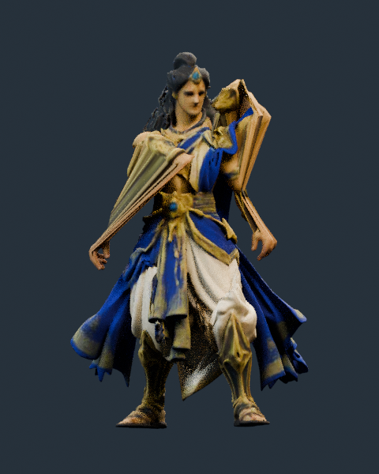

# Rama rig reuse: two rejected binding candidates

The generated Rama mesh was actually bound to the existing 164-bone Rama rig and exercised with the existing idle, fire, run and cast actions. The first candidate was exported to GLB. Both candidates fail deformation review. The accepted runtime hero and original generated source remain unchanged.

The [rest pose](r1/views/rest.png) looks plausible by itself. The [fire pose](r1/views/fire.png), [wrist detail](r1/views/fire-wrist.png) and [running cloth detail](r1/views/run-cloth.png) expose the binding failure. These are actual Cycles CPU renders at 16 samples; they are not concept images. The generated source has no bow, so weapon grip, release and bow contact are **untested**.

## Results

| Check | R1 nearest-face transfer | R2 anatomy-gated transfer |
| --- | ---: | ---: |
| Blender mesh vertices | 93,214 | 93,214 |
| Existing bones / actions reused | 164 / 9 | 164 / 9 |
| Unweighted vertices / maximum influences | 0 / 4 | 0 / 4 |
| Idle frame 0 edge ratio, p99 | 4.441× | 4.044× |
| Idle edges changing by more than 2 cm | 4,060 | 5,030 |
| Fire frame 8 edges changing by more than 2 cm | 3,738 | 4,725 |
| Run frame 5 edges changing by more than 2 cm | 4,411 | 5,340 |
| Largest idle posed edge | 0.843 m | 0.959 m |
| Original fit → new REST edges changing by more than 2 cm | 0 | 846 |
| Original fit → new REST maximum edge ratio | 1× | 12.672× |
| Export / actual pose renders | GLB / 5 | No / no |
| Production acceptance | Rejected | Rejected |

R1 takes nearby donor drape/leg weights at the generated mesh's lower wrist positions. One measured source edge expands from 0.021 m to 0.843 m during idle: one endpoint is assigned to the forearm while its neighbor is assigned to the upper leg. Across 28,809 coincident-position groups, only two separate by more than 0.00001 m; seam splitting does not explain the large streaks.

R2 adds provisional arm centerline landmarks, side-specific donor surfaces, arm-chain repose and capsule blending onto the torso. It reduces some relative strain statistics but increases absolute action damage and already distorts the source at REST. The mirrored source landmark assumption is wrong: left wrist/fingertip residuals are about 0.120/0.119 m, while the right residuals are about 0.006/0.007 m. This candidate is not an improvement for release.

R2's zero forbidden arm/leg-prefix weights apply only to its inferred labels; they do not prove correct anatomy. A separate named-group audit found zero opposite-sided core-group contributions for this candidate, but the classifier still requires review of clavicle, shoulder, pelvis and other sided groups. The [repose audit](r2/repose-audit-v2.json) records both this limitation and the original-fit→REST damage.

## Evidence and retained artifacts

- [Machine-readable handoff and hashes](rig-handoff.json)
- [Original rig/source inventory](input-inspection.json)
- [R1 weight and action samples](r1/transfer.json), [localized failures](r1/deformation-localization.json), [GLB integrity](r1/export-integrity.json), [camera/render contract](r1/views/views.json)
- [R2 weight and action samples](r2/transfer.json), [localized failures](r2/deformation-localization.json), [original-fit→REST audit](r2/repose-audit-v2.json)
- [Frozen R1 binder](frozen-code/r1-build-transfer.py), [frozen R2 binder](frozen-code/r2-build-transfer.py), [frozen R2 anatomy module](frozen-code/r2-anatomy-gate.py)

Large rejected artifacts remain in `/workspace/scratch/ten-rounds-oct23/rig/` with exact paths and SHA-256 values in the handoff. They are not duplicated in Git: R1's `.blend` and GLB, plus R2's `.blend`. The R1 GLB contains 164 skin joints and all nine action identities with finite data and normalized four-weight skinning. Its two embedded image byte sequences exactly match the source. Export contains 93,350 attribute vertices; the extra splits do not establish unchanged exported vertex indices. These integrity checks do not accept deformation or image quality.

There were two binding candidates. R2 also had two execution failures before producing its completed candidate: an incompatible donor corner and a degenerate donor triangle. Their logs are retained under `execution-failures/`. Those failures do not count as additional art rounds.

## Next measured correspondence task

1. Mark actual asymmetric shoulder, elbow, wrist, finger and garment regions on this source mesh. Record vertex IDs and measured landmarks from several views, with independent review of arm versus drape boundaries.
2. Build a continuous source-rest repose from those labels. Audit source-fit→REST edge lengths and seam continuity before binding; a new rest baseline must not hide existing damage.
3. Transfer from matching donor body regions and sides using the existing skeleton and actions. Audit every named sided group, weight normalization, discontinuous boundaries and absolute edge deltas.
4. Reuse the same rest/idle/fire cameras and sample frames, then add full run/cast animation review, finger articulation and real bow/hand/cloth contact checks.
5. Export and reimport only after deformation and visual gates pass. Verify rest transforms, skin weights, every action, materials and contacts before requesting any runtime replacement.

The reproducible tooling and commands are in [tools/hero-reuse-rig](../../../tools/hero-reuse-rig/README.md). Existing asset and model-generation provenance continues to apply; this work adds no new third-party character asset.
