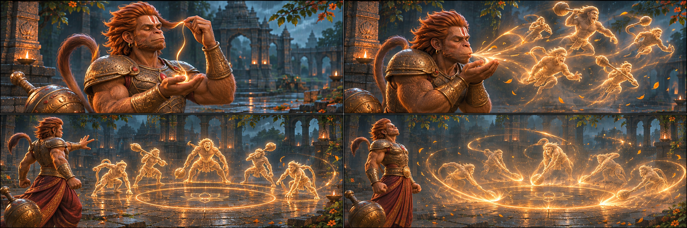

# Vanara Sena · ability concept

This image is original generated concept art made on 25 November 2026 using the [existing Hanuman portrait](../hanuman-hero-finish/design/hanuman-portrait-target.webp) as a visual reference. It is **not** a screenshot, 3D model, motion capture or evidence that every detail is present in gameplay. The playable prototype uses a reused hero clip, animated spectral cues and an authoritative area effect; independently moving guardians are a separate future design. [Ability rules and sources](../../docs/design/vanara-sena-2026/README.md)

SHA-256: `6e22c0ad3d1f365639ef9d24c2d2c81a5eddb4e8a60ca5a226e9d31ef1eab58c`.

## Image-generation brief

> Create an original premium-quality cinematic game ability keyframe sheet for YUGA, using the supplied image only as the design reference for Hanuman: powerful expressive vanara warrior, copper mane, tilak, red dhoti, engraved gold armor and gada. Tell a coherent new ability called Vanara Sena in four sequential panoramic frames: (1) Hanuman respectfully gathers one glowing strand of his own hair with calm focus in a ruined Indian-inspired temple courtyard, (2) he breathes upon it and golden wind, saffron petals and soft light flare into five distinct vanara guardian spirits, (3) the five translucent yet anatomically convincing miniature warriors holding small wooden gadas land in a clearly spaced crescent around a marked circular zone, (4) coordinated brief strikes sweep the zone then the spirits dissolve into gentle saffron light. Emphasize readable silhouette, convincing animated gesture, physical lighting, warmth and teal shadows, Indian-inspired stone and leaves, high-end 3D animation concept art. The character and environment should stay consistent across panels. No text, logos, existing video-game characters, blood, UI or watermarks. This image is concept art, not a screenshot or an actual 3D animation.
