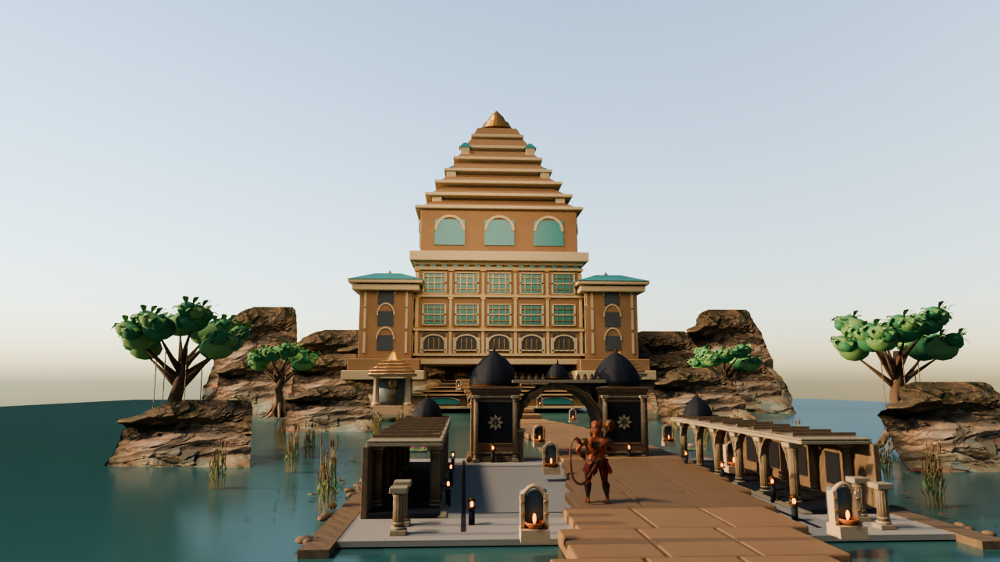

# Wetland landmark · Blender composition study

This early, static 3D study tests a route toward a tall temple over a shallow wetland. Its foreground uses YUGA's existing Lanka courtyard for the ghat and gateway. Repeated rock faces frame the shikhara, while an existing Hanuman model supplies a human-scale reference. The scene and all file-backed textures open offline. Runtime import, collision, navigation, lighting and frame-rate evaluation are future work.



[Open the editable Blender scene](landmark.blend) · [Original render before denoising](landmark-raw.png) · [Initial overhead view](first-pass.png) · [Source and license record](SOURCES.md) · [Scene checks](verification.json) · [Independent offline review](qa.json)

The first overhead pass clipped the top of the temple and left its foundation visually unsupported. The revised camera sits 3.4 m above the ground, closer to the route. A terraced plinth, an additional central rock and a foreground gate establish the destination's scale. The [intermediate pass](mid-pass.png) exposed an armature display sphere, so it was hidden in the final scene. A [later review](precontact.png) identified a 0.161 m foot gap. The corrected scene places each foot on the walkway, with evaluated ray casts measuring 0.14 mm of intersection at the lowest sole vertices. The hero mesh casts shadows.

The world uses named, editable collections for rocks, temple, wetland planting, causeway and character. Sixteen placements share one 20,174-triangle rock mesh. The whole scene contains 750,376 visible raw triangles with repeated instances counted and modifiers unevaluated. Blender 4.3.2 Cycles rendered the final 1280 × 720 frame at 32 CPU samples. Open Image Denoise 2.5.1 filtered the delivered image. The 40 file-backed images are packed into the `.blend` and its rock, courtyard, material and hero remain separate scene objects.

The generated [composition target](../../docs/research/elden-ring-world-study/concept.png) is a separate image made for art direction. The Blender image above is rendered from the editable scene and has simpler geometry and surfaces. Hampi's documented relationship between boulder-strewn terrain, gateways, waterways and temple routes informed the placement of the components. [UNESCO · Hampi](https://whc.unesco.org/en/list/241/)

## Rebuild

From a full checkout, use Blender 4.3.2, Python 3 with NumPy and Pillow, and the supplied source textures in this directory. The script checks the hashes of the project world library, courtyard, Hanuman rig, Poly Haven rock glTF and HDRI before building. The scene retains editable meshes and materials.

```sh
study=games/yuga-native/art/world-landmark-study
blender -b -t 2 --factory-startup --python-exit-code 1 -P "$study/build.py" -- \
  --variant refined --width 1280 --samples 32
```

The command saves `landmark.blend` and `landmark-raw.png`. To reproduce the denoised image, install the [Intel Open Image Denoise 2.5.1 command-line release](https://github.com/RenderKit/oidn/releases/tag/v2.5.1), set `OIDN_EXECUTABLE` to its `oidnDenoise` binary and run:

```sh
python3 games/yuga-native/tools/hanuman-art/denoise.py \
  --oidn "$OIDN_EXECUTABLE" "$study/landmark-raw.png"
cp "$study/landmark-raw-denoised.png" "$study/landmark.png"
blender -b -t 1 --factory-startup --python-exit-code 1 -P "$study/verify_scene.py"
```

The verification reopens the saved scene, checks packed textures and the shared rock mesh, and casts downward rays from both soles to the evaluated slabs. It records the current scene and image digests. Blender's compressed project file can have a different digest on a later rebuild, so compare the actual reopened scene and rerender rather than assuming identical project bytes.

For game promotion, the next world artist should remesh and texture the temple facade, create lower-detail versions of the rocks and foliage, then build a short playable section against an authoritative collision and navigation layout. Review entrance sightlines, lane clearance, shadow performance and host/client position agreement from the actual match camera.
