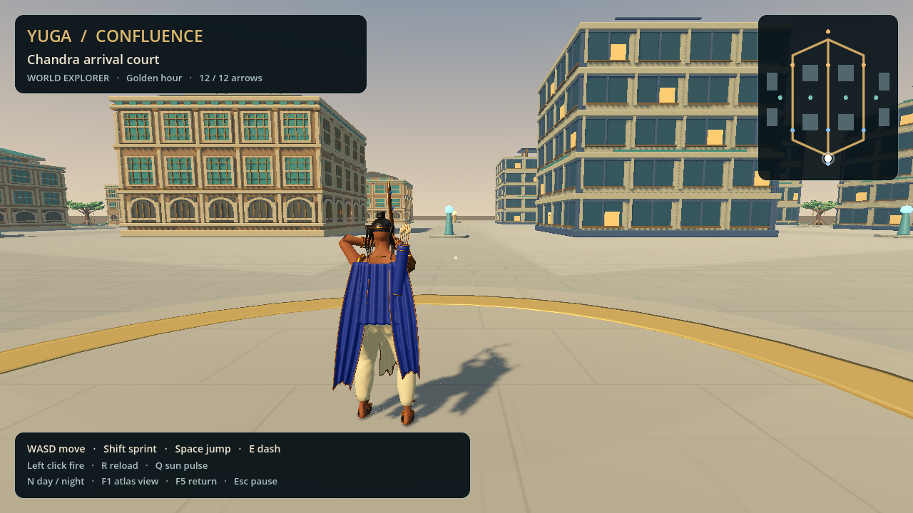

# Confluence native map milestone

The native title now opens **Explore Confluence**, a local traversal preview of
the complete current three-lane layout. Six specialist workstreams built layout,
architecture, nature, runtime, lighting and independent QA in parallel; root
integrated the menu, rendering review, packaging and cloud setup.

The 140 × 170 m assembly has seven districts, circular middle rotations, eight
static buildings, eight visual objective anchors and four camp markers. Eight
architecture presets and seven nature presets supply 58 imported placements;
five intentional procedural ground inlays bring the total to 63. Coast and reed
court surfaces, warm lamps, smooth day/night changes, an atlas and travel controls
are implemented. Static collision coordinates match the current browser map.

## Actual views and revisions



The [first review](evidence/confluence-r1/README.md) found floating skyline
buildings, excessive stone variation, overlapping lane ribbons, sparse foliage
and offscreen controls. Its final source-freeze check also rejected a lighting
edit during capture; the failed report is preserved.

The [second review](evidence/confluence-r2/REVIEW.md) contains nine matched
views with stable source hashes and current imported assets. Repairs added
noncolliding exterior ground/footings, calmer stone, a single paving shader,
irregular wet edges, a fuller canopy and corrected UI anchors. Independent QA
also found and reproduced a typed-array projectile error, which was repaired.

| View | Evidence |
| --- | --- |
| Whole map | [Day overview](evidence/confluence-r2/01-city-overview.png) |
| Temple and modern blocks | [Temple](evidence/confluence-r2/02-temple-avenue.png), [metro](evidence/confluence-r2/04-metro-gardens.png) |
| Reed court | [Swamp approach](evidence/confluence-r2/05-reed-court.png) |
| Lamps and night | [Street](evidence/confluence-r2/06-lantern-night.png), [overview](evidence/confluence-r2/07-night-overview.png) |
| Controls | [Hero camera](evidence/confluence-r2/08-player-scale.png), [pause](evidence/confluence-r2/09-pause-controls.png) |

## Verification

| Gate | Result and scope |
| --- | --- |
| Layout design | Nine checks, including eight defective-layout rejection variants |
| Executed TypeScript authority | 19 checks; 76,853 connected walkable grid samples with living objective blockers |
| Actual native scene | 25 checks: blocker surfaces, 4,883 floor samples, capsule route sweeps, bounds, two UI sizes, firing and neutral pause/travel transitions |
| Menu/world lifecycle | 13 checks across three complete title → world → pause → title cycles |
| Lighting resources | 30 checks: finite inputs, bounded lights, resource reuse and configuration |
| Existing training regression | 18 native checks and seven projectile boundary checks |
| Both final world GLBs | Khronos validator: zero errors and zero warnings |
| Actual renderer | Nine Forward+ images; unchanged runtime source and fresh import stamps |

Reports, rejected fixtures and reproduction commands are in
[QA_ROUNDS.md](../tests/evidence/world-map/QA_ROUNDS.md). The current architecture
library has 35,460 triangles; the nature library has 23,908. Actual captured views
reported 266–559 draw calls and 184,200–732,896 rendered primitives, including
renderer passes. These measurements came from llvmpipe software Vulkan and do
not establish consumer GPU frame rates. Only 12 unshadowed practical lights and
two directional lights are allowed; one directional light casts bounded shadows.

## Run and reproduce

[Download the native map preview](https://github.com/occult-kranti/ANDOLAN/releases/tag/yuga-confluence-map-2026-10-17).
Its frozen source is `7f17c12394c1f52e150ce3dd3267b6ace062d899`;
[GitHub Actions passed](https://github.com/occult-kranti/ANDOLAN/actions/runs/38998089810).
The [extracted Linux ZIP review](evidence/confluence-package/REVIEW.md) records
actual window input for entering the map, movement, firing, night, pause, travel,
atlas and return. Both platform packs contain 114 integrity-checked resources.
Windows execution remains unverified. Full refreshed cloud setup also completed
successfully in this worker.

From the repository root:

```sh
bash tools/cloud/setup-native.sh
godot --path games/yuga-native
```

Choose **Explore Confluence**. WASD moves, mouse aims, left click fires, Shift
sprints, Space jumps, E dashes, Q pulses and R reloads. N changes lighting; F1
opens the atlas camera; F5 returns to arrival; Esc opens pause/travel controls.

For actual rendered review after importing:

```sh
python3 games/yuga-native/tools/run-world-capture.py --output /tmp/yuga-world-review-new
```

The output directory must be new. The helper owns its X11 display and renderer,
verifies imported asset freshness, and rejects source changes during capture.
The runtime JSON is a byte-identical staged copy of the canonical layout;
`tools/stage-world.py --check` rejects stale copies before export.

## Remaining production work

This packet advances the full roadmap without closing its production-world
gate. The native scene is offline: towers/cores and camps are visual markers,
and native objective collision, army simulation and match state are not wired to
the server. Native capsule corners also differ from the authority's square
expansion despite matching nominal radius. Multiplayer/elevation parity needs
the versioned collision contract before new traversable height or cover.

Visual gaps remain substantial: sparse flat courts, repeated facades,
placeholder objectives, simplified wetlands, boundary readability and the
existing Rama motion/cloth. The art review accepts the correction pass as a
prototype; it does not establish the requested commercial quality. Full combat
load, all heroes, physical-GPU performance and Windows execution remain open.

Next packets are the shared map/content version contract, authoritative dynamic
structures and units, one fully authored production lane section, hero motion
repair, and matched gameplay profiling on declared hardware. The accepted
full-game design and roadmap retain their original hashes.
