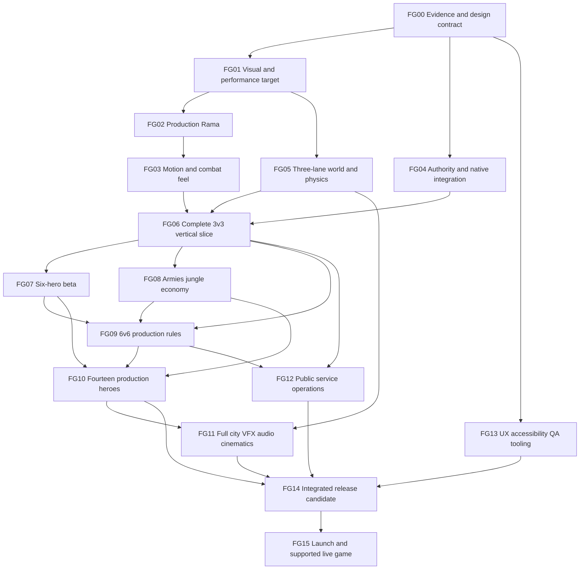

# YUGA full game production roadmap

Updated 17 October 2026. This is the execution guide for the original native YUGA game. The target is the visual coherence, animation quality, combat readability and complete competitive experience requested through Deadlock, Dota 2 and Overwatch references. Those games are reference points, not an assertion that their source, artwork or server implementation has been recovered. The target remains open until the integrated game passes the gates below.

The companion [game design master](GAME_DESIGN_MASTER.md) owns detailed rules, hero kits and player journeys. [ROADMAP_BACKLOG.json](ROADMAP_BACKLOG.json) owns stable task IDs, dependencies, statuses, acceptance conditions and evidence. This roadmap owns sequencing, production standards and release decisions. Change all affected records when a design decision changes; a new document alone does not complete its implementation tasks.

## Intended finished game

- A native Windows/Linux, third-person, competitive **6 versus 6**, three-lane game. Each team initially assigns two heroes per lane, with rotations through a connected jungle. Practice bots, private rooms and a guided first match precede public competitive matchmaking.
- Fourteen individually readable myth-inspired heroes: Rama, Hanuman, Sita, Ravana, Arjuna, Duryodhana, Karna, Bhima, Meghnad, Draupadi, Subhadra, Hidimbi, Chitrangada and Ulupi. All heroes are available without gameplay purchases. No duplicate hero within a team; opposing mirrored picks are allowed.
- An original city combining Lanka-inspired coastal architecture, temple avenues and ghats, reed/swamp jungle, and modern Mumbai/Delhi/Bengaluru-inspired districts. A circular connecting route supports rotations around three legible lanes. Decorative depth must not conceal traversable boundaries or authoritative collision.
- A production match target of **18 minutes**, normally won by destroying the enemy core. At the cap, compare destroyed enemy structures, then enemy core damage fraction, then an exact draw. Six towers per team, outer then inner in each lane; losing any inner tower exposes that team's core. These are planned rules, not the current server's behavior.
- Lane armies include soldier, city-watch and minister roles, plus a king siege unit; myth-inspired jungle entities provide contested gold and temporary buffs. Every unit needs readable anticipation, attack, hit and defeat animation and a distinct sound/weapon silhouette.
- A complete journey: installation, settings and accessibility, training, hero selection, party/room, queue, loading, match, death/respawn, disconnect/rejoin, result, rematch, reporting and support. Cinematics enrich that journey without blocking repeat competitive play.

“4D/5D” is implemented as animated 3D, physics, temporal effects, day/night atmosphere and cinematic presentation. These terms do not name an additional asset format or substitute for a production renderer.

## The verified starting point and recovery boundary

| Workstream | What exists | What it does not establish |
| --- | --- | --- |
| Native foundation | Godot 4.6.3 Forward+, Rama courtyard, two-actor combat film, extended offline three-lane Confluence practice, flight/tether, local armies, remapping and portable packages; see the dated progress section below | Rendered online native matches, the production ruleset, the full roster or finished art quality |
| Existing browser game | `games/yuga/shared/` contains fourteen hero kits/42 abilities, three lanes, minions, camps, gold and authoritative rules; `server/server.ts` serves protocol 2 | Native content integration; production 6v6/18-minute rules; production online operations |
| Browser authority | 3v3 default, 480-second matches, 20 Hz simulation/10 Hz scheduled snapshots, three towers per team | Stacked traversable geometry, twelve-player performance, production matchmaking or WAN service validation |
| Native network work | Reconstructed adapter and interpolator pass fresh two-client lifecycle/reconnect, 27 deterministic checks, recorded replay and six defective variants; exact evidence is in `tests/evidence/native-network-final/` | Rendered online gameplay, local prediction, WAN behavior or a complete native match |
| Art corrections | The restored `bd6740f` baseline contains production Rama v4 and courtyard v2. Later M2/M3 corrections were reviewed before the reset, but their uncommitted assets and evidence are absent | Those later corrections as current files, or approval of final hero/city quality. Recover or reproduce them and capture fresh evidence |
| Motion reference | Licensed carry library reconstructed on the restored Rama; numerical QA and 236 actual sequential rendered samples saved in `docs/evidence/motion-carry-restored/` | Runtime promotion or production animation. Open grip, rigid carry posture, substantial flight and moving-ground contact remain review findings |
| REA/Ghidra | Native analysis was executed on an original compiled fixture; evidence in `docs/evidence/native-analysis-toolchain.json` | Analysis of unavailable Deadlock/Overwatch client files or recovery of their server logic |
| Release | Earlier native previews remain published. The traversal/army prerelease at `395986a` passed CI and independent verification of all 46 public files; the exact public Linux package was exercised | Windows execution, physical-GPU profiling, native online operations or a finished game |

The initial roadmap recovery restored **`bd6740f`** with Rama v4 (`6657f4bf…`) and courtyard v2 (`1454e036…`). Later worker recovery and new native feature work have fresh evidence described below. The older missing M2/M3 corrections remain separate tasks: new traversal, armies or a successful package do not establish those art corrections or final hero quality.

The current items in [PRODUCTION_TASK_BOARD.md](PRODUCTION_TASK_BOARD.md) are bounded implementation packets. **FG00–FG15 below are the larger full-game gates.** Completing a packet does not silently close its parent gate. The browser game remains a working rules/reference product while the native game advances; it is not reskinned and relabeled as the requested visual outcome.

## Offline prototype progress — 17 October 2026

Published preview **`yuga-traversal-armies-2026-10-17`** is tagged at **`395986a512ecabe874710048a19bd0fdd0a71f89`**. The captured runtime and locally executed portable package are pinned to `0124fd4d63384a988223eb76ceb72b2510659ac3`; their archives state the exact sources and payloads tested. Public CI rebuild, independent verification of all 46 downloaded assets and a bounded exact-public-Linux window repeat passed; see [published review](evidence/traversal-armies-published/REVIEW.md). Follow [traversal and army verification](TRAVERSAL_ARMY_VERIFICATION.md) for the current publication gate.

- **Map and movement:** native Confluence is 140 × 260 m, with three extended lanes, eight original blocker footprints plus eight solid landing decks, ten tether anchors, energy-limited flight, a 24 m feet ceiling and 36 m tether range. Actual native capsule collision, landing, cancellation and limits are tested. The browser remains 140 × 170 m; local vertical movement does not close the shared authoritative elevation contract.
- **Offline armies:** spear soldiers, bow guards and banner commanders advance, fight, damage cores and grant once-only player last-hit gold. This local experiment uses a 30 s wave interval, a 72-live/24-corpse cap and its own core outcomes. It does not implement the browser's soldier/watch/minister/king rules, the production economy, jungle combat or server-owned combat receipts.
- **Input and flow:** persistent keyboard remapping, contextual Help, mouse sensitivity/inversion, existing audio/video settings, focus/pause release and explicit malformed-settings backup/reset are implemented. The actual portable Linux window was exercised at 960 × 600 for entry, remapping, movement, flight, pause, day/night, overview, reset, mute and return. Controller support, complete accessibility options and the online journey remain open.
- **Evidence and presentation:** [final rendered review](evidence/traversal-armies-render-r2/REVIEW.md) covers a six-second 720p take with 180 consecutive rendered frames and separate staged views; [portable window review](evidence/traversal-armies-window-r2/REVIEW.md) records actual OS input. The video is silent, and software Vulkan does not establish gaming-GPU FPS. Detailed animation, cloth/hair/grips, full roster art, human balance and online matches retain their production gates.

These are completed **supporting prototype packets** for FG05, FG08 and FG13. Their evidence is attached to the relevant backlog tasks without closing those tasks or changing production dependencies. The next work remains the shared rule/entity/elevation bridge, rendered native authority integration and the full three-hero match; no local core outcome is counted as that competitive match.

## Chosen stack and the decision rule

| Layer | Production choice now | Evidence and decision boundary |
| --- | --- | --- |
| Renderer/client | Pinned Godot 4.6.3, Forward+, GDScript and versioned resources | Restored worker passed native acceptance and actual software-rendered motion capture. Use AnimationTree, skeleton modifiers/IK, GPU particles, material LODs and profiling where validated; names in this table do not imply integration is complete |
| Art | Blender 4.3.2, editable source scenes, glTF/GLB delivery, PBR maps and reproducible Python export/validation | Keep source mesh, topology, textures, rig, clips and provenance. Generated paintings are concept references; they are not runtime character models |
| Rules/server | Existing TypeScript/Node authority and protocol 2 for the integration slice | Introduce explicit rules/map/protocol versions before changed capacity, geometry or outcomes. Compare an extended authority with a headless Godot authority for stacked terrain before choosing production simulation |
| Physics | Godot native queries/character controller for local presentation and offline practice; authoritative outcomes on server | Evaluate the engine's built-in Jolt backend with fixed collision tests. Do not claim deterministic cross-platform physics or install the maintenance-mode external extension without a demonstrated need |
| Connectivity | Use the reconstructed and freshly tested WebSocket adapter for the slice; TLS/WSS gateway and regional session allocation for production | Measure ordered-stream stall behavior under loss before choosing production transport. A change to UDP/ENet requires evidence, versioned migration and reconnect/security equivalents |
| Services | Containerized authority, TLS reverse proxy, small account/party/match API, PostgreSQL only when persistent data is required | Supabase is optional for accounts/profile/support, not a replacement for a real-time authoritative match simulation. Select a provider from measured deployment needs; no provider is assumed provisioned |
| Verification | Existing TypeScript tests, Godot headless cases, Blender/glTF validators, real captures, GitHub Actions and portable package checks | Headless counts prove their exact assertions. Real motion, platform execution, hardware profiles and human play evidence have separate gates |
| Study tools | REA/Ghidra, pinned open-source examples, replay parsers when compatible inputs exist | Each ticket names the source version, question, reusable scope, license and implementation experiment. No download-count or fork-count milestone |
| BRUTAL/C# | Evaluated alternative, **not the selected game engine** | The inspected BRUTAL tree `a25cdf80b2a15530e7da6cff744def9d841ad3c3` advertises no renderer, scene graph or editor; packages are low-level .NET 10 components with a custom MIT-based license. See the research desk's [BRUTAL_STACK_DECISION.md](research/BRUTAL_STACK_DECISION.md). A migration needs a representative benchmark and a funded replacement plan for the missing engine systems |

Use [REUSABLE_GAME_SYSTEMS.md](research/REUSABLE_GAME_SYSTEMS.md), [CHARACTER_REUSE_AUDIT.md](research/CHARACTER_REUSE_AUDIT.md) and [REFERENCE_CHARACTER_IMPORT.md](research/REFERENCE_CHARACTER_IMPORT.md) for already-inspected sources. Godot TPS code and asset licenses differ; the imported character/motion requires its CC-BY 3.0 attribution. Reconstructed OpenLara/OpenMW engines do not grant reuse of the original commercial game assets. Source SDK 2013 is not a permissive Source 2/Godot foundation. Preserve this distinction in every intake manifest.

A research-engineering desk services blocked production tickets. Each ticket asks one implementation question, records exact sources and uncertainty, and returns either a small reproducible experiment or a bounded decision. Current priority: a shared three-dimensional collision/elevation contract. The existing authority's `blocked`/`lineClear` logic ignores elevation, gravity lands at y=0 and a single heightfield cannot represent a bridge over another route. Aim input already includes pitch, but remote actor snapshots lack it. Neither a visual staircase nor a successful IK example resolves these contracts.

## Milestone dependency graph

This graph is a high-level overview of full-gate dependencies; the task DAG in the backlog is authoritative for individual work readiness. Cross-discipline prototypes can depend on a specific earlier task without waiting for that task's whole gate. This is not permission to defer foundational work. Accessibility, telemetry, performance instrumentation, source licensing and server defense begin in FG00/FG01 and continue throughout. Research and sketches may precede a dependent gate; promotion of production content requires the upstream gate to pass.

**Critical path:** approve one actual hero/lane quality target → build and animate Rama convincingly → reconcile a rendered native client with a valid 3D authority/map contract → complete a full 3v3 match → prove 6v6 rules and scale → complete fourteen heroes and the city → run external matches and hardware/platform acceptance → release. Art quality, networking and 3D authority are currently independent high-risk branches. More workers cannot eliminate their integration points.

## Gate specifications

| Gate | Deliverable and owner | Pass evidence | Main risk / next packet |
| --- | --- | --- | --- |
| **FG00 — baseline and design contract** · in progress | Root + design + research: reproducible source baseline, rules version plan, master design, backlog, source/license registry and artifact taxonomy | Fresh setup succeeds; stable dependency IDs validate; each claimed completed item links existing evidence; browser/native/current/planned behavior is explicit | Status drift while agents edit. Freeze a revision for each acceptance run; complete the current design review and backlog validation |
| **FG01 — visual/performance target** · planned | Art director + renderer engineer: approved concept family and actual-runtime comparison scene; declared target hardware and trace harness | Same hero/camera/lighting sequence compared at portrait and gameplay distance; art defects recorded; real target-GPU traces with settings, resolution, driver and source revision | Decorative detail mistaken for quality; software rendering mistaken for GPU performance. Capture the first calibrated hardware baseline; keep hardware acceptance blocked until hardware exists |
| **FG02 — production hero model/rig** · planned | Character artist + technical artist: Rama sculpt, retopology, UV/PBR, fitted cloth/hair, sockets, deformation correctives and LODs | Editable sources and export reproduce; front/side/rear/face review; cloth/skin/metal distinction; shoulders, wrists, knees and grip hold under extreme poses; LOD transitions do not alter gameplay silhouette | Smoothing an existing mesh cannot replace authored anatomy/drape. Recover/revalidate the previously accepted bounded fixes, then resolve larger sculpt and costume construction before copying the pipeline |
| **FG03 — motion and combat feel** · in progress | Animation + gameplay + audio: grounded locomotion, aim layers, bow draw/release, abilities, hit/death/respawn, IK and event timing | Continuous clips and transitions, not only stills; foot/grip measurements plus human review; event ID aligns authoritative release, projectile, flash and sound; no duplicate effect after reconnect | Reused robot motion conflicts with bow grip; root motion conflicts with authority. Reconstruct and inspect bow-carry adaptation, then author original archery and layered motion |
| **FG04 — native authority integration** · in progress | Network + physics: hardened adapter/interpolator, native scene entities, input/prediction/reconciliation, reconnect and version contracts | Two rendered clients share movement, cast, hit, death and outcome; malformed numeric inputs rejected; loss/jitter/reorder/half-open tests; sequence continuity and credentials absent from logs | Headless lifecycle success hides rendered divergence. Transport and numerical repairs now pass their bounded checks; present authority-driven entities in a matching map next |
| **FG05 — map/physics vertical slice** · planned | Level designer + world artist + physics: three playable lanes in authoritative coordinates, one art-complete lane segment, jungle routes, collision/nav source | Route and sightline review; all hero capsules/cameras traverse gates/stairs/ramps; stacked-deck fixture works on both clients; bots recover from blocked routes; collision and visual bounds agree | Flat server rules cannot support the intended vertical city. Resolve collision/elevation contract before promising bridge/rooftop gameplay |
| **FG06 — full 3v3 native slice** · planned | Root + gameplay + UX: Rama/Hanuman/Sita, all three lanes, match start to result/rematch with bots and private rooms | Uncut native match recordings; server outcome agrees; tower/core progression, rewards, death/rejoin and rematch complete; replay/event ledger accounts for results | A beautiful courtyard plus isolated systems still lacks a game. Build one complete integrated match and fail the gate if any essential step needs developer intervention |
| **FG07 — six-hero beta** · planned | Character/animation squads + combat design: add Ravana, Arjuna and Duryodhana using proven pipeline | Each hero passes the shared production checklist and kit-specific counters; 3v3 drafts exercise all six; silhouette/VFX/action readability survives team fights | Cosmetic hero copies and uncontrolled per-hero rig exceptions. Require independent kit identity and reusable tooling before next batch |
| **FG08 — armies, jungle and economy** · planned | AI + animation + systems: soldier/watch/minister/king, Naga/Yaksha/Cloudwing, camps, secure/steal gold, items and temporary buffs | Animation events agree with attacks; no duplicate awards; expiry/leash/reset/team attribution tests; bots buy/rotate; contested rewards understandable from UI and sound | Concurrent deaths, reconnect and overlapping pickups mint gold or obscure attribution. Use a server event ledger and invariant tests |
| **FG09 — production 6v6 rules** · planned | Authority + combat + level design: twelve slots, draft, eighteen-minute cap, six towers/team and versioned economy | Incompatible clients rejected or deliberately supported; full twelve-player/bot session, all six lane positions, core exposure and exact tie cases; no ranked farm-score exploit | Existing constants, packet budgets and maps assume six heroes. At least six accepted heroes are required for duplicate-free 6v6; capacity and outcome migration must change contracts and tests together |
| **FG10 — complete fourteen-hero roster** · planned | Hero squads + balance + QA: Karna, Bhima, Meghnad, Draupadi, Subhadra, Hidimbi, Chitrangada and Ulupi added after six-hero gate | Each hero has model/LOD, complete motion, primary/three abilities/counters, sound/portrait/tutorial, telemetry and platform tests; pairwise interactions and team-fight matrix pass | Roster quantity masks incomplete animation and unusable counters. Approve each hero separately, then the whole roster under load |
| **FG11 — complete city and presentation** · planned | Environment + lighting + VFX + audio: authored district kit, Lanka coast, swamp, temple core and modern edge, polished cinematics | Both bases/three lanes/jungle are navigable and visually complete; day/night readability parity; VFX priority under 12-hero clashes; spatial audio and subtitles; measured LOD/streaming | Beauty shots conceal empty routes or expensive transparent effects. Inspect walkthroughs and worst-case combat, not only views |
| **FG12 — operated public multiplayer** · planned | Backend + operations + security: TLS/WSS, session allocation, account/party/matchmaking, reports, rate limits, monitoring and recovery | Independent external clients complete matches; certificate/restart/timeout/reconnect tests; capacity traces; restore/rollback rehearsal; documented owner and runbook | Pages cannot host an authoritative socket server; free-tier limits create match loss. Deploy static site/downloads separately from match services |
| **FG13 — complete UX and QA tools** · in progress | UX + accessibility + QA: all launch-to-rematch states, remappable controls, subtitles/visual cues, replay/telemetry and reproducible soak harness | Keyboard/controller focus where supported; persisted settings and safe defaults; tutorial explains goals; no color/sound-only critical cue; readable error/reconnect/results; defect ledger linked to recordings | Finishing menus late hides missing lifecycle states. Build each state alongside the feature and retest at actual aspect ratios/scales |
| **FG14 — release candidate** · planned | Release + QA + all owners: integrated build with frozen content/rules, signed or otherwise verified packages, manifests and rollback | Linux and Windows actually run; declared physical GPUs meet frame/memory budgets; full matches and soak/edge/security checks pass; no unresolved crash/data-loss/match-outcome defect; art director approves actual output | Passing separate tests on different revisions. Freeze one candidate, record hashes and re-run only gates invalidated by fixes |
| **FG15 — launch and live support** · planned | Release/operations + design: public website/downloads, regional service, support/reporting, patch and balance process | Fresh user install→match→rematch works; metrics/alerts operational; rollback rehearsed; patch compatibility and recovery verified; first-live-match defects triaged with evidence | Publication mistaken for sustainable operation. Keep service ownership, incident response, capacity and balance review active after launch |

## Character and animation production contract

Every hero has a versioned folder with editable `source/`, licensed `references/`, `mesh/`, `textures/`, `rig/`, `animation/`, `vfx/`, `audio/`, `lod/`, `runtime/` and `review/` artifacts. Existing repository paths can remain during migration; a manifest maps them to this logical structure. Store asset/source hashes, tool versions, scale/unit/up-axis, rig/rest hash, dependencies, licenses and export settings. Keep raw generated images distinct from approved concepts and actual runtime captures.

1. **Research and concept:** record a bounded mythology/architecture source, which tradition/edition it represents, and which design choices are original. Produce silhouette, face, costume layers, weapon, palette and three action thumbnails. Compare the hero to the approved Rama/Hanuman/Sita visual family. Reddit is community feedback/inspiration where accessible, not a substitute for primary sources or proof that every claim is accurate.
2. **Sculpt and retopology:** author major anatomy, face/shoulders/hands and cloth construction before microdetail. Create deformation-friendly topology, material masks, UV seams and texel-density plan. Bake maps from controlled high-resolution source to the runtime mesh; inspect actual normal orientation, tangent seams and roughness in engine.
3. **Hair and cloth:** choose grouped geometry/cards and restrained bone/secondary motion that preserves silhouette and combat readability. Fit straps and jewelry to moving body surfaces. Use simulation for authoring or local secondary motion only where stable; cloth never moves the authoritative hitbox. Freeze/cull secondary simulation by distance and visibility.
4. **Rig and deformation:** document humanoid base versus exceptional appendages, twist distribution, sockets, bind/rest pose and correctives. Test elbows, shoulders, deep crouch, twist, jump landing, extreme aim, death and cape/weapon intersections. A retarget source must compensate rest axes and preserve target lengths; a matching bone name is insufficient.
5. **Locomotion:** ready/relaxed/combat idle; forward/back/strafe walk and run; acceleration/start/stop/turn; jump rise/fall/land; supported traversal/dash; hit reaction, defeat, respawn. Include turn-in-place and low-speed blending before cinematic flourish. Foot IK solves visual contact with authoritative surfaces without relocating the player.
6. **Weapon/ability layers:** primary windup/draw, hold, release, recover and reload/charge where applicable; lower-body movement under upper-body aim; three distinct ability anticipations/active/recoveries and interrupt branches. Grip/string/weapon socket constraints must remain valid during aim and blends. Authority defines accepted shot/cast time; animation markers and local previews present that decision.
7. **Presentation/optimization:** facial or head/eye focus where visible, readable ally/enemy/occluded states, hair/cloth follow-through, LODs and animation update throttling. Evaluate all states with camera collision and during multiple overlapping effects. Downstream clips must not invalidate original attribution.
8. **Review:** continuous real-time turntable and action reel, four gameplay-distance views, pose/transition numerical tests, final source hashes, performance trace, kit/counter checklist and independent art/animation sign-off. A hero with one good still or finite transforms is incomplete.

Rollout is Rama → Hanuman/Sita → Ravana/Arjuna/Duryodhana → two balanced batches (Karna/Bhima/Draupadi/Ulupi, then Meghnad/Subhadra/Hidimbi/Chitrangada). Batch order can change for measured pipeline reuse or role coverage; the fourteen stable hero task IDs remain. Do not promote all assets because one hero passed.

## Systems integration contracts

**Authority and rendering:** the server owns positions relevant to gameplay, collisions, damage, cooldowns, gold, upgrades, objective states and results. The client owns camera, presentation interpolation, cosmetic particles and provisional feedback. Local prediction replays acknowledged inputs against a versioned movement contract, then applies bounded correction; remote interpolation uses a separate buffer. Respawn/teleport invalidates interpolation history. Camera responsiveness must not inherit remote snapshot delay.

**World geometry:** one exported map package names coordinates, collision layers, static primitives/meshes, floor levels, walkable links, ledges, no-go bounds, spawn safe zones, objective anchors and version/hash. Client art can add non-colliding detail but cannot create a usable-looking route through an invisible server wall. A required prototype has a ramp, stairs, low ceiling, ledge and two walkable decks occupying the same x/z. Compare TypeScript shape-query authority with a headless Godot authority using identical inputs; select by correctness, measured cost and migration complexity, not engine fashion.

**Combat events:** stable event IDs and authoritative ticks link attack anticipation/shot acceptance/impact/reward/death. A replayed snapshot must not repeat a sound, spawn a second projectile or award gold. Pending local predictions need confirm/reject/timeout behavior. The production protocol needs remote aim pitch, movement/animation intent and explicit discontinuities only as necessary; do not infer gameplay outcomes from cosmetic animation state.

**AI and waves:** server-owned lane formation, targeting, line of sight, attacks, objective priority, route recovery and despawn. Separate unit identity from shared movement/attack components. A king is a slower visible siege threat; minister support must visibly precede the buff. Jungle aggro/leash/heal/reset/respawn and shared/stealable rewards require simultaneous-player tests. Difficulty changes reaction/strategy within known rules, not invisible information.

**Progression:** match power comes from the versioned economy and visible choices; account progression is cosmetic/learning-focused. Item/upgrade purchases are idempotent, server-priced and logged. Death, disconnect, contested last hit and shard expiry cannot duplicate value. Include a conservation/accounting test for created, awarded, expired and spent rewards. Balance decisions use measured outcomes and counterplay reviews, not invented win-rate precision from a handful of bot games.

**Presentation:** VFX have a priority budget: threat anticipation, active danger boundary, projectile/impact, then decorative trails. Teammate effects must not conceal enemy telegraphs. Pair audio with visible cues; distinguish own hit, enemy hit, empty weapon, accepted/rejected ability, gold secured/stolen, tower warning and core danger. Day/night is atmospheric unless a separately designed rule explicitly changes visibility; competitive readability remains comparable.

## Provisional budgets and proof requirements

These are initial engineering limits to test, **not measured achievements**. The cloud worker uses CPU software Vulkan and cannot qualify a target gaming GPU. FG01 must record actual hardware availability and replace guesses with a profile before FG14 can pass.

| Budget | Initial hypothesis | Measurement that can accept or revise it |
| --- | --- | --- |
| Minimum PC target | Ryzen 5 3600/i5-10400 class CPU, 16 GB RAM, RTX 2060 6 GB/RX 6600 8 GB class GPU, SSD; 1080p low/medium at 60 FPS | Actual named Windows and Linux machines; 18-minute replay and worst-case 12-hero fight. Record p50/p95/p99 frame time, GPU/CPU breakdown, VRAM/RAM and stutter counts. Proposed gate p95 ≤16.7 ms, p99 ≤25 ms after warm-up; investigate every >100 ms stall |
| Recommended target | Ryzen 5 5600 class CPU, 16 GB RAM, RTX 3060/RX 6700 class GPU; 1080p high at 60 FPS | Same source/replay/settings comparison; no visual readability loss from lower presets. These machines have not been tested here |
| Characters | Start LOD0 around 80k–120k triangles, LOD1 ≤50k, LOD2 ≤20k, distant ≤5k; compare skinning/bone/material cost as well as triangles | Twelve heroes plus worst-case armies in actual camera views. Override per silhouette only with measured benefit; a lower count is not automatically a better image |
| Textures/effects | Start 2K character map sets with optional 4K hero/portrait detail, compressed runtime maps, mipmaps; cap transparent overdraw and shadowed light count per effect | Texture residency and GPU pass captures; worst-case overlapping ultimates/lamps/water; scalability turns down decoration before telegraphs |
| Authority | Keep 20 Hz initially; simulation work p95 ≤25 ms and p99 <50 ms on a declared server instance at target room load | Real server traces with twelve players, full wave/camp/projectile caps; raise tick rate only with responsiveness evidence and capacity headroom |
| Network | Begin with existing 10 Hz snapshots; investigate delta/interest updates before unbounded frequency increases | Bytes/sec by message class, queue growth and event delay under 0/50/100/150 ms RTT, variable jitter and 1–5% loss/reorder/disconnect scenarios. No single bandwidth promise until measured |
| Animation contact | Begin with planted foot drift ≤2 cm over a declared support interval; weapon grip error ≤1.5 cm; no normal-transition snap visible in gameplay | Actual skinned contact/socket traces plus continuous footage. Hero scale and intentional movement may require documented bounds; quaternion finiteness alone is not sufficient |
| Event timing | Release/flash/sound follows the accepted local presentation event within one render frame under nominal conditions | Event trace + frame-stepped recording. Network delay is recorded separately; hide neither lost receipts nor server timing behind a cosmetic offset |
| Resource lifetime | No unbounded growth in actors, effects, snapshots, commands, audio voices or replay buffers | Warm-up plus repeated full matches and reconnect churn; plot high-water marks and retained objects. Any sustained leak blocks release |

First hardware profiling can invalidate the engine/content budget. Respond in order: fix pathological work, add culling/LODs/batching, reduce unnecessary effects, compare equivalent engine configuration, then evaluate a different engine only if a representative target still cannot be met. Rebuilding an editor/renderer/network stack is a production cost, not a free graphics upgrade.

## Verification ladder and release definition

Each layer has different evidence; none replaces the others.

1. **Source and content validation:** reproducible downloads/exports; licenses; hashes; rig/rest/animation manifests; malformed content rejected. Preserve original assets and failed attempts for diagnosis.
2. **Deterministic system cases:** damage/cooldown/counters, segment collision at lifetime/range boundaries, rewards, tower/core gate, tie outcomes, respawn, disconnect and commands. Include negative fixtures that demonstrate detectors fail on intentionally bad input.
3. **Animation/visual review:** actual continuous idle/run/stop/jump/aim/fire/cast/hit/death sequences at several frame rates and camera angles. Inspect meaningful transitions and contact, plus all fourteen heroes together in effects-heavy scenes.
4. **Real multiplayer integration:** two clients first, six-player slice, then twelve players/bots. Compare server receipts and client views; impair live traffic or replay exact recorded streams with clearly named limitations. Test clock changes, duplicate/stale snapshots, huge/tiny finite values, reconnect tokens, server restart, silent half-open connections and bad versions.
5. **Full match and balance:** full duration, distinct team compositions, novice and experienced human play when available, all lanes/objectives, economy progression, leaver/bot substitution and outcome. Bot win rates are diagnostic, not a replacement for player comprehension/counterplay evidence.
6. **Soak and capacity:** begin with repeated local full matches, then an eight-hour candidate soak on a declared server instance and a separate capacity ramp. Record memory/CPU/tick time, disconnects, failed commands and outcomes. Increase load until measured limits are known; never label an unexecuted schedule a completed stress test.
7. **Platform/accessibility/security:** actual Windows and Linux execution, fresh install, offline training, update/rollback, different displays/DPI/aspect ratios, keyboard/controller supported paths, focus loss and device changes, color/sound alternatives, bounded hostile protocol inputs and account/session isolation.
8. **Release candidate:** one frozen source/content/rules revision, exact packages and public endpoint. No unresolved crash, corrupted save/profile, reward duplication, incorrect winner, impossible core state or unjoinable normal journey. Art director and independent QA review actual output; hardware and service gates pass. Maintain known lower-severity issues with owner and user impact.

A public release is complete only when a fresh external user can install, learn, join, play, reconnect if needed, finish, rematch and obtain support on a supported platform. GitHub Pages can provide the website, documentation and download links; it cannot run the persistent authoritative server. A browser build is optional and cannot force the native quality target downward.

## Squad ownership and three-to-five-round reporting

Use a lead integrator, art director/character artist, animation/technical art, environment/lighting, gameplay/AI, network/backend, audio/VFX, UX/accessibility, QA/performance and research-engineering roles. On this worker, schedule roles into the available seven concurrent agent slots; do not pretend all roles are permanent people or always-running processes. Heavy renders run one at a time. Every task has one file owner and named reviewers; agents may delegate a bounded child after checking capacity.

- **Round 1 — inspect and specify:** exact defect or missing behavior, source/version, owned files, acceptance test, dependency and smallest artifact. Research desk closes one implementation uncertainty, not an endless survey.
- **Round 2 — build:** deliver code/source art and first import/run. Report failures and incompatible source assumptions immediately.
- **Round 3 — independent challenge:** another role checks actual output, adversarial/edge cases and the acceptance claim. Art review uses screenshots/motion; network review uses real messages/receipts. A failed gate returns to implementation.
- **Round 4 — correct and integrate:** preserve failed evidence, fix the bounded cause, freeze final assets, run affected checks and merge into the playable build. Default end of a normal packet.
- **Round 5 — optional release/field validation:** exact package and external/hardware session where the task requires it. If unavailable, mark that gate blocked and keep independent production work moving.

Each report records task ID, round, source revision/hash, changed files, passed/failed checks, evidence paths, remaining limitation and next owner. `complete` requires all acceptance conditions and linked evidence; `in_progress` means active implementation with remaining gates; `planned` means not started; `blocked` names a concrete unmet input/dependency. Do not invent a date or percentage. Research scope is stated as read, executed, inferred or unverified.

## Current supporting siege milestone

[Siege vehicles and visual-target plan](SIEGE_MILESTONE.md) defines the five parallel implementation packets, cannon/chariot counterplay, independent checks and conditional staffing/time estimates. This offline milestone supports FG08/FG13 while the production dependencies below remain open. Its acceptance requires actual current-source combat, motion and package evidence.

## Immediate execution queue

The JSON `next_packets` list contains dependency-ready tasks only. `upcoming_packets` is the following horizon and includes tasks whose prerequisites or hardware are still unavailable. The sequence below explains both; it is not a claim that every listed task is ready. Complete ready packets while the larger gates remain open:

1. **FG00-T01 is complete:** restored published baseline, fresh 18/18 native and 7/7 projectile checks, plus structural asset validation are pinned in `tests/evidence/recovered-baseline/manifest.json` and `docs/research/gltf-validator-restored-preview.json`. This does not recover later uncommitted art. **FG03-T01:** the recovered carry has a continuous rendered review; author the unresolved grip/posture and qualify support/flight before promotion. The full-body TPS run was rejected; do not overwrite visual findings with numerical pass counts.
2. **FG04-T01 is complete:** repaired yaw/time arithmetic and fresh native transport/interpolation evidence are archived in `tests/evidence/native-network-final/`. Entity/aim/map integration follows the rules-version contract; the larger FG04 gate remains open.
3. **FG02-T01 / FG05-T01:** recover or reproduce the previously accepted Rama/world corrections and their exact render evidence. The reset lost those uncommitted artifacts. Fresh acceptance closes these correction tasks, not full hero/world quality gates.
4. After **FG00-T02** design acceptance and **FG00-T04** version contracts, **FG04-T02 and FG05-T02:** define the versioned scene/entity/3D collision bridge and build the stacked-deck authority experiment. In parallel, author Rama's missing bow draw/release/aim layers against stable sockets.
5. **FG04-T03:** render two native clients on the same authoritative map with movement/shot/hit/reconnect/result, then begin the three-hero full-match slice.
6. After **FG01-T01/T02** visual-target and trace-harness preparation, **FG01-T03:** obtain a real declared GPU profile when hardware is available. Keep this acceptance open; CPU rendering remains useful for correctness and art comparison.

After each packet, update the backlog and board from evidence, select the next ready dependency, and continue implementation. If the quality bar rejects an artifact, revise that artifact; do not silently replace the requested game with a cheaper visual target.

## Three-round roadmap review record

**Round 1 — repository audit:** inspected current native roadmap/board/visual gates, player and project settings, protocol adapter/interpolator reports, actual `map.ts`, `simulation.ts`, hero IDs, source/license studies and pre-reset evidence paths, then checked the restored baseline. Missing current-pass artifacts are recovery tasks, not completion evidence. Distinguished current 3v3/480-second/flat-world behavior from the planned production rules. No fresh Reddit corpus or commercial binary analysis is claimed.

**Round 2 — production plan:** agreed production defaults with the game-design owner; created the dependency graph, fourteen hero tasks, stack decision rules, 3D authority experiment, numerical/visual/hardware/operations gates and explicit immediate work queue. Incorporated the research desk's bounded BRUTAL finding without changing the functioning engine.

**Round 3 — skeptical completeness review:** checked that the plan covers all start-to-finish player states, not just battle; every hero and unit needs animation and counters; rewards and result authority survive reconnect; vertical world geometry has a server contract; performance has real hardware evidence; service operation and support continue after publication. Rejected shortcuts: screenshots as motion proof, headless clients as an online game, a published ZIP as platform qualification, downloaded code as asset permission, and a plan as completed implementation. The model/rig gate FG02 closes before complete animation/kit acceptance in FG03; the plan avoids requiring a later gate to complete its own prerequisite. The independent review also required FG07 before production FG09: a duplicate-free six-person team needs six accepted heroes. Synthetic scale tests can use explicitly labeled placeholder repetitions; production draft/match acceptance cannot. Root's backlog validator checks IDs/dependencies/evidence separately; it does not certify visual quality.
