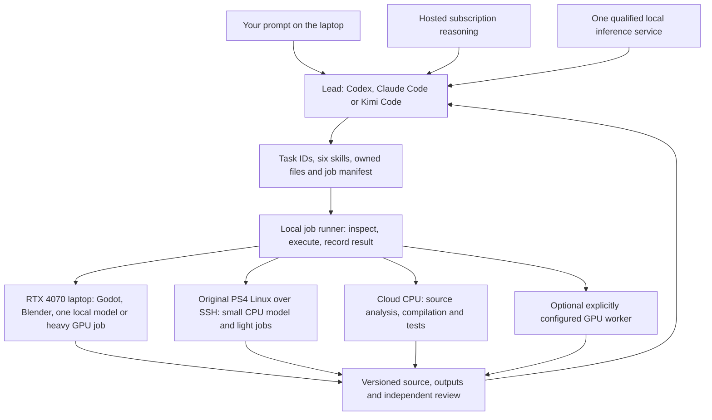

# YUGA game-build setup: RTX 4070 laptop, original PS4 Linux and cloud

Prepared 23 October 2026. This extends [the local-model guide](LOCAL_MODEL_SWARM.md), [six canonical agent skills](../../../.agents/skills/README.md) and the existing desktop-first game roadmap. The current task prepares and tests the production tools; game acceptance still belongs to actual art, animation, play, network and hardware evidence.

The user confirmed an **RTX 4070 Laptop GPU with 8 GB dedicated VRAM and 16 GB shared memory**, plus an **original PS4** and an affirmative answer about existing jailbreak/Linux. PS4 firmware, Linux distribution, kernel, available memory and driver support remain unverified. No user device is connected to this cloud. Subscription entitlements must be checked in the corresponding account on the laptop.

## How the machines work together



The laptop is the control machine. It holds the working checkout, your normal client logins and SSH configuration. An agent can write a task manifest and invoke the same ordinary commands you could run in a terminal. An SSH connection gives access to the configured PS4 Linux user; it does not make the PS4 GPU appear as an NVIDIA device in the laptop. HDMI is a display connection, and a USB cable does not pool the devices' GPU memory.

Use independent jobs on each machine. PS4 memory, laptop VRAM and a remote GPU are separate allocations. Six specialist roles can share a model service; that routing arrangement is different from a trained mixture-of-experts checkpoint. A model with few active experts may still require all its total weights to be stored or loaded.

| Machine | First useful responsibilities | Keep out of its initial assignment |
| --- | --- | --- |
| RTX 4070 laptop | Interactive game/editor, local coding model, artist review, GPU-qualified Blender work, package execution | Several resident coding models plus heavy rendering/generation without measured headroom |
| Original PS4 Linux | Read-only inventory, tiny CPU-model pilot, source notes, lightweight tests or deterministic offline utilities | Assuming modern CUDA/ROCm support, copying laptop AVX2 builds, or declaring gaming-GPU performance from console specifications |
| This cloud | Pinned source builds, code/tests, source ledgers, bounded CPU inference when the model artifact is available | Treating software rendering as hardware FPS or assuming a GPU account is attached |
| Optional GPU service | One bounded original-prop/hero experiment or a declared remote render/build job | Treating public demo status as an unrestricted machine, or assuming a subscription to a chat service pays for GPU rentals |

## RTX 4070 laptop setup

1. Use one supported Windows-native or Linux/WSL environment for the first model/client pilot. Verify `nvidia-smi`, installed system RAM, disk space and the exact GPU. Do not combine the reported 16 GB shared memory with the 8 GB VRAM budget.
2. Keep the existing Godot 4.6.3 + Blender 4.3.2 + glTF game pipeline. Check exact versions and project import before changing engines. Put model weights and source-build caches outside the Git checkout; keep source art, manifests, code and acceptance reports versioned.
3. Choose **Ollama** for the first convenient local service or **llama.cpp** for explicit GGUF/CPU/driver control. Qualify one installed model at a time. A small Q4 model is a candidate, not a guarantee that the client's full prompt, KV cache and tool workflow fit.
4. Bind the model service to loopback. For Ollama, the [existing startup examples](LOCAL_MODEL_SWARM.md#local-only-startup-and-client-qualification) set cloud off, one loaded model and one concurrent request. Configure the actual server process and restart it; a client terminal's variables do not reconfigure another daemon.
5. Use a short generation, a tool-call fixture and one bounded repository edit to qualify each client. An inventory request proves only that the server lists a model. Record exact model identity, revision, weight hash, template, context, client/server version, peak memory and result quality.
6. Before GPU rendering or 3D inference, finish requests, unload resident coding weights and check free VRAM. Queue the heavy job separately. Resume the coding model afterwards. Keep the game/editor and desktop display in the measured budget.

Start local experiments with a small qualified model and modest context. The [pinned model study](research/local-swarm-oct23/runtimes/README.md) includes Qwen3.5-4B and older coding baselines, with artifact/template/compatibility limits stated. Hosted reasoning is a practical lead option for complex design and review while smaller local models perform bounded tasks. Local-model capacity is separate from the game's eventual graphics acceptance.

## Original PS4 Linux setup

Read [the PS4 research and inventory](research/ps4-swarm-oct23/ps4/README.md). After an initial CONNECT denial, the supplied thread was retrieved and all 15 posts read. Its 2023–2024 self-reports describe slow 7B GPT4All, an Orca Mini 3B trial using six CPU threads, and CPU image generation measured per step. These are historical reports, not reproduced PS4 benchmarks or a current-model ranking. One universal claim about missing kernel modules conflicts with the inspected kernel configuration. Keep firmware-specific boot/kernel instructions separate from application installation.

1. **Inventory the existing Linux installation first.** Run the supplied non-mutating inventory script on the PS4. Record model, firmware if known, distribution, kernel, CPU flags, actual `MemAvailable`, storage, GPU driver and render nodes. Keep private machine/account information local. This task does not require flashing firmware, repartitioning storage or replacing a boot setup.
2. **Create an ordinary work directory and SSH user workflow.** Use OpenSSH with a verified host key and key authentication configured by you. Keep your subscription/client logins on the laptop; no need to copy browser cookies or credential directories to the console. Confirm a simple authenticated command before model installation.
3. **Compile the CPU baseline on the PS4 or for its measured CPU/OS ABI.** `GGML_NATIVE=OFF` alone does not establish compatibility: check the exact upstream flags and disable unsupported instruction sets. The [PS4 report](research/ps4-swarm-oct23/ps4/README.md) pins the current flag evidence. A new laptop build can require AVX2/FMA instructions absent from this console.
4. **Start small.** Qualify a roughly 0.5B-class instruct/coding GGUF before considering a 1B–1.5B candidate, with one request, bounded context and a measured thread count. These are capacity experiments; Linux's usable share of the console's memory depends on its boot configuration. Measure first-token latency, generation rate, RAM/swap and sustained temperature. This cloud's CPU results do not predict PS4 speed.
5. **Serve only on PS4 loopback.** The laptop can forward a port through SSH; the inference API does not need a public listener. Start and stop the process through its owning user and recorded PID/service, rather than broad process kills.
6. **Consider graphics acceleration only after the CPU comparator works.** The cited kernel/driver and llama.cpp Vulkan requirements are separate evidence. A working Linux desktop or `amdgpu` driver does not establish ROCm/KFD or a working Vulkan inference kernel. Any GPU experiment needs real backend execution, output comparison, memory measurements and recovery behavior on this exact PS4.

Example SSH configuration on the laptop, with values replaced locally:

```sshconfig
Host ps4-dev
    HostName REPLACE_WITH_PS4_LAN_ADDRESS
    User REPLACE_WITH_LINUX_USER
    IdentityFile ~/.ssh/id_ed25519
    IdentitiesOnly yes
    StrictHostKeyChecking yes
    ServerAliveInterval 30
    ServerAliveCountMax 3
```

Establish and verify the host key using your normal trusted connection first. For a PS4 server already listening on `127.0.0.1:8081`, a laptop tunnel is:

```sh
ssh -N -o ExitOnForwardFailure=yes -L 127.0.0.1:18081:127.0.0.1:8081 ps4-dev
```

Then use `http://127.0.0.1:18081` from the laptop with a client/API that is actually compatible. This is a template; no PS4 connection, port forwarding or inference has been executed here. Keep server and client protocol differences explicit: an OpenAI Chat Completions endpoint does not automatically satisfy current Codex's Responses requirements.

## CPU model in this cloud

The [CPU pilot](research/ps4-swarm-oct23/cpu/README.md) records a real source build and generation on this cloud. A pinned llama.cpp server was compiled with two build jobs and all GPU backends disabled. The selected official Qwen2.5-Coder-0.5B-Instruct Q4_K_M artifact is **491,400,064 bytes**, pinned to its publisher revision and SHA-256, with an inspected Apache-2.0 model license. Source, tools, weights and cache stay outside Git.

```sh
python games/yuga-native/tools/local-swarm/cpu/cpu_llama.py build \
  --cache-dir /workspace/scratch/ps4-swarm-oct23/cpu
python games/yuga-native/tools/local-swarm/cpu/cpu_llama.py fetch-model \
  --cache-dir /workspace/scratch/ps4-swarm-oct23/cpu
python games/yuga-native/tools/local-swarm/cpu/cpu_llama.py qualify \
  --cache-dir /workspace/scratch/ps4-swarm-oct23/cpu
```

Model fetching is explicit; ordinary cloud setup does not silently download weights. Qualification starts its own loopback server, verifies identity and readiness, makes one bounded request and stops the service. A new environment needs its own capacity/version check; preserving files does not preserve live processes. The recipe uses this cloud's native CPU instructions and must not be copied as a PS4-compatible binary.

The first real request generated 102 tokens from an 87-token prompt in 1.769 seconds; the server reported 68.30 generation tokens/second. The original response failed the requested JSON/blocked-tile regression content check. These results establish CPU serving and generation on this machine, not reliable autonomous coding, PS4 speed or a game-quality milestone. The evidence retains that failure and any later tool-correctness requalification separately; do not replace it with a successful-looking selected answer.

## Subscriptions, prompts and control

Read [the fresh client/control study](research/ps4-swarm-oct23/clients/README.md) alongside [the earlier exact local-routing examples](research/local-swarm-oct23/interop/README.md).

| Mode | Where reasoning runs | Login and accounting |
| --- | --- | --- |
| Codex with ChatGPT sign-in | Hosted model through the supported client | Use the subscribed account's supported login and actual allowance; API-key usage is separately accounted |
| Claude Code account mode | Hosted Claude | Confirm that the actual plan includes Code and inspect its limits; an API key is a separate route |
| Kimi Code account mode | Hosted Kimi | Use current Code membership/device-login documentation; a general chat subscription does not establish Code quota |
| Any supported client routed to a local model | Selected local service on laptop/PS4 | No proprietary hosted weights are supplied by the CLI; qualify protocol, template, tool calls and context |

Authenticate each client normally on the laptop. This cloud does not inherit those subscriptions or access your devices because you mentioned them in chat. Use separate explicit local/hosted profiles, preserve rate limits and account terms, and never silently substitute a paid API route when local inference fails. Kimi's documented remote-control option is a separate online account feature, not an offline bridge into this cloud.

Use one lead initially. The lead reads the six skills, assigns exclusive real files and submits bounded jobs. Parallel client processes are useful only where paths and resources are independent. Keep one heavy GPU lane on the laptop and a separate PS4 CPU lane. If a client requires more context than fits, reduce the task or choose an explicit hosted profile; do not silently truncate instructions.

## Executable job and cleanup workflow

The [control helper](../tools/local-swarm/CONTROL.md) extends the existing planner and GPU command lock. It executes declared local commands, optionally sends a validated job to an explicitly configured SSH worker, and records results. It does not create model weights, provision hosts, or turn arbitrary commands into an OS sandbox.

```sh
python games/yuga-native/tools/local-swarm/control.py jobs \
  games/yuga-native/tools/local-swarm/control.example.json \
  --workspace /absolute/working/checkout
```

Start by reading the dry-run output. Use the helper's documented `--execute` and fresh receipt path for an authorized real run. SSH also requires the explicit SSH opt-in and an installed remote runner matching its source hash. The example and remote bootstrap have their own prerequisites; validation must not pretend a placeholder target is connected.

For downloads, use exact publisher URLs/revisions and expected artifact hashes; budget weights, environments, caches and outputs, verify TLS and refuse a mismatched artifact. The CPU pilot's recorded script is one concrete example. Do not allow an LLM to turn an unpinned installer command from a post into a trusted setup step merely because it appears in a search result.

For cleanup, list **specific generated files and their expected hashes** in the helper's cleanup manifest. It checks the declared workspace and protected/source paths, then moves eligible files to quarantine. Preserve receipts and a recovery map. The helper deliberately avoids broad deletion; routine disposable outputs can be removed later through an explicit retention policy once their recovery/ownership is known. An arbitrary command still has the privileges of the user who runs it; use the client's real OS sandbox/account/container when isolation is required.

The quarantine command applies to generated outputs under a Git-root workspace; it is not a generic model-cache cleaner. For Ollama-managed weights, use the source-documented `ollama stop MODEL` and `ollama rm MODEL` for the exact selected ID as a deliberate job, after checking which clients use it. Arbitrary external-cache deletion still needs an explicit inventory/retention plan. Project-local `.local-swarm/` receipts, locks and quarantine are ignored by Git; copy only reviewed, non-sensitive evidence into public research reports.

Suggested lead prompt:

```text
Work in this existing YUGA checkout. Read AGENTS.md, docs/START_HERE.md,
GAME_BUILD_FARM.md and the six project skills. Inspect HEAD/status first.
Choose one dependency-ready game packet; preserve all other owners' files.
Assign exact paths and acceptance checks to W1–W6. State the selected model,
client mode and machine for each job. Use the control helper for bounded
commands and a single heavy GPU queue. Keep downloads source/hash-pinned.
Record failed attempts and output receipts. Ask for missing device/account
access only when required; continue independent work. Close no packet until
its actual code/art/play/online evidence passes independent review.
```

## Six-owner production rounds

Use [the existing next-owner queue](evidence/desktop-finish/continuation-oct18b/NEXT_SIX_OWNERS.md). This setup does not invent another completed campaign or restart accepted work.

| Owner | First gaming assignment using the setup | Machine and evidence |
| --- | --- | --- |
| W1 evidence/QA | Review the exact candidate package and original native captures; independently challenge the model/tool setup | Cloud source/archive checks; laptop for physical-GPU play/listening; PS4 results remain separate |
| W2 UI | Reproduce an active-state hierarchy/input defect at both UI scales before repair | Laptop editor/runtime and bounded cloud tests; actual native input/screens |
| W3 hero art | Artist-controlled Rama hair sweep, gather, joins and material/rig correction through the existing task | Blender/laptop GPU lane; four matched views before UV/skin/LOD promotion |
| W4 world art | Finish one Vayu landing-court pilot with preserved footprint, routes and truthful collision | Blender/Godot, actual views and budget checks; do not replicate an unaccepted pilot |
| W5 motion/combat | Exercise a real horizontal/support-edge landing, then repair the reproduced discontinuity | Native collision/motion traces plus continuous footage and 30/60/120 Hz checks |
| W6 models/builds | Qualify the model/service, exact package sources, generated-output retention and portable delivery | Cloud compilation/tests, laptop hardware run, optional PS4 tiny-model comparator |

For every packet: **source/contract pass → implementation/adverse cases → independent integration review**. Add a correction pass for a named defect. Record source/model hashes, machine, exact commands, inputs, outputs, costs where applicable and remaining limits. Source installation, a clean test count and a generated concept have different acceptance scopes.

Continue full-game production through P1 Rama/arena → P2 authority → **FG06 full native 3v3** → P3 six-hero/6v6 core → P4 fourteen heroes/full map → P5 operated alpha → P6 beta/release. Original source assets, continuous motion, full journeys, real network matches, physical-hardware measurements and human feedback remain required. Keep Android M1–M18 deferred until the desktop gates are accepted.

## Reuse and external GPU lane

The existing [reuse audit](research/REUSABLE_GAME_SYSTEMS.md), [character intake](research/CHARACTER_REUSE_AUDIT.md) and [REA/native analysis evidence](research/RESEARCH_BRIEF.md) own prior source findings. Reuse permitted engine/tool code and architectural lessons within their recorded terms. REA/Ghidra needs an actual selected input to analyze; absent commercial clients cannot be recovered by installing more tools. A replay parser, scene viewer, released engine and production multiplayer implementation are different components.

The [GPU/video access report](research/ps4-swarm-oct23/access/README.md) records this session's actual tools, provider bindings, public demo status and endpoints. No general-purpose GPU allocation or authenticated GPU provider is attached. The available image-generation tool can produce concept art but does not expose a CUDA/Blender machine. A public GPU demo may accept bounded original inputs under its quota; its availability, API, queue, terms and actual output must be verified independently. A running Space is not evidence that a complete 3D pipeline or unrestricted job slot is available.

This task actually used the available image-generation tool for one original RGBA diya concept, then ran **one anonymous TRELLIS.2 generation and one export** through the official public demo. The 3,805,612-byte GLB imported into Blender and an isolated Godot project; four actual Blender views were reviewed. [The asset pilot](research/ps4-swarm-oct23/asset-pilot/README.md) records this successful path and remaining art/scale/LOD/collision gates. Service wall times are not measured GPU kernel time, and the server's exact resident weight revision remains unverified. No account token, paid API or GPU rental was used.

For an owned/rented remote GPU, first record provider/account, exact device/VRAM, maximum spend/runtime, disk and shutdown policy. Use its supported image and your configured SSH/API identity; inspect the worker before installing pinned dependencies. Run one original small-asset comparator, stop the worker through the provider's normal lifecycle and independently validate downloaded output. No rental, paid API or anonymous machine has been provisioned by this task.

## Current evidence and remaining inputs

The [current research index](research/ps4-swarm-oct23/README.md) owns the CPU build/inference receipt, PS4 primary sources, client research, external GPU/video attempts and independent review. Read its current states rather than the older blanket statement that no model setup had ever been attempted.

Missing device details are captured by the PS4 inventory; missing account entitlements must be read after normal laptop login. The PS4 forum was retrieved and reviewed; the four earlier YouTube videos remain unread after their latest CONNECT 403 responses. Network requirements saved in a cloud draft do not become live access until applied and retested. A prepared SSH template does not establish a device connection.

Desktop campaign status remains **17/78 accepted packets, 0/13 complete rounds**; Android remains **0/108 implementation packets**, deferred. Tool qualification earns no finished-hero, animation, multiplayer or game-release credit. Reforecast throughput after measured accepted asset production and rework, rather than converting worker count into a promised commercial-quality completion date.
