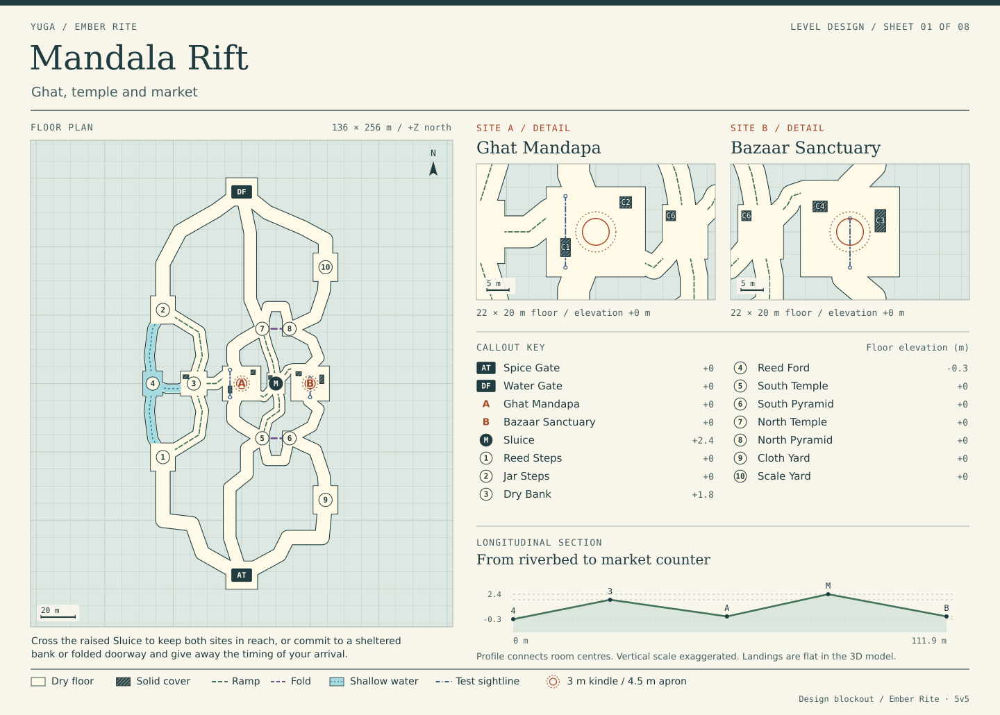
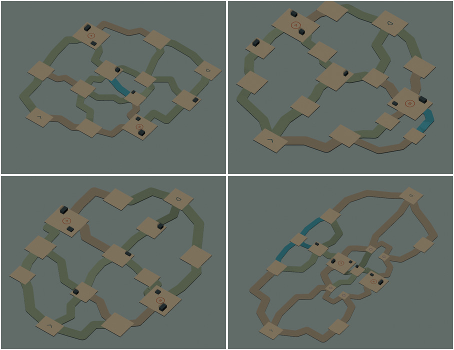

# Ember Rite map atlas

Five bearers have 100 seconds to bring the Ember to one of two sanctums. The carrier needs four uninterrupted seconds on the stone. Once the Ember catches, the defenders have 40 seconds to reach the actual vessel and give one teammate 3.5 seconds to pour. A defender on the wrong side of the city has to decide when a sighting is worth leaving their post. The four maps give that decision different costs. [Round rules](../ROUND_AND_TECH.md) · [One round from both teams’ perspectives](ENCOUNTERS.md)

**[Download the eight-page printable blueprint atlas](blueprints/yuga-map-atlas.pdf).** Each map has a metre-scale plan, two enlarged site drawings, an elevation section and a companion sheet with opening times, cover dimensions, landmarks and camera tests. The GLBs below open in Blender or any glTF 2.0 viewer. These are standalone level-design models. The current browser download runs the Hanuman/Rama knockout skirmish. [Playable build](../../../../../yuga-rust/README.md)

| Map | Choice the carrier makes | Blueprints and models |
| --- | --- | --- |
| [Mandala Rift](maps/mandala.md) | Hold the raised Sluice for a late switch, shelter the vessel on the riverbank, or use a folded doorway whose local cue gives away the crossing. | [Plan](blueprints/mandala.svg) · [Encounter sheet](blueprints/mandala-encounters.svg) · [3D model](massing/mandala.glb) |
| [Lanka](maps/lanka.md) | Cross the exposed Wind Arch between the high Signal Court and Ashoka Garden, or take the sheltered salt arcade early enough to matter. | [Plan](blueprints/lanka.svg) · [Encounter sheet](blueprints/lanka-encounters.svg) · [3D model](massing/lanka.glb) |
| [Ayodhya](maps/ayodhya.md) | Leave the Assembly Court by a dry inner-bank street, or tell nearby opponents you are heading for the Ferry Quay by splashing across the wash. | [Plan](blueprints/ayodhya.svg) · [Encounter sheet](blueprints/ayodhya-encounters.svg) · [3D model](massing/ayodhya.glb) |
| [Kurukshetra](maps/kurukshetra.md) | Use a fast outer opening toward Palace Terrace or Wind Field, or show the team on Gauge Bridge and keep either site in reach. | [Plan](blueprints/kurukshetra.svg) · [Encounter sheet](blueprints/kurukshetra-encounters.svg) · [3D model](massing/kurukshetra.glb) |



## Read a sheet at the table

Hand one team the plan. Mark who actually saw the carrier and who merely saw a teammate. After the first interruption, let the bearers choose whether to hold the same lip, move the vessel through mid, or drop it for a teammate. Give the defenders the same information a player in the room would have had. The encounter script gives both sides’ calls for this exercise, the two possible continuations and a support-player recap. [Rehearsal script and playtest protocol](ENCOUNTERS.md)

The scale bar applies inside its own view. North is positive Z in the plan. AT and DF mark role spawns, M marks contested mid, and A and B mark the two dry 3 m kindle disks. The dotted 4.5 m perimeter includes a 1.5 m design clearance for edge placements. A quenching defender has to reach the vessel where the carrier finished the channel. The blue dash-dot lines mark where to test a shoulder view. The section uses separate horizontal and vertical scales and follows the named room centres. The dashed line on the cover elevations is a 1.7 m reference for comparing solids.

## What changed in review

- **Mandala.** The earlier sketch gave both sides matching graph times. Keeping the original sites and spawns, the designers replaced straight approaches with a Sluice, a bank, and angled fight entrances. A plan check caught a gearbox obstructing the market ramp. The revised footprint clears the route. [Earlier study](../../mandala-rift-5v5/README.md) · [Current design](maps/mandala.md)
- **Ayodhya.** An early opening gave attackers roughly a full kindle before defenders arrived at B. Moving Archive Gate and refining the dry passages narrowed the modeled lead to 1.1 seconds. The first timing review of the new dry retake still left only 3.1 seconds for fighting after travel and pouring. The inner-bank revision raises that allowance to 8.5 seconds. [Revised routes](measurements.md#ayodhya)
- **Kurukshetra.** The outer routes reached both sanctums sooner than Gauge Bridge. The map now gives mid an information advantage for delaying the destination choice. Its main open balance question is whether the defender who reaches Palace Terrace early can watch both entrances from one place. [Opening and retake design](maps/kurukshetra.md)
- **Lanka.** A team that leaves the opposite site when the 40-second fire starts has just over one second to spare if it takes the sheltered 35.4-second arcade and reserves 3.5 seconds to quench. The shelter rewards an early read. The exposed 21.9-second rotation gives a late retake a fighting chance. [Causeway rehearsal](maps/lanka.md)

Valve’s accounts of Dust II and Inferno informed doorway backdrops and cover before entry. Riot’s Split and Ascent design histories informed how much a central position should reveal and how a landmark can identify a site. Valve’s dated Deadlock updates informed the separate tests for shortcut speed and arrival safety. The research panel also traced the markets, waterworks and literary city forms used as art references. [Source notes and image comparisons](REFERENCES.md) · [Four original district landmark concepts](../../../../art/ember-rite-5v5/README.md#district-landmarks)

## Authoring and verification

Design baseline for this pass is Git commit `3be4d37c`. The source panel, district designers, encounter writer, route analyst and technical artist reviewed the same two-site objective and checked the exported layouts independently.

The [four JSON layouts](maps/) own room dimensions and elevations, bent corridor centrelines and widths, cover, probe endpoints and landmark bindings. The drawings, timings and 3D models use those same inputs. Start a revision in the map JSON and keep its encounter brief beside it. The underlying game and networking sources live elsewhere.

From the atlas directory, run the following commands after a geometry change.

```sh
python3 audit.py
python3 draw.py --pdf
blender -b --factory-startup -t 1 --python-exit-code 1 --python massing.py
blender -b --factory-startup -t 1 --python-exit-code 1 --python massing.py -- --check
blender -b --factory-startup -t 1 --python-exit-code 1 --python probe_massing.py
python3 audit.py --check
```

The layout audit and SVG drawing use Python’s standard library. PDF assembly also uses Inkscape and pypdf. The massing builder uses Blender’s bundled Python and glTF exporter. Open a GLB with **File → Import → glTF 2.0**. Source sheet coordinates (X, Z) map to ground-plane (X, Y) in Blender with Z up. glTF uses X east, Y up and negative Z north. A runtime importer must apply that convention explicitly.

All 16 spawn-to-site combinations must support two dry approaches sharing only the start and destination, with the other site and enemy spawn closed. The audit reports both routes, dry and optional rotation times, usable site clearance and which cover a probe intersects in plan. Door sightlines, third-person corner peeking, bent ramps and whether a hero can move abreast with the carrier need play-space measurements. [Computed routes and method](measurements.md) · [Geometry source](massing.py)



These are the imported floor and cover models viewed from above. The repeatable floor check samples authored routes and empty space around them. It caught an early export that put floor between separate corridors. The corrected exports pass 6,436 route samples and 18,341 exterior samples. At Mandala the steepest sampled two-metre stretch out of the Sluice rises about 0.55 m per horizontal metre. The outside turn shows faceted shading in a close view. Bring Rama and Hanuman up and down it and check foot contact, slide and camera clearance before committing to the crest height. Lanka’s sharpest sustained grade is 0.50, Kurukshetra’s 0.33 and Ayodhya’s 0.25. The route times still use a constant walking speed.

The independent Blender check locates 55 room anchors and 26 cover solids. Across 48 line tests at three heights and in both directions, Mandala’s bell screen concealed a standing trace and allowed an elevated one. On Kurukshetra the Ledger Screen on the higher terrace still caught the elevated porch trace. Its top clears that ray by only about 5 cm. That margin makes the porch the first place to try real shoulder offsets and both heroes. [Measured Blender sightlines and repeatable check](massing/sightlines.md)

## First build and acceptance gates

| Order | Owner and deliverable | Decision before proceeding |
| --- | --- | --- |
| 1 | **World and collision.** Bring Mandala’s ordinary routes, dry bank, site floors and selected solids into an isolated playable blockout with Rama and Hanuman. Add room returns, ceilings and capsule collision. | Walk both alternatives to each site. Plant at the centre and each compass edge, recover a drop and reach a quench from each entrance. Check that a shoulder peek or floor below cannot operate the vessel. Keep folds closed for this pass. |
| 2 | **Combat and network.** Connect the tested Rust round rules to authoritative movement, held interact, damage, legal floors and a ten-seat round. Add captions, interruption, side swap and reset. | Rehearse the Mandala branch with an interrupted carrier, a fake quench and a disconnect. Match event order on two rendered clients. Check which players can hear or caption a fold. |
| 3 | **Environment art and accessibility.** Place a single skyline landmark and a quiet hero-height backdrop for each flagship site. Add the local fold and ford cues after the baseline dry paths pass. | Repeat both shoulder views at dusk, in grayscale, with muted audio and reduced effects. Ask first-time players to call the landmark and find the marked site. A false door, visible hidden carrier or missing dry route returns to the designer. |
| 4 | **Encounter and playtest.** Compare the two entries, exact vessel placements and site-dependent retakes on one Mandala revision in the proposed 48-round test. | Record choices and reasons by team and side. Revise a dominant perch or unused entrance. Promote the next map only when both sites support a contested human retake. [Sampling and rejection criteria](ENCOUNTERS.md#playtest-sequence) |

The prototype’s pure round tests cover clock and interaction rules. A passing route check or Blender import alone cannot establish match balance, online operation, performance or final visual quality. The panel has supplied a design and measured build inputs for a future playable Ember Rite. [Production roadmap and owners](../SOURCES_AND_ROADMAP.md)
