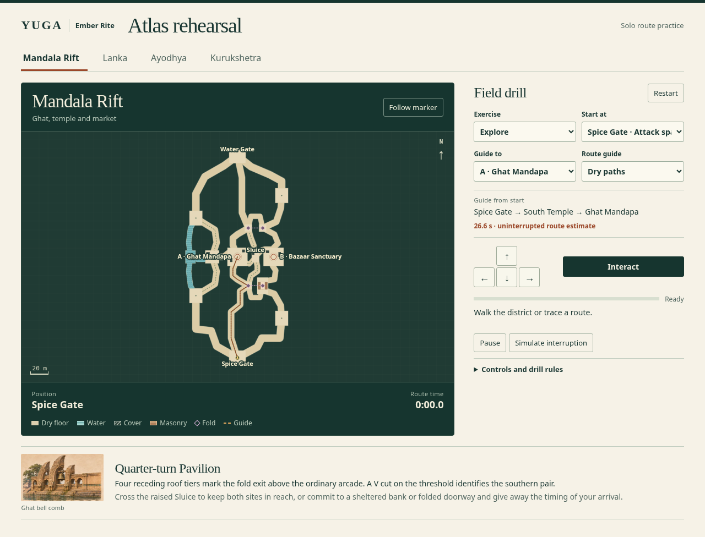

# Verify this Ember Rite release

The browser title and the separate rehearsal are distributed in the same portable game ZIP. The packaged skirmish and rehearsal can be tested separately. The rehearsal gets its map coordinates from the disk layouts and timing from the Rust ritual module. The skirmish uses the Rust battle authority in WebAssembly. [Game ZIP](../../../../../../yuga-rust/downloads/yuga-rust-confluence.zip?raw=true) · [Release verification and content hashes](release-validation.json)

[Phone capture with both site labels](rehearsal-mobile.png) · [Measure Well with its dry crossing and two wet basins](rehearsal-measure-well.png)

| Check | Evidence | What it establishes |
| --- | --- | --- |
| Four districts and eight sites | [Route computations](../measurements.md) · [Entrance distances and timings](../BALANCE_MATH.md) · [Independent path enumeration](../test_balance.py) | Every spawn/site pair has two dry paths without a shared interior room. On each district a dry rotation survives a mid closure with both spawns removed. The proposed timing budget begins when the defender leaves the centre of the other site. |
| Twelve dimensioned sheets and eight Blender models | [Post-import floor and sight tests](../massing/sightlines.md) · [Registered architecture, clear headroom, ingress and limits](../massing/architecture-checks.md) | Measurements are over the exported geometry. The steepest sustained descent from Mandala's Sluice to the bazaar measured 25.6%. Human camera peeks and target-hardware performance are separate tests. |
| Solo objective practice | [Run and test the offline drill](../rehearsal/README.md) · [Title integration test](../../../../../../yuga-rust/tools/test_ember_title.mjs) | Eight simulation tests exercise dry routes, walking-height masonry, water, both fold directions, interrupted holds and a retake at the actual placement. Browser checks also moved the marker against both sides of each building. Opening and closing it from the game title resets the embedded drill and restores keyboard focus. |
| Two playable skirmish heroes | [Rust tests and source checksums](../../evidence/hero-balance-tests.json) · [Abilities and counterplay](../../HERO_BALANCE.md) | The default suite passed 101 tests. Two normally ignored tests passed separately in release. A short or blocked step cannot earn an arrow. Simultaneous Sena casts share only the actual health restored. |
| Private 5v5 Confluence host | [Packaged authority and browser checks](release-validation.json) · [Ten-seat parity test](../../../../../../yuga-rust/tools/test_5v5_parity.mjs) | Native and packaged WebAssembly agreed on 910 seat snapshots across 91 frames. Ten loopback network peers saw the other nine heroes. The rendered room test uses one graphical seat and nine socket peers. |
| Production Observatory | [Dashboard entry and controls](../../../../PRODUCTION_OBSERVATORY.md) · [Dashboard](https://occult-kranti.github.io/ANDOLAN/production/) | The locally served dashboard reads the current workspace. The public page links a saved production snapshot, four diagram plates, the drill, the PDF, the measurements and a floor-model overview. |

A separate two-window software-rendering trial delivered the aimed cast and all 28 damage, yet the observing viewport missed the five-guardian visual during a frame stall. The report records the browser and WebAssembly hashes and the active ticks observed over the wire. This remains an explicit graphics acceptance test. [Two rendered seats](two-seat-visual.json)

The first Pages publication of these game and atlas bytes passed 75 public HTTP requests and matched all 69 published dashboard assets to their Git bytes. Chromium completed 107 checks at 1440, 390 and 320 CSS pixels. The unchanged site baseline contains 90 files. The publication receipt names the currently deployed commit. [Initial checked deployment](https://github.com/occult-kranti/ANDOLAN/actions/runs/45727265630) · [Current public receipt](https://occult-kranti.github.io/ANDOLAN/production/publication.json)

To repeat the package checks, build into a writable directory with `games/yuga-rust/tools/build_web.py --output DIR`, extract the ZIP in that directory, and run the game tests against the extracted folder. Rust 1.88, its WebAssembly target, the repository's locked Node packages and Chromium are used for the browser build and graphical tests. Run the atlas regeneration and read-only checks after editing a district. [Build requirements](../../../../../../yuga-rust/README.md) · [Atlas authoring commands](../README.md#authoring-and-verification)
