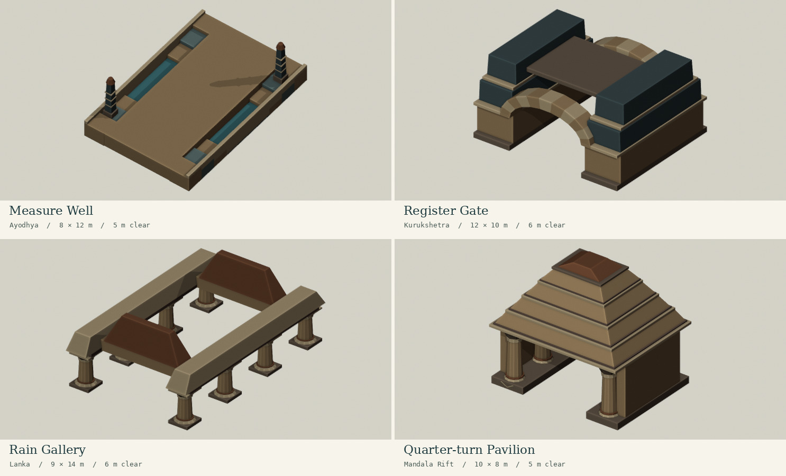

# Architectural models and measured clearances

Each building imports in metres at the host room’s map coordinates. Combine its GLB with the corresponding [district floor study](sightlines.md) at the scene origin to rehearse its approaches. The standalone models retain individual named courses, piers, arch stones and gauge elements for editing. Each third sheet in the [12-page atlas](../blueprints/yuga-map-atlas.pdf) cuts the same geometry.



| Building and research reference | Width × axial depth × height above sill | Clear width | Full-width headroom | Named mesh parts | Clear axial rays |
| --- | ---: | ---: | ---: | ---: | ---: |
| [Quarter-turn Pavilion](mandala-architecture.glb) · [M1](../RESEARCH_ROUNDS.md) | 10 × 8 × 9 m | 5 m | 4.23 m | 62 | 24 |
| [Rain Gallery](lanka-architecture.glb) · [L1](../RESEARCH_ROUNDS.md) | 9 × 14 × 5 m | 6 m | 2.35 m | 64 | 24 |
| [Measure Well](ayodhya-architecture.glb) · [A1](../RESEARCH_ROUNDS.md) | 8 × 12 × 3 m | 5 m | Open to sky | 31 | 18 |
| [Register Gate](kurukshetra-architecture.glb) · [K1](../RESEARCH_ROUNDS.md) | 12 × 10 × 6 m | 6 m | 2.52 m | 35 | 24 |

| District and host room | Entrance I → exit II, map X/Z | I → II bearing | Dry sill | GLB SHA-256 prefix |
| --- | --- | ---: | ---: | --- |
| Mandala Rift · South Pyramid | (28, -36) → (28, -28) | 0° | +0 m | `b5c8794dec29e19b` |
| Lanka · Rain Gallery | (-30, 26) → (-16, 26) | 90° | +5 m | `cf9e168059ccea4e` |
| Ayodhya · Measure Well | (29, 9) → (41, 9) | 90° | +1 m | `4414f8f8509168c6` |
| Kurukshetra · Archive | (-34, 37) → (-34, 47) | 0° | +4 m | `c988f73f133fe1c7` |

In Blender the horizontal coordinates are X east and Y north. In glTF, north is negative Z and elevation is positive Y. Bearings turn clockwise from north. A ray traversed the whole building in both directions at its centre and at ±49.5% of its clear width. Test heights were 0.12, 1.70 and 2.12 m above the dry sill, plus 0.04 m below the recorded headroom on covered buildings. Each import passed source-hash, room registration, bearing and bounding-envelope checks.

## Approach routes with both models loaded

Blender then imported the district and the building together at the shared origin. It tested each incident ordinary corridor from the host room centre to just outside the architectural footprint, following the authored bends. Casts at 0.25, 1.70 and 2.12 m above the host sill used the centreline and both 0.28 m shoulder offsets.

| Building | Ordinary approaches | Clear segment rays |
| --- | --- | ---: |
| Quarter-turn Pavilion | Bazaar Sanctuary, Cloth Yard, South Temple | 27 |
| Rain Gallery | Signal Court, Bell Pier | 18 |
| Measure Well | Sluice Gate, Ferry Landing | 27 |
| Register Gate | Roll Call, Palace Terrace | 18 |

The pavilion has four corbelled courses and a one-notch inlay at the entrance. The gallery’s two rows of four columns leave three recurring bays. The gate has eleven separate arch stones at each end. The well has three treads on each bank and a recessed water surface. Three additional vertical rays touched both water surfaces at +0.20 m and the central causeway at +1.00 m. In an integrated district scene, cut openings in the host floor over the two basin rectangles before enabling water visuals or collision. The ray samples leave shoulder-camera clipping, a swept character capsule and lateral movement outside the authored approaches for a playable build.

From this atlas directory, regenerate both Blender reports and the capture sheets with:

```sh
blender -b --factory-startup -t 1 --python-exit-code 1 --python probe_massing.py
python3 massing/render_studies.py
```
