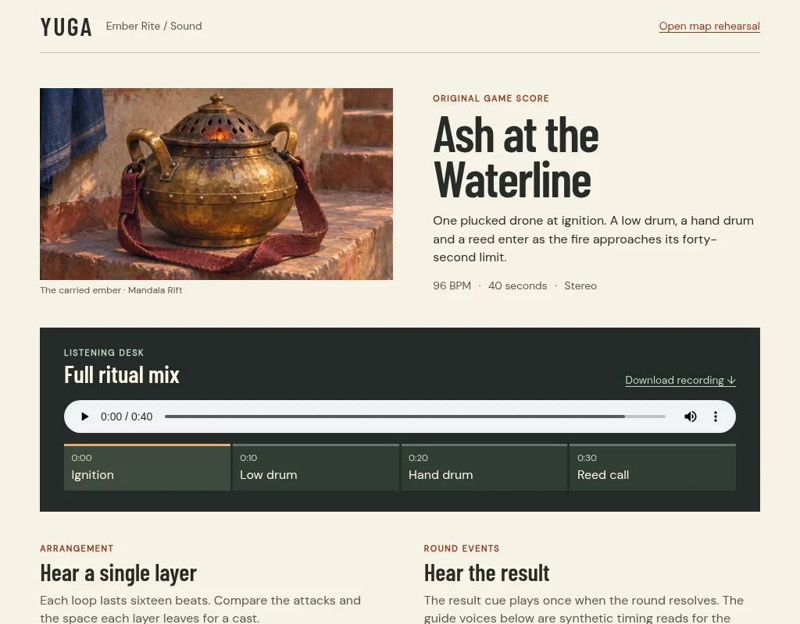

# Ember Rite sound production roadmap

A defender at the Ghat Mandapa bell screen should be able to hear a rival begin to kindle, decide whether the sound is a feint, and recognize the instant the fire actually takes. That encounter drove the first audio release. Try it with speakers, captions, or both. [Listening exercise](https://occult-kranti.github.io/ANDOLAN/production/ember-rite/rehearsal.html?map=mandala&exercise=explore&listen=1) · [Audio bible](README.md) · [Play the score](https://occult-kranti.github.io/ANDOLAN/production/ember-rite/audio/index.html)



## Decisions from three design rounds

Six agent roles covered player flow, spatial rendering, composition, cast direction, rights research and independent QA. The integration owner supplied the listening desk, bilingual guide performances, offline title integration and release. At baseline `2acb45b3d61973a924fe5518c617e4fd2afb02d7` the map exercise ran on a fixed clock with geometry and interactions. Its Web Audio mix was missing. The existing Confluence game already had distinct character sounds. Reusing its Hanuman takeoff and synthesis instruments let the team spend time on information, performance and composition. [Baseline](https://github.com/occult-kranti/ANDOLAN/tree/2acb45b3d61973a924fe5518c617e4fd2afb02d7) · [Ability audio provenance](../../../../NOTICE/HANUMAN-ABILITY-AUDIO.json)

| Round | Review question | Decision and shipped change | How to challenge it |
| --- | --- | --- | --- |
| 1 · Information | Does hearing the beginning of an interaction tell the listener who finished it? | A legal kindle and quench make local onsets. Releasing the input or being interrupted ends the actor’s windup. Confirmed ignition, quench and expiry have distinct public receipts. Sound and captions pass through the same eligibility rule. | Stand just inside and outside each authored radius. Repeat an interruption near cover with sound muted and captions on. [Listener tests](../atlas/rehearsal/audio.test.mjs) |
| 2 · Legibility | Can the team follow the score without losing the movement and ability information it needs? | Four aligned stems add density at the same tempo. Narrow-band analysis exposed a weak low-drum onset. The second performance added roughly 7.2 dB in the first 150 ms on that test band while holding the stem peak. The renderer ducks the bed for important cues, and the listener can adjust or mute music alone. | Compare the low drum in isolation with the full final phase, then replay Hanuman’s leap in stereo and mono. An additional listening session will establish which events people can identify on physical speakers. [Composition and measurements](../../../../art/yagna-audio/README.md) · [Audition desk](../../../../art/yagna-audio/index.html) |
| 3 · Playback across entry points | What does a player hear after an aborted hold, a tab switch or a return from the game title? | The renderer associates a windup with its actor even when standing 1.49 m from the vessel. Interrupting that hold leaves a colocated audition alone. Reopening the Rust title drill restores the mix controls and asks for a fresh sound gesture. Hidden or reset drills release the old output. | Replay the final quench, switch tabs mid-score, then close and reopen the drill. Compare center and side cues on the downloadable title and standalone page. [Browser cases](../atlas/rehearsal/audio.browser.test.mjs) · [Title cases](../../../../../yuga-rust/tools/test_ember_title.mjs) |

## Next production work

The solo release establishes a listening vocabulary. The first multiplayer deliverable is one short Mandala retake where a carrier, two nearby players, an out-of-range rival and a reconnecting player each receive the right information. Roles below can work concurrently once they agree on the accepted-round event and round clock. [Authoritative round rules](../ROUND_AND_TECH.md) · [Ten-player encounters](../atlas/ENCOUNTERS.md)

| Order and owner | Build or review | Evidence for completion |
| --- | --- | --- |
| 1 · Rust room and gameplay | Connect the existing objective rules to actual movement, site reach, channel requests, accepted damage and side swaps. Assign audience-scoped receipt IDs. Send coarse information only to eligible listeners. Reconnect from the public clock. | Exercise ten seats, two rendered clients, a late join, repeated and stale events, and different spectator privileges. An out-of-range observer receives no hidden position or role. A snapshot resumes current layers without replaying a private attempt or result. [Rust objective](../../../../../yuga-rust/src/ritual.rs) |
| 2 · Audio and level design | Register surface material and room volumes on the in-engine Mandala floor and upper story. Compare equal-distance pairs around low props, full walls, one open gate and each folded exit. Compare the current stereo mix with one native HRTF and occlusion prototype. | Verify localization both above and below the listener. Record hardware, frame and audio-thread timings, polyphony, memory, settings, and identical event recordings for both renders. An acoustic mapping change must remain independent of decorative floor recolors. [Architecture fieldbook](../atlas/vertical-play/README.md) · [Engine options and conditions](tools-and-rights.md) |
| 3 · Hero animation and audio | Attach authored takeoff, impact, summon, decoy and recovery markers to accepted game states, starting with Hanuman, then the contrasting precision kit. Keep story announcements in their own event group. | A missed landing, canceled cast or illusion cannot emit a rival's genuine result cue. Ten-seat cast timings, mono captions and reduced-music playback preserve counterplay. [Hero-by-hero production sheet](hero-cuebook.md) |
| 4 · Music, voice and cultural direction | Run the English and Hindi reads with a bilingual director and performers. Have instrumentalists listen to the drone, drum and reed art direction and revise idiom, phrase endings and pronunciation. Capture agreements and takes for the actual public uses. | Reviewed spellings and pronunciation, approved performances, licensed masters, reviewed captions, loudness measurements and a traceable replacement for each accepted guide take. [61-line casting sheet](hero-voice-lines.csv) · [Four timing reads](../../../../art/yagna-audio/voice-guide/README.md) |
| 5 · UX research and release | Run side-swapped sessions on headphones, phone speakers and mono with deaf and hard-of-hearing players. Repeat at final-score density, during a feint and after overtime. | Report event-identification errors, direction mistakes, cue masking, caption comprehension, fatigue and device failures by setting and listener. Tune radii and mix from observed cases. Demonstrate the release on the actual room and both download and web entry points. [Test script and current measurements](qa.md) |

The tool register records the evaluation path for Wwise, FMOD, MetaSounds and Steam Audio. A native middleware decision belongs after the same map and event set have been profiled on the target devices. The original score, cue admission, transcripts and audience rules remain reusable across engines. [Research and license register](tools-and-rights.md) · [Traceable source receipts](source-checks.json)

## Release evidence

The listening desk test checks native playback, seeking, transcripts and downloaded file hashes for all eleven recordings on desktop and touch. The title test opens the actual extracted release, changes the mix in the rehearsal, closes it, and checks it again in a fresh map session. A separate test exercises the existing Confluence skirmish and compares 910 native and Wasm seat snapshots. That parity result applies to the existing room game. [Listening desk receipt](evidence/desk.json) · [Offline title receipt](evidence/title.json) · [Package and regression receipt](evidence/release.json)

During the download check, opening the skirmish directly from disk exposed a Chromium worklet-loading issue. The extracted title now supplies its existing Rust limiter worklet as an inline data URL on `file:` and retains the blob URL for the server entry. Both entry points use the same worklet code. [Title audio implementation](../../../../../yuga-rust/web/main.ts) · [Two-hero skirmish test](../../../../../yuga-rust/tools/test_match.mjs)

With the repository's Node and Playwright dependencies installed, the following command exercises the deployed desk and writes a fresh receipt. The synthesis instructions and the playable simulation checks live with their respective sources. [Rebuild the music](../../../../art/yagna-audio/README.md) · [Run the map and audio checks](qa.md)

```sh
node games/yuga-native/art/yagna-audio/test_desk.mjs https://occult-kranti.github.io/ANDOLAN/production/ /tmp/ember-desk.json
```
