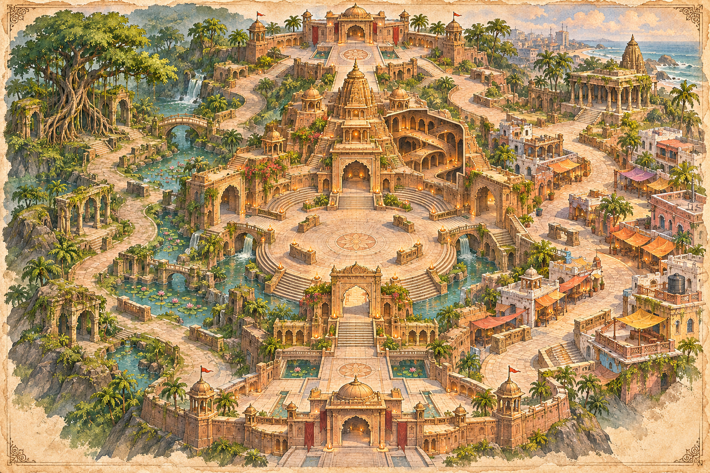

# Mandala Rift · 5v5 map and game-design handoff

Mandala Rift is an original YUGA arena for five heroes against five. It combines three readable approaches, a temple courtyard, a city-edge bazaar, shallow jungle water and two mirrored folded-space links inside fictional temples and stepped sanctuaries. Soldier waves, siege vehicles and autonomous jungle minions are outside the new mode. The existing soldier art, animations and wave implementation remain available as source material for future hero equipment, visual echoes and noncombat architecture.

The illustration is original generated concept art. It is not a playable map or a measured floor plan. Use the separate [top-down route sketch](map-sketch.png), [editable SVG](map-sketch.svg), [route data](map-spec.json), [validation receipt](plan-validation.json), [match script](MATCH_SCRIPT.md) and [engineering and art notes](IMPLEMENTATION.md) to plan an actual level.

## What exists and what is proposed

The Rust browser prototype now runs a temporary **hero-only skirmish**: 5v5 is first to 25 hero knockouts, with an 18-minute score limit. Smaller private rooms and solo exploration are retained for testing. Solo exploration has no AI opponents; Hanuman practice still uses three stationary training targets. This is a prototype on the **existing** Confluence map. It does not yet implement Mandala Rift, swimming, portals or the round-based objective mode below. The separate Godot native project retains its own rules until it is updated and checked. [Download and host](../../../../yuga-rust/README.md)

The intended competitive mode is a round-based 5v5 attack/defend match with a carried Rift Seal and two sites. [Complete proposed rules and event script](MATCH_SCRIPT.md)

## The space

| Place | Intent | Player choices |
| --- | --- | --- |
| **Ghat Jungle** | West approach: mangrove roots, stone steps, shallow lotus water and a raised dry bank. | Take a noisy, slower water crossing for cover, or follow the dry flank. Both approaches have exits and sightlines that can be contested. |
| **Mandapa · A** | Central arena: an open circular court bounded by a pillared temple and stepped terraces. | Contest the court through more than one entrance, use low cover to cross, or rotate to a fold door instead of forcing the main choke. |
| **Bazaar · B** | East approach: a fictional modern Indian market merged with an old stepped sanctuary. | Fight through readable storefront cover or take the neighboring pyramid corridor. Keep the central site and its entry readable from shoulder height. |
| **Folded temple ↔ pyramid links** | A pair of short spatial links on each team-side half. Each pair connects a temple doorway to a separate stepped-sanctuary doorway. | Hold to traverse after an audible, visible windup; opponents can contest either end. A normal walking route joins the same areas. The interiors create an impossible connection for the player without requiring an infinite or physically curved world. |

The route sketch uses the current map's conceptual X/Z envelope of 136 × 256 m and keeps Sun/Moon halves mirrored across Z. It is a new diagram, not a claim that the current collision boxes or elevations already fit. In the abstract graph, routes to A take 22.4 s and routes to B about 26.6 s from either spawn at an assumed 5 m/s. Water edges use a proposed 0.85 speed multiplier and each portal edge a proposed 1.5 s cost. The graph proves only equal graph weights and route connectivity; it does not prove equal sightlines, cover, movement, collisions or game balance. [Inputs](map-spec.json) · [Reproduce and validate](make_plan.py)

To regenerate the diagram and graph receipt, install Python 3 with Matplotlib and run `python3 games/yuga-native/docs/design/mandala-rift-5v5/make_plan.py` from the repository root.

## Reference and design observations

- The [Level Design Book's layout chapter](https://book.leveldesignbook.com/process/layout.md) treats a top-down drawing as a communication tool for spatial structure. Its [blockout chapter](https://book.leveldesignbook.com/process/blockout.md) emphasizes testing massing, metrics, wayfinding and collision before polish. The node graph here is the first planning artifact, followed by an in-engine blockout.
- The [combat chapter](https://book.leveldesignbook.com/process/combat.md) discusses aiming, sightlines, positioning and visibility denial in tactical shooters. The proposed sites therefore require measured cover and a clear flank, not just symmetric travel distances. Riot's [official VALORANT map overview](https://playvalorant.com/en-us/maps/) describes several distinct locations and traditional three-lane maps. No specific game map or proprietary asset was copied.
- UNESCO describes [Hampi](https://whc.unesco.org/en/list/241/) through its river, hills, halls, gateways and water structures, and [Rani-ki-Vav](https://whc.unesco.org/en/list/922/) as a multi-level stepwell conceived around water. Those are references for material, terraces and spatial relationships. The arena and stepped pyramidal forms are fictional, not reconstructions of those sites.
- Godot's [viewport documentation](https://docs.godotengine.org/en/stable/tutorials/rendering/viewports.html) describes rendering a SubViewport to a texture. That is one possible later visual method for a portal preview in the Godot project; the Rust browser authority and PlayCanvas renderer would need their own implementation and profiling. The first planned combat prototype uses opaque, clearly marked gates so visibility and projectile rules remain explicit.
- [Fixed-timestep guidance](https://gafferongames.com/post/fix_your_timestep/) supports separating simulation steps from rendering. YUGA's current Rust authority runs at 20 Hz. It still needs an authoritative portal state, reconciliation and multiplayer tests before any folded route can ship.

## Next gates

1. Continue verifying the new 5v5 hero-only authority and ten-client room on the existing map, especially with ten rendered clients, real human input and network latency. Preserve the previous wave assets and rules as a separate historical source.
2. Replace the symbolic diagram with a playable graybox containing A, B, the jungle route and measured spawn, cover and line-of-sight tests. Match both team starts and use actual hero movement and camera height.
3. Prototype one mirrored folded-link pair with safe exits and a dry alternate path. Run the gameplay, network, prediction and reduced-motion checks in [implementation notes](IMPLEMENTATION.md).
4. Add the round-state objective, server-owned interactions, HUD and practice bots in separate tested slices. Measure attack/defence outcomes and timing in human 5v5 playtests.
5. Reuse the existing temple, rocks, nature, water and hero assets to art-pass an accepted slice, then profile the ten-hero scene on target hardware. Do not treat the concept illustration as an in-game render.

Concept image generated 25 November 2026; SHA-256 `a5dba84da83c92f31da84529b5ac6d98f451eb3a25d2ef1ed10502c871c7fb3a`.

## Verification of the current prototype

- The [Rust suite](evidence/rust-tests.txt) passed 77 tests with two ignored. Four new authority tests cover ten valid spawns, no spawned waves, a 25-knockout win, a simultaneous tie at the target and a full 18-minute draw.
- [Ten WebSocket peers](evidence/ten-peer-rooms.json) connected to the extracted package: five on each team, nine remote heroes per peer and no wave units. The [native/Wasm comparison](evidence/ten-seat-parity.json) compared 910 seat snapshots over 91 frames, with no numerical difference in the tested trace.
- One [Chromium player with nine WebSocket peers](evidence/browser-5v5.json) rendered nine remote heroes and accepted keyboard movement. [Screenshot](evidence/browser-5v5.png). Two Chromium windows also exercised a [private 1v1](evidence/browser-duel.json), while [solo exploration](evidence/explore.json) and all five actions in [Hanuman practice](evidence/practice.json) passed. These tests used local loopback and software rendering, not a public internet deployment or ten rendered clients.
- The existing 3v3 paths passed a [six-seat native/Wasm comparison](evidence/six-seat-parity.json) and [room transport test](evidence/six-peer-rooms.json). The packaged close-wall camera passed [six viewport/team cases](evidence/camera-browser.json) using staged room snapshots.
- Package SHA-256: `677470c5c104c20c0a8b302b0e0de91a4320b5aba4187116be2256d37285f6f3`. The [build manifest](evidence/build.json) records the matching HTML and Wasm hashes. Competitive balance, online latency, audio listening and physical-GPU performance remain unverified.
