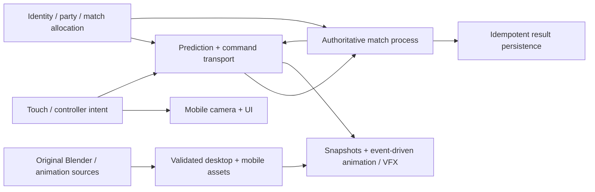

# Mobile architecture and code migration

Status: researched proposal, 18 October 2026. Parent: [mobile roadmap](../MOBILE_PRODUCTION_ROADMAP.md). Existing implementation facts below are source observations, not successful mobile-device runs. Specialist source ledgers own external tool/license claims.

## Architecture decision record

| Decision | Recommendation | Reopen only with |
| --- | --- | --- |
| Client engine | Retain Godot 4.6.3 standard and GDScript; share authoring source with desktop | A matched device spike demonstrating a critical engine limitation that cannot be solved within an agreed cost |
| Render path | Trial Mobile on qualifying Vulkan/Metal devices; qualified Compatibility fallback; Forward+ desktop remains separate | Measured visual/performance differences on named minimum/standard/high devices |
| Authoring | Blender → glTF/GLB → validated Godot imports, separate mobile variants | A pipeline tool that demonstrably preserves rig/skin/action/material contracts and improves cost/quality |
| Match authority | First spike: stripped headless Godot process, reusing extracted native rules | Same-fixture comparison with a Nakama-authoritative TypeScript implementation if planar mobile rules justify the port |
| Identity/social/storage | Nakama OSS + PostgreSQL, self-hosted initially; small fixed-host room allocator | Operational test proving another service reduces actual requirements/cost; no dependency added solely for popularity |
| Transport | Evaluate Godot native UDP/ENet and secure reliable alternative against latency, packet loss and mobile networks | Measured comparison plus authenticated admission/encryption/abuse design; ENet alone is not a secure account/session protocol |
| Server orchestration | One region, explicit capacity limits and health checks first | Room-density/load data justifying Agones/Kubernetes/OpenMatch; do not start with an unmeasured distributed platform |
| Client physics | Server-owned movement rules; local prediction/render interpolation | Defined reconciliation tests; never assume Godot physics is bitwise deterministic across phone/server architectures |
| Web deployment | Website and reference/demo builds only; downloadable native mobile apps are the target | Qualified browser feature/performance matrix; Pages cannot host match processes or a database |

Unity or Unreal could support a high-quality mobile game, but switching would require reimplementing current Godot scripts, import contracts, scenes, motion ownership, tests and packaging. Neither supplies finished original art or online operations. BRUTAL is not a replacement renderer/editor pipeline; see [the existing source review](../research/BRUTAL_STACK_DECISION.md). C#/GDExtension is reserved for measured hotspots or platform bridges, not a speculative full rewrite.

## Runtime boundaries

Presentation consumes authoritative or explicitly predicted events; it does not award damage, gold or cooldowns. Pose interpolation may smooth a network correction, but must not alter hit ownership. Match state and services are separate: account/database calls never sit inside a movement tick. Hidden enemies are filtered before snapshots leave the server; hiding them in the client renderer is insufficient.

## Existing seams and proposed destinations

Paths are relative to `games/yuga-native/`. Proposed paths below do not exist merely because they are listed.

| Existing source | Reuse | Change / proposed seam | Regression obligation |
| --- | --- | --- | --- |
| `project.godot`, `export_presets.cfg` | Engine pin, desktop startup | Feature-tagged mobile startup; Android and iOS presets with their own texture/import settings | Desktop launches unchanged; actual exported app reports correct profile/renderer/build identity |
| `scripts/player.gd` | Accepted movement/hero presentation where applicable | `scripts/input/player_intent.gd`, desktop adapter, `scripts/mobile/touch_intent.gd`; remove global input reads from shared simulation | Keyboard behavior preserved; multi-pointer events cannot cause double casts or stuck movement |
| `scripts/rama_hero_runtime.gd` | Hero/runtime composition and event routing | Separate aim provider, local/remote/bot actor controller and authoritative event sink | Same action ID/sequence routes once to motion/VFX/audio; death/rejoin cleans subscriptions |
| `scripts/rama_ability_kit.gd` | Action states, costs, commit/cancel/recovery event semantics | Extract rule state from Node/world queries; explicit actor/target/clock interfaces | Cancel before commit cannot damage; post-commit cancellation cannot erase authoritative hits |
| `scripts/lane_army.gd`, `lane_minion.gd` | Wave/targeting fixtures, event patterns | Separate lightweight entity state from Node3D visual instances; add mobile profile towers/economy/visibility | No reward duplication, target through walls, unbounded queued attacks or dead-unit occupancy |
| `scripts/confluence_world.gd`, `world_atlas.gd` | District assets and navigation visualization | `scripts/mobile/moba_camera.gd`, mobile arena/map manifest; live minimap without pause behavior | Camera/UI never changes simulation time, collision or fog state |
| `scripts/rama_hero_hud.gd`, `rama_hero_panel.gd`, `hero_ui_theme.gd` | Shared glyphs, copy, semantic styles and readable states | `scripts/mobile/mobile_hud.gd`, layout settings, safe-area/scale service; reusable screen components | All actions reachable with touch; cooldown/disabled/target/cancel states remain distinguishable |
| `scripts/rama_motion.gd`, secondary/facial systems | Existing state ownership and animation evidence | Budgeted mobile rig/clip variants, match vs showcase quality, lower-frequency distant animation | Same combat commit timing, no duplicate bone writer, no foot/weapon pop at transitions |
| `scripts/rama_ability_effects.gd`, unit art helpers | Bounded shared mesh/material pools and event cues | Device-tier effect representation, importance/culling rules, baked secondary alternatives | Hostile area/range/impact information is identical at every quality tier |
| `scripts/world_lighting.gd`, `production_lighting.gd`, world shaders | Original lighting palette, modular art direction | Mobile material variants, bake/emission strategy, explicit capability checks | Current code gates SSAO/glow on Forward+; engine support must be checked separately rather than inferred |
| `scripts/native_contracts.gd`, `assets/contracts/native-contracts-v1.json` | Strict identity/admission patterns and historical fixtures | New versioned mobile profile/catalog or explicit schema migration; do not append an unrecognized profile to the current validator | Old native/browser admissions retain their exact rules; incompatible mobile packets fail clearly |
| `tools/package-native.py`, notices, CI | Source/asset provenance, exact payload review patterns | `tools/package-mobile.py`, Android CI/export, separate macOS/iOS signing lane | APK/AAB/IPA source identity, included notices, no credentials/debug endpoints, actual installed-byte validation |

The existing catalog validates exactly three profiles and `live_handshake=false`; it is a pure validator, not a live server. Proposed ID `mobile-moba-5v5-v1` is a design name, not an implemented profile. Its map/rules/content/input/event/entity/replay versions and wire protocol must be allocated deliberately. Keep native offline content revisions and browser protocol 2 independent.

## Shared contracts to freeze before parallel implementation

**Intent:** monotonic input sequence and client sample timestamp; normalized movement; world aim point/direction; ability ID; press/aim/release/cancel phase; optional visible-target request. Validate finite bounded fields, button transitions, rate and actor ownership. UI pointer IDs stay local. Server clamps timestamps and validates targeting/range/visibility/cooldown; clients do not submit damage, reward or an authoritative hit list.

**Actor:** stable entity ID plus spawn generation, faction, position/orientation/velocity, action/animation state, health and presentation flags. Despawn/reuse cannot attach old effects or late events to a new actor. Client input, render rate and animation sampling are independent of authoritative tick rate.

**Action:** cast ID, caster generation, server tick, ability version, target type, windup/commit/recovery events, projectile or zone identity and cancellation reason. The current 20 Hz combat clock and 60 Hz physics are initial comparison fixtures, not mobile tick rates selected without measurement. A balanced ten-player match may need different settings; select once in M1/M5 and migrate explicitly.

**Map:** original visual assets separate from server collision/navigation/visibility data; immutable hashes of each. Elevation/flying/brush/river rules are explicit. Art-only occlusion must not create different target legality. Bound spawn counts, projectiles, zones, pickups and replay storage against the workload actually shipped.

**Result:** match ID, rules/content identity, participant IDs, outcome, final tick and validated reward transaction ID. One authoritative finalization; retries are idempotent. Reconnect cannot duplicate gold, ownership, leaderboard updates or result rewards.

## First engineering slice

### Equipment and shop integration requirement

The gameplay proposal includes six equipment slots and one active item. This adds a shop/inventory route and an active-item control to the touch packet's screen inventory. M4 freezes item, purchase-zone, price, sale/refund and slot rules; M7 implements server transactions; M9-W2 owns their complete touch UI. Show pending/accepted/rejected purchase states, authoritative gold and full-inventory reasons. Duplicate requests/reconnects must not grant an item twice. The active-item button gets its own pointer owner, drag/cancel behavior, cooldown/disabled state and customizable safe-area placement; it cannot steal the joystick or an ability's pointer. Practice may pause its shop; the online shop never pauses the match. Include keyboard/controller parity and screen-reader/assistive semantics where the platform supports them.

### Implementation order

1. Freeze the existing Rama inputs/action receipts and an ordinary desktop smoke run as regression fixtures.
2. Extract `PlayerIntent` and aim provider behind the current keyboard/mouse adapter, with no initial gameplay rebalance.
3. Add the elevated mobile camera and touch adapter in a dedicated original arena fixture. Reuse the real hero and effects; do not substitute blocks as a visual acceptance target.
4. Author mobile shader/texture/rig variants and Android export configuration; compare the same asset/camera/light on two candidate renderers on physical devices.
5. Run the same commands against a headless rule owner and one local client; then two clients. Only then expand population and services.

Keep this slice small enough to diagnose. A failing input adapter must not be hidden by new models; a better model must not be accepted from a render that bypasses gameplay.

## Source and decision hygiene

The mobile document set and machine backlog are planning artifacts. Source evidence includes filenames/hashes/observed version and specialist retrieval ledgers. Missing commercial clients remain missing. Reuse tool code only under its verified license; assess models/textures/music separately. Record accepted and rejected experiments, exact output hashes and changes to the decision table. Update [START_HERE](../../../../docs/START_HERE.md) and the backlog instead of asking a new agent to read the entire repository.
