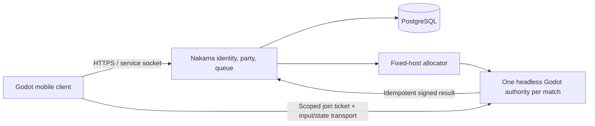

# M0 — original mobile 5v5 gameplay, authority and services

**Recommendation.** Start the M1 experiment with a Godot mobile client, a stripped headless Godot match process, Nakama OSS for identity/parties/matchmaking, and PostgreSQL. Use a small allocator on a fixed regional host before introducing a Kubernetes fleet. This preserves the current native combat implementation as the first candidate and gives each match one authority. The architecture is **proposed**, not selected or deployed: a same-fixture parity, latency and room-load experiment must compare it with a Nakama-authoritative TypeScript implementation before the whole-stack ADR is settled. No production rules, G2 art sources, contracts or dependencies were changed for M0.

All numerical gameplay and service targets below are **new design assumptions or proposed test budgets**, not existing behavior or measured capacity. The new user direction is an original mobile 5v5 game with an elevated camera. It does not silently replace the existing browser 3v3, native offline practice, or proposed native 6v6 profiles.

**Evidence boundary.** The [small source ledger](sources/gameplay-network-sources.json) records exact repository commits, fetched license bytes, primary URLs, code/doc hashes, local source hashes and failed requests. Official Mobile Legends, Google Play, iTunes and Apple web requests returned proxy 403. No official gameplay video, timecoded match, Reddit discussion or private game asset was reviewed. Therefore this document makes no freshly verified claim about Mobile Legends' exact map, tower counts, equipment, cooldowns, server rate, reconnect promises or matchmaking. The reference supplies the user's genre direction; the rules here are original proposals. Before approving a reference comparison, an accessible official publisher match/tutorial must be watched and logged with URL, upload/build date and timecodes for camera, targeting, map pressure, item purchase and reconnect behavior. Publisher marketing claims must remain separate from observed gameplay.

**Current code boundaries.** The working-tree source audit was performed against the files pinned in the ledger; the native graphics campaign currently has an intentional unreleased content 7 catalogue. Its prior public Linux qualification is a different source/content 6 artifact.

| Existing product/profile | What the source actually provides | Reuse boundary |
| --- | --- | --- |
| `browser-p2-3v3` | Node/TypeScript authority, 3 per team, 480-second default, 20 Hz simulation and 10 Hz snapshots. `server.ts` owns strict intent parsing, bounded rooms, input expiry, command receipts, hashed reconnect reservations and single-current-connection ownership. Shared simulation includes lanes, towers/core, waves, neutrals, credits and three upgrade tracks. | Useful rules/test patterns. This is a different map/combat schema; `botsPerTeam` is clamped to 3, and snapshots/joins explicitly identify protocol 2. Public WSS provisioning is still unclaimed. |
| Browser local Practice | Runs `ArenaSimulation` in the browser; its menus pause only local practice. | A development mode, not evidence of online service availability. |
| `native-offline-triad` | Local Godot practice; current catalogue declares local 60 Hz/army 20 Hz/relay 10 Hz authority. Rama combat/vitals, troops and relays are actual offline receivers. | Preferred code path for the Godot-authority spike, but it needs multi-player ownership, a server bootstrap and a separate mobile rules/map profile. Current world scenes preload presentation assets and are not a ready server deployment. |
| `arena_client.gd` / native validators | A distinct protocol 2 adapter plus admission/lifetime guards. Guards specify room/epoch, sequence, generation and discontinuity boundaries. | Reuse bounded parsing/identity tests. A schema validator or diagnostic bridge does not connect the current native world to authoritative 5v5 combat. |
| `production-6v6` | Proposed 6 per team, 1,080 seconds; authority, collision artifact and transport are unselected. | Preserve its identity and historical roadmap. It is neither the mobile specification nor an implemented online mode. |

The browser source also exposes concrete migration work: all clients currently receive the full room snapshot, disconnected rooms stop advancing when no clients remain, and the simulation uses `structuredClone`, JavaScript collections and module imports. None of these becomes mobile fog-of-war, continuous match ownership, or a Nakama runtime port by changing the team-size constant.

**Original playable contract to prototype.** Use a fixed elevated follow camera, a left movement stick, right-side attack/ability controls, drag-to-aim with release/cancel, and an optional recentre/map-pan action. The camera is presentation; the server validates targeting. The first map uses one authoritative navigation surface with ramps represented consistently in its collision artifact. Native flight/grapple and bridge-over-road combat remain outside the first mobile profile unless the parity experiment explicitly budgets them. Visual elevation must not invent inaccessible collision paths.

| System | Proposed first playable | Decision/acceptance condition |
| --- | --- | --- |
| Teams and win | Exactly 5 seats per team, including explicitly labelled bots. Destroy the opposing core. Target ordinary match duration 12–18 minutes for playtesting; a server safety timeout is a separate rule, not the browser's 8-minute score finish. | Ten seats cannot become 11 through reconnect or bot substitution. Victory and settlement happen once. Decide timeout/surrender through playtests and versioned rules. |
| Map and towers | Three lanes with outer and inner towers per team/lane; an inner-lane breach exposes the core under an explicit rule. Forest routes provide rotations and contestable camps. Tower range, target priority, hero-aggression response and return-to-target behavior are public rules. | Mirror traversal time and safe-side advantage before decoration. Towers cannot change victim due to frame rate or client targeting claims. This proposed 12-tower layout is not attributed to another game. |
| Waves | Paired waves with melee/ranged units and periodic siege pressure; prototype 25-second spacing, then tune from measured lane contact. Start with a 96-minion hard cap, separate corpse/transient caps and deterministic overflow policy. | Simultaneous waves stay symmetric under load; no one-sided spawn after cap rejection. Cap changes require profile and load-budget review. |
| Neutrals/objectives | Small original camps provide individual/team resources; one timed contested objective creates a rotation decision. Leash, reset, credit attribution and respawn clock are authoritative. | Reset cannot duplicate rewards. A contested objective must have counterplay, clear spawn state and no permanent snowball reward. Add a second major objective only after the first is understood. |
| Economy/experience | Match-only gold and experience; modest proximity income plus a last-hit bonus, assisted-defeat attribution and explicit camp rewards. Team activity matters without requiring frame-perfect last hits for every role. | Every award has a server event ID; one death cannot pay twice. Test AFK/proximity leeching, support income, lane swaps and comeback pressure. No persistent wallet purchase changes combat power. |
| Equipment | Six proposed match slots; start with a small original component tree covering damage, durability, mobility and support. At most one active item initially; unique-passive stacking and sell/refund rules are explicit. | Server validates stock/cost/slots/cooldown and commits purchase atomically. Build recommendations expose reasons and counters. Items and prices need new schemas; the browser's three upgrade counters are not an equipment system. |
| Heroes/counters | Prototype 6 original mobile kits spanning frontline, sustained range, burst, control and support; mirrored picks may support early 10-seat tests. Reuse native Rama behavior only where its touch targeting and readability are proven. | Record a counter matrix: range, interruptibility, escape, shield/heal interaction, resource cost and telegraph. Each strong action needs an observable response. Simulated bots are not human balance evidence; ranked draft/ban needs enough tested alternatives. |

All combat-readable art, names, sounds and ability implementations remain original or provenance-approved. A permissive code repository is not permission to reuse bundled marketplace models or proprietary game binaries. No such assets were downloaded for this review.

**New profile and source seams.** Propose `mobile-moba-5v5-v1` with an independent application wire family, tentatively `ym5/1`; do not call it browser protocol 3 until the bridge owner explicitly chooses that migration. It begins as `proposed` with live handshake disabled. Admission must bind profile ID, wire/schema versions, map/collision digest, rules/content digest, feature mask, server build, room ID and authority-issued epoch. Record exactly 10 hero seats, per-kind entity caps, input/packet limits, equipment/experience schemas, visibility policy and a declared simulation rate. The existing validator hard-codes the current three profiles; its allowlist, fixtures and package checks need a deliberate migration rather than accepting arbitrary client-supplied profile fields.

Proposed implementation seams, subject to the architecture owner's directory decision:

- A separate mobile profile and client adapter (`mobile_contracts`, `mobile_arena_client`) with explicit match-data messages. Preserve current `arena_client.gd` protocol 2 interoperability.
- A server-only Godot scene that loads collision/rules and multiplayer receivers, without `courtyard.tscn`, hero art, HUD, sounds, particles or per-client cameras. Extract authority/presentation coupling from `rama_ability_kit`, `rama_vitals`, `lane_army` and relay rules before claiming headless efficiency. One hero's globals cannot represent ten independent owners.
- A versioned collision/navigation artifact consumed by authority and prediction. Export stable collider/support IDs and test walls, corners, ramps, dashes, target occlusion and forced displacements. The current map-source hash is not proof of equivalent collision in another runtime.
- Service adapters for identity, party, match allocation and signed join tickets. The match server is the only combat authority; Nakama storage is the service record, not a second tick simulation.
- Shared data definitions/test vectors where practical. The browser simulation is a useful reference and adversarial test corpus, not a drop-in implementation of native Rama, vertical movement or mobile equipment.

**Authority and netcode.** Begin the experiment at 20 Hz authority with 10–20 Hz state delivery and 60 Hz local rendering where the device supports it. These are test candidates, not committed shipping rates. Input consists of bounded movement direction, facing/aim target, monotonically increasing input sequence and idempotent action IDs. Clients never submit accepted position, health, cooldown, gold, item effects or hit results. The server owns movement sweeps, target visibility/range, cast validation/commitment, projectile lifetime, damage, crowd control, respawn, waves, purchases and victory.

Predict only the local player's movement and reversible cast presentation. Each authoritative snapshot acknowledges the last applied input; discard acknowledged inputs and replay the remaining bounded buffer against the same movement rules. Correct small errors over a short visual interval, snap on declared teleport/death/generation change, and clear prediction on respawn/rejoin. Remote units render from a short interpolation buffer, initially 100 ms with bounded adaptation under jitter. Never extrapolate damage or let a missed snapshot continue firing. A correction-rate/error-distance metric must be collected on actual mobile clients.

For the first projectile/area abilities, use current authoritative state and committed future cast times; do not implement unrestricted world rewind. A later instant-hit ability may justify a historical hit-shape query, initially capped at 100 ms and clamped by server-estimated clock offset and observed RTT. Validate historical visibility and generation; do not rewind rewards, health, defenses, movement or already-settled impacts. Reject stale/future sequence abuse. Melee, displacement, shield activation and zone application need individually specified ordering; a generic "lag compensation on" flag is insufficient. High-latency input receives an honest outcome, not an enlarged invisible hit region.

Fog-of-war is a server visibility rule. Send only permitted enemy state, with controlled last-seen records; hiding an already-delivered opponent on the client is insufficient. Spectators, reconnect bootstraps, death cameras, minimaps and bot observations must respect the same policy. Neutral/objective public announcements are separate from exact hidden positions.

**Reconnect and mobile lifecycle.** Menus and backgrounding cannot pause an online match. Clear held input immediately when a lifecycle callback arrives, and expire stale intent server-side after the declared lease, initially 350 ms. The OS may kill/suspend the app without a callback. After a proposed 5-second absence, a labelled server bot can take control; reserve the same seat/hero for a proposed 90-second authenticated rejoin window. These timings must be playtested and versioned. Returning input atomically replaces bot ownership; an old connection cannot retain authority or claim another player's seat.

Use short-lived signed join tickets scoped to account, room, epoch, profile and a single-use nonce. Refresh account sessions separately from match ownership. Store long-lived mobile credentials in OS-protected storage; device ID alone is not an account-recovery policy. Resume requires a full authoritative bootstrap plus last input/action/event watermarks, current inventory, casts, cooldowns, death/respawn and entity generations. Discard old outgoing commands and touches. Reward events already acknowledged cannot replay as new awards.

Test background/foreground, phone lock, app termination, Wi-Fi↔cellular change, duplicate login, expired ticket, joining a finished match and loss during result settlement. Bots continue the declared match policy while humans are absent; do not inherit the browser server's zero-client clock stop unnoticed. If every human leaves, use an explicit abandonment/abort rule with no farmable rewards. The first deployment does not promise live migration of a crashed Godot process: mark the match aborted, prevent duplicate/lost financial settlement, and make recovery visible. Checkpoint-based match migration is a later measured feature.

**Backend comparison, based on inspected primary sources.** Full commits and raw license hashes are in the ledger. Licenses below cover the identified repositories, not all optional services, dependencies or artwork. No stack was installed or benchmarked in M0.

| Candidate | Verified source/license | Useful scope and overhead | M0 disposition |
| --- | --- | --- | --- |
| Headless Godot match process | Godot MIT; inspected Godot 4.6 dedicated-server docs at `b10b7ed3` under CC-BY 3.0 | Reuses native language/physics/combat seams; dedicated export can strip presentation resources. Each room needs process lifecycle, health, resource limits and transport admission. Headless does not automatically remove world/art allocations or create authority. | **Recommended starting authority candidate** because native is the current production focus. Prove a stripped ten-seat room first. |
| Nakama + Godot SDK | Server `7c94b8f3`, SDK `6dc7b395`, both Apache-2.0 | Accounts/storage/social/parties/matchmaking and supported Godot 4 SDK. Requires a database, migrations, backups and operational configuration. Hosted/commercial offerings have separate terms; multi-node guarantees are not assumed from OSS branding. | **Recommended service candidate**, PostgreSQL-backed, single regional coordinator initially. Use custom authoritative game messages; the SDK README's client-position RPC example is not the combat security design. |
| Nakama authoritative TypeScript | Same Apache-2.0 server; inspected Goja runtime and matchInit 1–60 Hz validation | Could combine services and planar simulation in one server runtime. Porting current native GDScript/physics and browser JS built-ins is real work; `structuredClone`, imports and collision semantics require compatibility tests. | **Measured alternative**, attractive only if the mobile profile deliberately simplifies movement and parity/load results beat the Godot process path. Do not run both as authorities. |
| Colyseus | `0029df28`, MIT | Node.js rooms, binary state synchronization, room matching/reconnection; README describes Redis/load-balancer horizontal scaling. Familiar for browser TypeScript but native rules still need porting, and account/moderation/result operations remain product work. SDK/schema integration must be tested for the selected Godot client. | Useful comparison if Node becomes the chosen authority. Adding it beside Nakama just to duplicate rooms is unnecessary for the first slice. Vendor scale/"cheat-proof" phrases are not evidence. |
| Open Match | `d781be1a`, Apache-2.0; inspected Helm chart 1.8.1 references Kubernetes/Redis | Matchmaking framework, not combat simulation or dedicated-game hosting. Custom policies/allocation integration and its operational dependencies remain. The inspected default-branch commit is dated 2024; later repo pushes do not establish maintained production support. | Defer until custom multi-pool matchmaking scale justifies it and current maintenance/release suitability is checked. |
| Agones | `2c9fadb5`, Apache-2.0 | Kubernetes controller/CRDs for GameServers/Fleets/allocation/autoscaling. Requires cluster/network operations, images, warm capacity and an external matchmaker/game process. | Defer until measured Godot fleet utilization/failure handling warrants Kubernetes. It is compatible with the chosen process model but not required for one fixed host. |
| PostgreSQL | `45fc51fc`, PostgreSQL License | Durable account/result/entitlement storage with backups and transactions. Match ticks should not block on per-frame database writes. | Use a tested supported release/container digest, not the development branch reviewed for license provenance. |
| OpenMOBA / OpenRTSCamera | OpenMOBA `c97360e4`, MIT; camera `ff822f1f`, MIT | OpenMOBA is an old Unreal/Blueprint repository with no retrievable README in this check; a repository license does not audit its asset rights or completeness. OpenRTSCamera documents Unreal 5 camera smoothing, bounds and target following. | Reference only. Neither is a selected Godot gameplay backend. No Unreal assets or proprietary binaries were fetched. |

The minimum experiment is a single regional service/database plus a small fixed pool of Godot processes. A backend allocator gives an authenticated party a room reservation and join ticket; clients connect directly to that room. Service allocation failures return to the lobby and release the reservation. A Nakama matchmaker result is a request to allocate a game server, not proof that the room is running.

Start with a TLS-protected WebSocket game transport for the shared mobile/connectivity experiment, while measuring its head-of-line blocking under loss. An ENet/UDP candidate may be tested if those measurements fail; it needs its own authenticated/encrypted transport, packet/replay limits and deployment-port review. Godot's RPC authority annotations or a UDP socket alone are not authentication. Transport selection is part of M1, not an unreviewed claim that TCP or UDP is universally sufficient.

**Rooms, bots and finding a match.** First support private invitation rooms, tutorial/co-op and one unranked regional queue. Reserve full party seats atomically; expose region/estimated latency, ready-check timeout and cancellation. Use region and party size as hard constraints, skill/role balance as bounded expanding constraints, and a visible queue fallback. Do not promise 10-second matches without a population model. Bots use the same validated commands and visible information as players, have difficulty caps, and are always labelled. Separate bot-training metrics from human balance. Ranked matchmaking, smurf/boosting analysis, seasonal ratings and penalties require an observed population and appeals process.

**Integrity, moderation and operation.** Enforce bounded message sizes, rates, input age, command deduplication and per-account/room admission. Validate numbers, IDs, equipment transitions and collision sweeps; reject client timestamps as sole truth. Server-side visibility and movement validation reduce cheating opportunities but do not prove a cheat-free game. Run parser/property fuzzing and recorded exploit reproductions as tests, with private security reporting and response ownership.

Persist final match/result IDs and participant awards through an idempotent transaction/outbox so retries cannot pay twice. Never trust a client-submitted victory screen or match gold total. Retain a bounded audit/replay stream with profile/build hashes, server inputs and decisions; define retention and deletion policy rather than collecting unlimited voice/location data. Keep secrets out of clients/logs; separate development, staging and production identities/databases. Operate backups, restore drills, health/readiness, queue age, allocation latency, room tick time, crash rate and per-region connection quality.

MVP communication can begin with rate-limited contextual pings, mute/block/report and a moderated name policy. Text/voice expansion needs abuse review, report context, staffed escalation, appeal and age/region/privacy requirements; do not ship global chat merely because the backend offers it. AFK/disconnect penalties should distinguish an infrastructure outage from repeated abandonment. Paid content, if added, needs platform receipt validation and entitlement idempotency; it must not change competitive combat statistics.

**Loading/service seam.** Match admission binds the profile and required map/rules/collision bundle before play. Use an allowlisted signed manifest and integrity-checked cache; missing gameplay bytes block join with retry/back, while optional cosmetic chunks can load later. Show actual stage progress—download bytes, verified required assets, resource loading—and name synchronous scene construction separately. Cancellation must release queue/reservation ownership and ignore late loading/allocation completion. Rejoin must never apply an old room's completed load. See the rendering owner's [pipeline plan](RENDERING_AND_MAP_PIPELINE.md) for client chunk budgets and mobile rendering gates.

**Network work packages and master schedule.** N1–N6 below are specialist subpackets of the [master mobile production roadmap](../MOBILE_PRODUCTION_ROADMAP.md), not six additional implementation rounds or six completed rounds. All are proposed. The master roadmap and its machine queue own scheduling, dependencies, worker assignments and acceptance. These packages cannot close a master gate by themselves.

Use the master's worker identities: W1 = rules/authority; W2 = touch/screens; W3 = hero/motion; W4 = world/units; W5 = rendering/build/tools; W6 = independent QA/security. The lead owns shared contracts and integration. Cross-owner work below is a dependency request, not a second assignment of a peer's files.

| Network package | Master mapping | W1 authority/services | W2 touch/screens | W3 hero/motion | W4 world/units | W5 rendering/build/tools | W6 independent QA | Dependency and exit gate |
| --- | --- | --- | --- | --- | --- | --- | --- | --- |
| N1 contracts/spike | M1 comparison/profile; implementation carries into M5 | Compare Godot process and Nakama-TS candidates; identity/ticket bootstrap | Camera/aim/cancel fixture | One native kit ownership split | Paired collision fixtures | Two real mobile clients + stripped export | Independent parity/latency/load/negative-join audit | Freeze the profile draft; select one authority/transport only after fixtures match and measured budgets pass. Missing device measurements keep the M1 decision open. |
| N2 ten-seat room | M5 authoritative process → M6 actual 5v5 | Private 5v5, bots, dedup commands, scoped snapshots | Lobby/ready/rejoin flow | Representative damage, support and displacement fixtures | One lane/towers/core | Ten-client render/CPU/device witness | Kill/disconnect/rejoin/duplicate-owner and full-match tests | Ten unique seats, correct result, no reward duplication. M5 begins with two clients; M6 requires ten rendered clients plus bot load. At least two must be actual mobile clients in this proposed witness; identify automated clients explicitly. |
| N3 match/economy integration | M7 complete loop; depends on M4 economy; expands with M10 map and M11–M14 roster/balance | Equipment/economy transactions, fog filtering, result outbox | Item shop/counter explanations | Representative counter fixtures, expanding with the master roster | Lanes, waves, camps and objective integration | Full-scene/device memory study | Mirrored seed invariants + human play sessions | No impossible purchases or hidden-state leaks; authoritative start/win/result/rematch. A six-kit prototype does not close the master's fourteen-hero roster or balance gates. |
| N4 lifecycle/resilience | M8 bots/service resilience; depends on M6 networking | Bounded regional unranked queue, abort/settlement, backup restore | Interrupted-session recovery | Disconnect bot handoff and status ordering | Map/cast boundary adversaries | Lock/background/kill/network-switch matrix | Network impairment, process/DB outage and replay audit | No stuck room, late input burst, duplicate control or duplicated result; recoverable failures shown on device. Preserve the master's separate offline practice-bot requirement. |
| N5 operating qualification | M16 performance/security/cost; closed-cohort evidence feeds M17 | Rate limits, moderation workflow, dashboards, incident/rollback drill | Comprehension/accessibility study | Human counter/balance evidence | Objective/rotation evidence | Minimum-device frame/thermal gate | Invited-cohort stability and cost report | Known capacity, restore/rollback and staffed support; no unresolved release-blocking integrity/lifecycle failures. This package does not replace M17 external alpha correction. |
| N6 production decision | M18 regional beta/launch; depends on passed M16/M17 and all master release gates | Capacity expansion; consider Agones/OpenMatch only from evidence | Queue fairness/retention review | Confirm tested roster depth | Confirm content readiness | Store/release/device regression | Independent release qualification and staged rollout | Go/no-go based on real population, cost, service objectives and user outcomes. Master integration owns the release decision; a private prototype is not production-ready. |

N1's authority comparison, owned by master W1 with W5/W6 support in M1, must run **the same** wall/corner/ramp/dash/cast/respawn fixtures and input traces, not two unrelated demos. Proposed trial budgets are a 50 ms simulation step with p99 room-tick work under 25 ms, stripped room RSS under 256 MiB, and ordinary per-client downstream p95 under 30 KiB/s; report spawn/combat peaks separately. These are starting gates, not measured facts or a reason to lower simulation correctness. Measure 1/2/4 concurrent rooms and publish CPU/RSS/bandwidth/allocation curves on a named host. Compare Godot's multi-owner extraction cost with TypeScript runtime/physics port cost, not just empty-server process size.

Use proposed RTT/jitter/loss matrices of 20/80/150/250 ms, 0/30/75 ms jitter and 0/1/5% loss with burst disconnects, recording correction error, cast acknowledgement and input-to-visible response on actual phones. Test the single-owner/sequence invariants under replayed and reordered commands, forged result/profile claims and stale bootstrap data. No deterministic cross-platform lockstep, zero-latency response, DDoS immunity or live crash migration is assumed. Human play and target-device/network measurements decide whether the first architecture is acceptable.

M0 is a source-backed recommendation and bounded plan. Open prerequisites are the accessible Mobile Legends primary-observation pass, mobile whole-stack ADR, native multi-owner extraction, authority/transport parity experiment, actual device tests, hosted operations and human balance. Existing offline Godot work and browser multiplayer evidence remain valid only in their recorded scopes.

**Integration revision history.** The initial M0 document SHA256 was `4d2e0e7e9e2b24b123e3ce4c5dfac957e538774b0a37209cda056a3be42baa4f`; its unchanged source ledger SHA256 is `86695dd4abcff9685975c1aa9e495864936edcc08d1c9e5e50233502ad10814e`. This documentation-only correction renames the former local M1–M6 labels to N1–N6, aligns worker identities, and maps them to the master schedule. It adds no completion, runtime or research claim.
