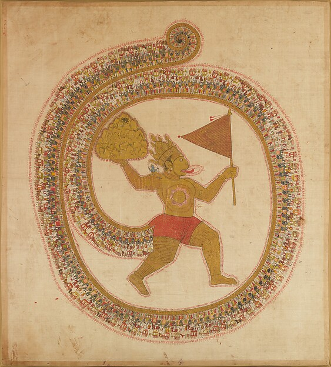

# Art history references for YUGA

Eight public-domain works provide a small, source-checked reference set for the hero and environment teams. The local images are institution-provided digital reproductions. The gallery links each work to its museum record and describes observable shapes, gestures and colors. [Open the offline gallery](gallery.html) · [Preview the gallery](gallery-preview.png) · [Full image and metadata catalog](catalog.json)

## Selected references

- **Hanuman carrying a mountain.** The Rajasthan image from about 1800 shows a running figure, a one-hand mountain carry, a flag and a tail spiraling around the composition. The silhouette and delayed tail arc can guide Mountain Pulse staging. Keep any combat-area marker distinct from the decorative tail. [Met 37960](https://www.metmuseum.org/art/collection/search/37960)
- **Meeting Rama and Lakshmana.** The Mankot folio from about 1710–25 uses seated body orientation, hand gestures and eye line to organize a quiet encounter. It can inform non-combat poses and readable dialogue scenes. [Met 37986](https://www.metmuseum.org/art/collection/search/37986)
- **Medicinal herbs.** A workshop active in the first generation after Nainsukh created this Guler folio around 1790. Groups, scale and surrounding landscape lead the eye to the care being offered at the center. This arrangement can inform the hierarchy of Hanuman's ally-healing effect. [Met 37988](https://www.metmuseum.org/art/collection/search/37988)
- **Rama and Lakshmana on Mount Pavarasana.** In this Jammu folio from about 1690–1710, both figures are seated with bows at rest on a mauve hill beneath a dark sky. Use it to study a calm ready silhouette and landscape contrast. [Met 53684](https://www.metmuseum.org/art/collection/search/53684)
- **Shiva Nataraja.** The copper-alloy figure from Tamil Nadu, late 12th to early 13th century, places a raised leg and extended arms around a planted point. It offers a weight and counterbalance reference for a pivot or landing. The sculpture has four arms, while the current YUGA Shiva design has two. [Met 39329](https://www.metmuseum.org/art/collection/search/39329)
- **Krishna and Govardhan.** The folio from about 1590–95 organizes villagers and cattle below an expansive mountain canopy. It offers a protective grouping and large-form reference for a proposed allied shelter. [Met 448183](https://www.metmuseum.org/art/collection/search/448183)
- **Vincent van Gogh, Wheat Field with Cypresses.** The 1889 painting separates sky, field and cypress with directional strokes. A surface artist can test their rhythms in foliage, sky cards and distant terrain while protecting hero and ability readability. [Met 436535](https://www.metmuseum.org/art/collection/search/436535)
- **Claude Monet, The Japanese Footbridge.** The 1899 painting layers green reflections and small pale water lilies beneath an arched bridge. Its value grouping is a useful wetland color reference. Its bridge is part of Monet's Giverny garden; the YUGA setting should use its own architectural research. [NGA 74796](https://www.nga.gov/artworks/74796-japanese-footbridge)

Dates, artist credits and titles follow the museums' records. The notes on possible game use are design proposals. This is a sample across several Indian traditions and two European painters, and can be expanded as the team locates more works.

## Sources and rights

The Met's API marked the seven selected objects isPublicDomain=true at collection time, and their images came from the associated primaryImageSmall URLs. The museum's Open Access policy places eligible public-domain images under CC0. The NGA's object page states that the media for the Monet work is free and in the public domain. The institution-donated Wikimedia Commons file also carries a CC0 label. Each image's direct URL, source record, credit line and SHA-256 appear in [catalog.json](catalog.json). [Met Open Access](https://www.metmuseum.org/about-the-met/policies-and-documents/open-access) · [NGA Open Access](https://www.nga.gov/artworks/free-images-and-open-access) · [NGA Commons file](https://commons.wikimedia.org/wiki/File:Claude_Monet,_The_Japanese_Footbridge,_1899,_NGA_74796.jpg)

The Met supplies these downloaded reference copies at approximately 600 pixels along the longer side. The NGA copy is 1,200 pixels wide. Use the original museum records for higher-resolution options and any updated rights information.

## Rebuild and check

From a checkout with Python 3 and Pillow installed, open gallery.html directly or run a local web server. The gallery uses local image files. verify.py checks object IDs, the seven Met rights flags, the NGA rights statement, metadata and image hashes, JPEG decoding, and gallery references.

    python3 games/yuga-native/docs/research/art-history-panel-2026/make_gallery.py
    python3 games/yuga-native/docs/research/art-history-panel-2026/verify.py
    node games/yuga-native/docs/research/art-history-panel-2026/verify_gallery.cjs

To refresh the images and institution metadata, run collect.py with network access. It verifies each selected work's rights flag or page statement before replacing its local files. The collected timestamp changes on refresh.

## Five review passes

1. **Inventory.** Checked the project's existing hero sheets and mythology research. The earlier museum image rights had remained unverified.
2. **Source selection.** Checked the current Met object records and NGA object page. Selected seven Met works and one NGA work with usable public-domain images.
3. **Intake.** Downloaded all eight images and their source metadata with file hashes.
4. **Art review.** Viewed every work. Corrected the Rama reference to seated bow-at-rest poses and retained the Met's full attribution to the workshop after Nainsukh.
5. **Verification.** Rechecked the downloaded metadata, JPEGs, rights flags, gallery links and browser layout. The gallery loaded all eight images with zero external requests at desktop and phone widths. Later game integration needs a separate runtime and readability review. [Image verification](verification.json) · [Browser verification](gallery-verification.json)
