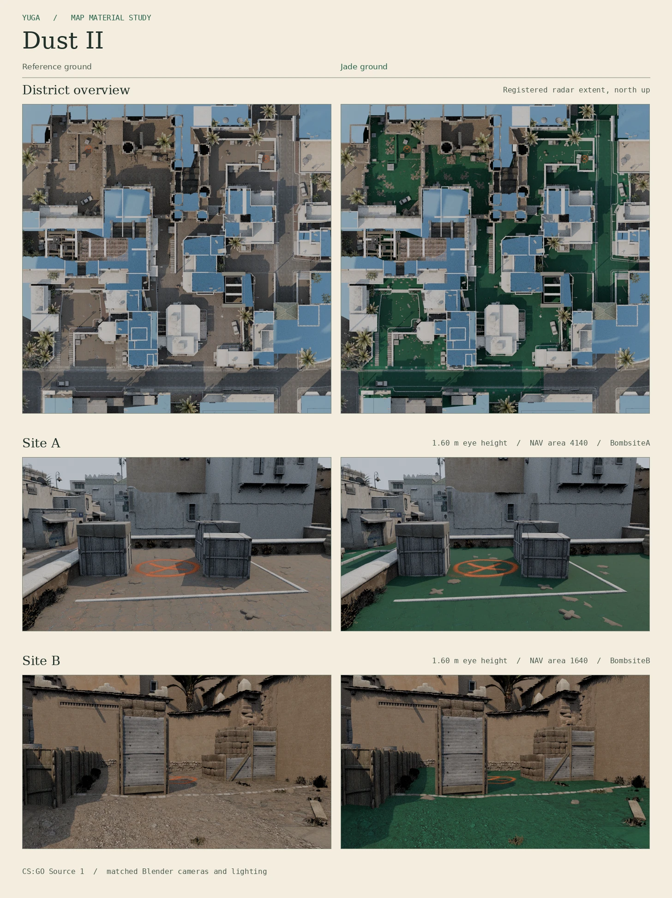
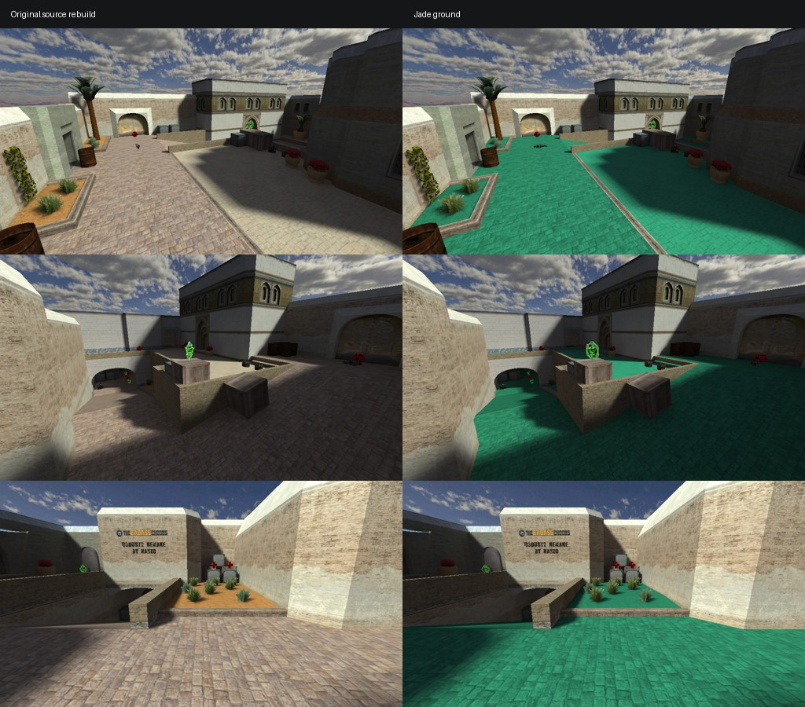

# Dust II, rebuilt locally

**Use the rebuilt maps in design.** The field inventory describes both editions’ entities, navigation, architecture, props, material families, collision and audio. The transfer register traces each tactical decision into Monsoon Exchange, an original district with a surveyed floorplan and an editable Blender model. [Inventory and edition differences](inventory/README.md) · [Keep and transform register](../../../art/monsoon-exchange/design/transfer-register.md) · [Walk the YUGA district](https://occult-kranti.github.io/ANDOLAN/production/monsoon-exchange/)

Two editions, one art change. We reconstructed the complete legacy CS:GO Dust II from Valve’s registered level and game assets, then used Rust to give its structural ground a jade finish. We also compiled Hanzo’s complete Nexuiz remake from its editable map, applied a jade ground finish, and walked it in its game client. These builds supply different kinds of evidence: fidelity to Valve’s shipped level and a working compiler path from editable brush geometry to a playable map. [Download the illustrated field guide](dust2-field-guide.pdf) · [Inspect the full-size comparison](matched-views.webp) · [Tools and exact rebuild commands](../../../tools/source-map-lab/README.md) · [File sizes, hashes and rerun results](build-receipt.json)



## What you can open

The completed package in this cloud workspace is `/workspace/ANDOLAN-local/dust2-map-lab/`. Paths below are relative to that directory. The Git repository contains the code, research, checks and comparison plates. The local directory additionally contains the original and rebuilt map data.

| Use | Local artifact | What it provides |
|---|---|---|
| Explore both finishes in a browser | `index.html`, served by local HTTP | Start with six registered stills. Select **Inspect in 3D** for the complete model, then orbit, pan, zoom and switch the ground finish. All textures and JavaScript are local. |
| Edit or render in Blender | `blender/dust2-ground-study.blend` | Two scenes share the original geometry and 262 packed textures. Timeline markers 1, 2 and 3 select overview, Site A and Site B. |
| Use a different 3D editor | `models/dust2-baseline.glb` and `models/dust2-jade.glb` | Self-contained, 205 MB each. Both contain 6,581,394 triangles after instancing. The entire binary geometry and image chunk has the same hash. |
| Load the CS:GO level in Source 1 | `native/{original,jade}/csgo/maps/de_dust2.{bsp,nav}` or `downloads/dust2-jade-source1.zip` | Two independent mounts keep the familiar file names for engine references. The native BSP preserves the map’s full-resolution original textures and baked light. Use a matching legacy CS:GO install for shared content. |
| Inspect the local brush reconstruction in Hammer | `source/de_dust2_reconstructed.vmf` | A 32,322,754-byte BSPSource reconstruction containing 10,796 solid blocks and 8,324 displacement definitions. Valve’s original authoring history is unavailable. |
| Play or edit the historical fan remake | `radiant/play.sh jade`, `radiant/q3dust2-jb-beta6.map` | A local Nexuiz game and mapper-authored editable source. The two compiled `.pk3` packages sit beside it. |
| Bring editable GPL arenas into Blender | `open-geometry/`, `downloads/open-geometry.zip` | Atelier and Trident ship with editable sources, material slot names, author credits and licenses. The OBJ exports reopened in Blender with all 45,930 and 6,920 faces. [Download the geometry and sources](open-geometry.zip) |
| Inspect the actual evidence | `evidence/`, `renders/`, `radiant/logs/`, `radiant/previews/` | Per-face registration, NAV support, VTF pixel checks, matched PNGs and masks, five compiler logs and gameplay captures. |

For the local browser, serve the package with the following command, open `http://127.0.0.1:8874/`, then select **Jade ground** or **Original**. The first view is a render. The interactive button loads the 205 MB model on demand. In Chromium the full model opened, switching finishes changed 35.22% of Site B’s WebGL pixels, the six renders loaded and the controls fit a 390-pixel viewport. [Viewer and offline package installer](../../../tools/source-map-lab/viewer) · [Blender camera and render instructions](../../../tools/source-map-lab/blender/README.md)

```sh
python3 -m http.server 8874 --bind 127.0.0.1 --directory /workspace/ANDOLAN-local/dust2-map-lab
```

## Which code and which map?

There are three different engines in this study. A file named `dust2`, or a Rust project named after a game, is insufficient to identify which one it supports. Edition, supported format revisions, and usable source assets decided the builds.

| Question | What we located and exercised |
|---|---|
| Is there Rust code that understands real CS:GO Dust II? | The MIT/Apache `vformats` reader decoded Valve’s v21 BSP, including its v11 prop data. `vbsp` 0.9.2’s generic header reader also worked. Its high-level prop reader rejected this particular revision, so the Rust editor kept the original prop lump intact. [Rust probes, results and pins](rust-and-cod.md) |
| Is there a Counter-Strike game remake in Rust? | Chimera’s Rust renderer targets Counter-Strike: Source. `cstrike_rust` and `cs-flythrough` work with the older GoldSrc family. Their code is useful for materials, camera motion and rendering. Valve’s 2023 legacy depot supplied this study’s actual CS:GO level. [Counter-Strike project matrix](rust-and-cod.md#code-we-can-use-by-format) |
| Is there editable Dust II geometry to compile? | Hanzo’s December 2013 package includes the complete 1,880,759-byte `.map`, the compiled level, credits and original compile settings. We ran BSP, visibility, eight-bounce lighting, minimap and scale. The output has 2,697 collision brushes, 3,929 draw surfaces, 507 curved patches and 1,288 visibility clusters. [Editable map and build](remakes-and-alternatives.md) |
| Does Rust Call of Duty code exist? | We located `COD4-Rewrite`, IW4L and MW2WEB. We compiled MW2WEB’s actual IW4 collision module and tested an authored floor, an outside miss and reversed triangle winding. The floor hit at fraction `0.47916666`. The test exercises its algorithm. No CoD map was used to construct Dust II. [CoD implementations, tool licenses and runnable test](rust-and-cod.md#call-of-duty-code-and-a-runnable-collision-experiment) |
| What about other editable maps for YUGA? | We compiled Xonotic’s **Atelier** and **Trident** to BSP, converted their patches, and exported 45,930 and 6,920 OBJ faces respectively. Their geometry is GPL-3.0-or-later. Unvanquished’s **Parpax** has a credited CC BY-SA geometry path with a separate asset ledger. [Actual extraction runs and licenses](rust-and-cod.md#existing-map-geometry-with-explicit-reuse-terms) · [Parpax and other options](remakes-and-alternatives.md#maps-with-explicit-adaptation-terms) |

The official legacy Workshop item 125438255 is an important failed candidate. Its downloaded BSP had 44 faces and zero objective triggers. `de_dust2_largo` is a genuine, editable one-passage spin-off. The selected full CS:GO map has 9,852 face records, two objective volumes and 3,158 static prop placements. Its 325,735,952 bytes match Valve’s dedicated-server manifest and an independently retrieved copy. [Depot number, map fingerprints and rejected candidates](sources-dust.md)

## Where the color goes

The one art direction change is a linear RGB gain of **(0.035, 0.52, 0.31)** on structural floor albedo. Paving joints, sand grain, road markings, the two orange site marks and lighting remain legible. We classified original world faces using material identity, surface orientation, and the height of the registered navigation surface. At vertically overlapping locations, a floor and a roof can share horizontal coordinates. Testing the original triangles in three dimensions resolves that ambiguity. [Classification and import method](../../../tools/source-map-lab/importer/README.md)

| Observation | Measured result |
|---|---:|
| Structural ground selected | 260 original face IDs, 20,583 triangles, 7,736.74 m² |
| Official NAV area centres on a recolored structural surface within 18 Source units | 991 of 991 |
| Centres supported by separately modeled objects | 109, including 56 on stairs and 16 on curbs |
| Remaining centres | 18 on original invisible player-solid collision surfaces, all within 7.482 Source units |
| Original source geometry checked | 8,840 visible faces, 8,324 displacements, 43 brush models, all 90 decals, all 3,158 static placements and the separate soccer ball |
| Native file preservation | 57 of 64 data sections byte-identical, including the collision and lightmap sections. All 5,579 original packed members also matched. |
| Native texture verification | 23 private shader bindings and 21 tinted texture files. All 29,360,121 decoded texels matched the specified color transform exactly. Alpha changes: zero. |
| Blender visual test | Strong color change in 98.663% of the visible overview ground interior, 99.960% at A and 99.994% at B, using a threshold of 12 eight-bit RGB levels |

Walkability and paint are different attributes. A crate someone can stand on keeps its crate material. The freestanding Kasbah stairs and curbs also keep their original paint. We inspected all 13 model assets involved. Their upward and vertical triangles share six texture atlases, and some UVs overlap. On one painted-curb atlas the overlap covered 27.6% of the tested upper-surface UV texels. Painting those atlases indiscriminately would also recolor vertical stonework. The native ground edit is therefore bounded precisely to structural ground. [Per-category QA](../../../tools/source-map-lab/qa/verification.json) · [Mesh and UV investigation](../../../tools/source-map-lab/importer/README.md)

The native edit duplicates only the necessary texture lookups and embeds new private VMT and VTF resources. The full-resolution tinted VTFs use lossless RGBA8888, which accounts for the larger 444,484,740-byte output. Both low- and high-dynamic-range face tables select the same 260 IDs. A copy of the original navigation file receives the new four-byte BSP length. In the GLB the same change needs only 23 material factors. The Blender presentation samples original albedo at a maximum of 512 pixels per image and reconstructs daylight from the map’s authored sun. Valve’s runtime retains its own baked lighting, shaders, and sky handling. One source lamp requests an unavailable skin family, so the presentation uses its valid default skin. [Independent native, geometry and render checks](../../../tools/source-map-lab/qa/README.md)

## Native engine checks

Valve’s unmodified Linux dedicated server version **1.38.8.1** loaded the original and edited maps on loopback. Its console reported `map : de_dust2` in one process and `map : de_dust2_jade` in the other. Both had zero humans and bots. Those runs establish server loading and navigation recognition. A live console query in each found both site entities and 15 spawn points per team. The reduced headless install logged 27 missing shared particle libraries and zero fatal map-load errors. The Source-edition images above came from Blender. The independent Nexuiz test ran in the actual graphical client: the player walked 297.59 Quake units, jumped 49.31 units above the pre-jump position and landed with 100 health. [Valve runtime evidence](server-smoke.json) · [Nexuiz compile and gameplay evidence](remakes-and-alternatives.md#seeing-the-change-in-the-game-client)



## Applying the result to YUGA

| Production decision | Concrete handoff and acceptance check |
|---|---|
| Keep map art, collision and round logic independent | Mark original temple paving and water-edge materials in the Mandala art assembly. The Rust GLB finishing command can restyle materials marked `extras.yugaGround = true` without touching the mesh. Keep the named `a`, `b`, `mid`, route elevations and objective identities in the map data. Check that a finish toggle changes zero vertices, collision shapes and ritual state transitions. [Mandala map data](../../design/ember-rite-5v5/atlas/maps/mandala.json) · [Art assembly](../../../art/mandala-map-studio/assembly/parts.json) · [Rust round rules](../../../../yuga-rust/src/ritual.rs) |
| Test climb, flight and cover against the actual surface | Reuse the NAV-vs-render check as a pattern for the Sluice, Ghat and Reed Ford. Register hero capsules and projectile test rays against the runtime colliders. Record visible mesh, walkable surface and invisible blocker separately. Use the imported Rust IW4 contact-margin and winding tests as comparison fixtures for Rama’s arrow and Krishna’s returning path. [YUGA world collision](../../../../yuga-rust/src/world.rs) · [Hero fieldbook and 19 test witnesses](../../design/ember-rite-5v5/atlas/vertical-play/README.md) · [IW4 fixture](probe/iw4-floor.rs) |
| Borrow an actual editable level as a working source | Use Atelier, Trident or Parpax for a branch whose asset terms fit the planned distribution. Compile its editable source, run visibility and lighting, and compare both game views and collision. Track the geometry author, texture licenses and edits separately. For YUGA-release districts, use the project’s own architecture and hero art or assets with compatible grants. [Map-by-map source register](remakes-and-alternatives.md) |
| Keep the iteration cheap | Preserve repeated prop instances, material and decal IDs, and a shared camera in both variants. Check native topology before tuning a screenshot. The rebuilt map uses 262 packed preview images across 3,255 mesh instances. Changing a small number of material factors keeps each comparison interpretable. [Two-scene Blender implementation](../../../tools/source-map-lab/blender/README.md) |

The map study is a local research build. Bringing these techniques to a shipping YUGA district still requires art ownership, YUGA collision fixtures, networking and frame-time measurements against that district. The tools in this update already exercise the read, classify, compile, recolor, render and verify stages on complete maps.
