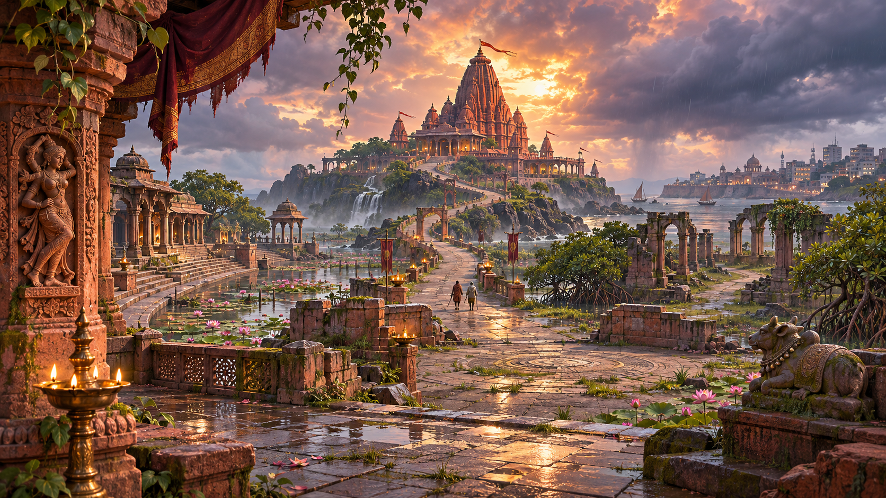

# Elden Ring-inspired world study for YUGA

YUGA can adopt the visual idea of a landmark seen beyond a broken approach, together with separately licensed terrain and bridge code. The two crossover mods use the installed games for Elden Ring's environment. Their public code licenses do not provide a license to ship that environment in YUGA. [Minecraft Ring source and notice](https://github.com/siddoff/Minecraft-Ring/blob/711015afa67ab25c7b9597c68038718d1cef322e/README.md) · [EldenCraft source](https://github.com/SocketByte/EldenCraft/tree/22a2ff959dd82f6e694af45eeb637ce849a9c2dc) · [Bandai Namco game EULA](https://store.steampowered.com/eula/1245620_eula_0)

The image is original generated concept art for the YUGA design team. It proposes a sandstone temple island, a ghat, a marsh and a distant modern waterfront. It is a visual target. The project also has a separate Blender study built from reusable geometry, and the current playable match remains the existing three-lane map. [Blender environment study](../../../art/world-landmark-study/README.md) · [Current map](../../../assets/world/confluence-map.json)

The Blender scene reuses YUGA's temple and courtyard, a finished Hanuman for scale, and 16 instances of the CC0 rock. It has 750,376 source triangles when instances are counted, before modifier evaluation. It is an unoptimized composition study, and its hardware cost has not been measured. [Rendered study](../../../art/world-landmark-study/landmark.png) · [Independent offline review](../../../art/world-landmark-study/qa.json)

## What we examined

| Source | Verified finding | Decision for YUGA |
| --- | --- | --- |
| Minecraft Ring | The project describes an experimental Windows x64 bridge connecting Minecraft Java 1.21.1 and Elden Ring app 1.17.1. Both games run; a Fabric mod supplies Minecraft content and a native D3D12 bridge composites it into Elden Ring. F8 switches control. The bridge code is MIT licensed and third-party notices identify additional terms. | Study its ownership, frame sync, depth occlusion and terrain sampling when a concrete multi-renderer need exists. It does not supply standalone map geometry. [Pinned README](https://github.com/siddoff/Minecraft-Ring/blob/711015afa67ab25c7b9597c68038718d1cef322e/README.md) · [Notices](https://github.com/siddoff/Minecraft-Ring/blob/711015afa67ab25c7b9597c68038718d1cef322e/THIRD_PARTY_NOTICES.md) |
| EldenCraft | SocketByte publishes a public MIT source repository and release. The pinned source README names Windows x64, an owned Elden Ring installation with executable version 2.7.2.0 and an owned Minecraft Java account running 26.3. The latest release observed was v0.26.0. The project describes alpha limitations. | Study its terrain cache and handling of dynamic surfaces. The game bridge and loader are tied to the installed games and Windows. [Pinned README](https://github.com/SocketByte/EldenCraft/blob/22a2ff959dd82f6e694af45eeb637ce849a9c2dc/README.md) · [Release](https://github.com/SocketByte/EldenCraft/releases/tag/v0.26.0) |
| EldenCraft terrain cache | One Rust module implements a moving 32 × 12 × 32 cell surface cache, adaptive ray budgets, 25 cm nearby floor samples and up to 4,096 published boxes. It asks its host for ray results. Its upstream module contains 18 tests. | The unmodified MIT source and minimal test harness are preserved as an isolated study. Compare it to YUGA's authored colliders before considering a live-world experiment. The sample is an approximation of sensed surfaces and needs a real query provider. [Runnable source study](worldterrain-probe/README.md) · [Upstream module](https://github.com/SocketByte/EldenCraft/blob/22a2ff959dd82f6e694af45eeb637ce849a9c2dc/native/src/worldterrain.rs) |
| DSMapStudio | This MIT-licensed FromSoftware modding suite includes an Elden Ring map editor. Its README lists 64-bit Windows, Vulkan 1.3 and game files among its requirements, with Wine on Linux mentioned as a possible configuration. | A source and interface reference for map-editing workflows. No game data or runnable editor session was available for this review. [Pinned source](https://github.com/soulsmods/DSMapStudio/tree/97bc264cbc3e82a783eb017f57edf651f8ba000b) |
| Smithbox | This GPL-3.0 modding editor supports Elden Ring and other FromSoftware games. | Study its editor workflow and review the GPL's terms before adopting any code. The editor and a game map were not tested here. [Pinned source](https://github.com/vawser/Smithbox/tree/99a76f9b3d54422dc9f64bdf8cf675f322a4c0b2) |
| Elden Ring landscape | A published EldenCraft gameplay image shows a castle gate framed by cliffs, foreground ruins, a grass slope and a clear sky behind the towers. This is one observed view, not an audit of the complete game map. | Test the same broad composition principles with YUGA's own landmarks and geometry. Keep the objective and actors readable at the actual combat camera. [Observed source image](https://github.com/SocketByte/EldenCraft/blob/22a2ff959dd82f6e694af45eeb637ce849a9c2dc/assets/showcase/torrent.jpg) · [Official game overview](https://en.bandainamcoent.eu/elden-ring/elden-ring) |
| Hampi and Mamallapuram | UNESCO describes Hampi's river, rocky hills, fortifications, temples, bazaars and water structures, and Mamallapuram's coastal rock-cut sanctuaries and sculpture. | Use these as distinct architectural and geographic references for an original fictional setting. Name the source and location when borrowing a specific historical feature. [Hampi](https://whc.unesco.org/en/list/241/) · [Mamallapuram](https://whc.unesco.org/en/list/249/) |
| Poly Haven Rock Face 01 | The artist Dario Barresi's 1K glTF downloaded with its binary and three material maps. Blender 4.3.2 imported one textured mesh with 20,174 triangles. Poly Haven dedicates its published assets to CC0. | Available for the Blender study. Record the chosen files and hashes, then evaluate LOD and collision before runtime use. [Asset](https://polyhaven.com/a/rock_face_01) · [Asset API](https://api.polyhaven.com/files/rock_face_01) · [License](https://polyhaven.com/license) |
| Poly Haven The Lost City HDRI | Greg Zaal's 1K HDR image loaded in Blender as a golden-hour lighting source. | Used as a studio lighting input under Poly Haven's CC0 dedication. Record the image and its hash with the scene. [Asset](https://polyhaven.com/a/the_lost_city) · [License](https://polyhaven.com/license) |
| South Indian Temple modular kit | Sketchfab's metadata lists rSquare's kit under CC BY 4.0 and reports 8,349 faces. The download API returned 401 in this session. | Candidate for a later intake. Review the downloaded files, license and required credit when available, then import and test them. [Listing](https://sketchfab.com/3d-models/south-indian-temple-modular-kit-25f0176668004faa98ec351e04e58920) · [Metadata](https://api.sketchfab.com/v3/models/25f0176668004faa98ec351e04e58920) |

The separate claim about the unreleased Tobyn Jacobs clip has not been independently established by this review. No connection between that clip and the published repositories has been established here.

An experiment using the actual Elden Ring world would require a compatible local game installation, the Windows-oriented bridge and an assessment of the game's terms. The crossover projects run that world inside Elden Ring. No game client, crossover session or game asset was tested during this study.

## Design team brief

The match has three lanes, a water edge and old and modern districts. The team should create **one recognizable landmark per approach**, then arrange foreground ruin, middle-distance cover and a background silhouette so a player can orient while moving. The concept uses a temple across water and deliberately leaves the foreground approach open. Generated architecture and the Blender study need a separate runtime adaptation. [Current map](../../../assets/world/confluence-map.json) · [Existing world kits](../../../art/reuse-library/README.md)

The measured base-to-base routes are 224 m along Temple Avenue and approximately 269.3 m along each outer lane. The proposed offshore sanctuary on the map is an unbuilt art location within the footprint of the existing `skyline-1` shikhara. The marker indicates a potential recomposition of that skyline; it does not add a traversable route. [Measured map plan](map-plan.png) · [Source and measurements](map-measurements.json)

| Owner | Decision or task | Acceptance evidence |
| --- | --- | --- |
| World designer | Select a ghat approach, a sanctuary landmark and a separate modern skyline. Establish team spawn-to-objective distances and three lane identities before adding side routes. | Top-down route diagram and fixed gameplay-camera views from both ends, with objectives, lane widths and sightline markers. |
| Environment artist | Reuse YUGA's temple, shrine, watchtower, mangrove and rock library. Use the licensed cliff as a material and silhouette input. | Packed Blender source, provenance, a matched overview and an eye-level view. Inspect visible seams, water edges and scale. |
| Gameplay and network engineer | Keep collision and movement authoritative. The Rust game resolves navigation and obstacle checks in the ground plane. The Godot prototype has separate raised platforms and traversal. | Reconcile visual blockers with the correct runtime's collision and line-of-sight data, then test both teams and synced private rooms. Elevated routes require actual floor and networking support. [Rust authority](../../../../yuga-rust/src/world.rs) · [Native world](../../../scripts/confluence_world.gd) |
| Performance engineer | Measure extra rock geometry, draw calls, texture memory and occlusion on the target hardware. Grouping or batching helps only if the actual renderer confirms it. | Record baseline and candidate p50/p95/p99 frame times, draw counts, memory, camera route, scene population, resolution and power profile on the RTX 4070 laptop. |
| Independent reviewer | Inspect the exact exported world through ordinary match entry, movement and ability targeting. Verify source license records and the artist's links. | Capture both faction views, combat readability, collision, routes, object counts and a clean package. Record unresolved visual and performance differences. |

The current Rust map has three lanes, eight authored building collision boxes and eight native traversal decks. Its terrain and LOS contract must be checked directly when promoting any new route. The existing world GLBs are original project-authored sources with their own provenance. [World provenance](../../../NOTICE/CONFLUENCE-WORLD-PROVENANCE.json) · [Rust map builder](../../../../yuga-rust/web/scene.ts)

## Smallest useful next rounds

1. Review the concept and the Blender study at the existing player camera. Choose one shoreline and one landmark to carry forward.
2. Fit licensed rock and temple pieces around the authoritative playable envelope. Produce low-detail variants and check texture memory.
3. Add a single approved section to a candidate map, with collision and both-team line-of-sight tests. Keep the three existing lane routes and objective timings measurable.
4. Capture a six-player match with minions and active telegraphs, then measure the candidate on the Legion's 8 GB dedicated RTX 4070 GPU.
5. Integrate the reviewed source, attribution, build and captures into the playable release and update this handoff.

## Generated concept prompt

ImageGen created `concept.png` on 25 November 2026. The image combines motifs for game art and is not a reconstruction of one archaeological site. Its SHA-256 is `a0c9f85317ce8d5fe363e15ded694cfc4a5912663e2c649c3658787bf42a4da1`.

> Create a single high fidelity 16:9 environmental art direction image for YUGA, an original India-inspired mythological competitive third-person action game. Show a sweeping cinematic but geographically coherent game environment at golden monsoon dusk: a heroic red sandstone Nagara-style temple with a layered shikhara rising on a rocky island in the distance, carved stone ghats and partly collapsed colonnades stepping into a shallow lotus marsh, three subtly distinct readable avenues that wind towards the distant landmark, low ruin walls that frame open battle spaces, and a far silhouette of an original coastal Indian city merging traditional domes with modest contemporary architecture. Hindustani sculpture motifs and lamps, lush mangrove roots, water reflections and atmospheric depth. The viewpoint is near player height from a courtyard, with foreground, midground and a crisp focal silhouette. Two tiny anonymous traveler silhouettes suggest human scale. Detail suitable for next-generation game environment concept work: materially plausible carved stone, weathering, moss, volcanic rock and cloth, rich warm/cool lighting. Ensure a beautiful and legible composition, with bright sky around the temple spire, no giant tree, no existing game characters, no visual imitation of any specific copyrighted game asset or specific known map. No writing, no labels, no symbols that resemble a logo, no UI.
