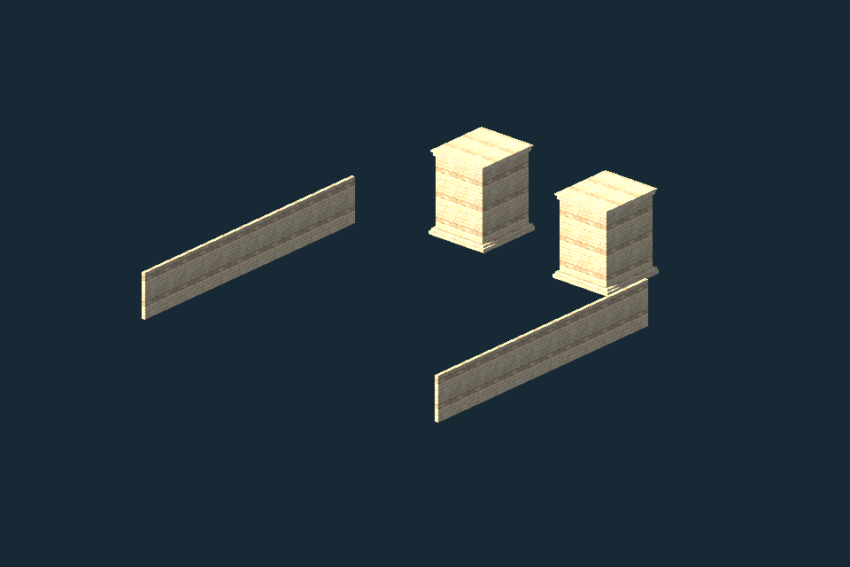

# Reuse existing map builds before authoring more geometry

**One map reuse path is working now:** an existing CC0 courtyard wall/pier
group loads through the project's existing Godot glTF path, receives the
already verified CC0 sandstone material and answers native physics queries.
The isolated prototype passed 23 checks. No new map geometry was authored;
the canonical map and assets remain unchanged.

This is a real 960×640 Godot/Mesa software capture of the original 1,296
triangles, not a concept image. It exposes the selected walls and piers as
separate parts; it is not a complete scene or a finished-art claim. Bright
top surfaces and the generic repeated material need contextual artist review.
Nothing in this packet establishes Deadlock graphics parity or GPU cost.

## Existing inventory came first

[existing-inventory.json](existing-inventory.json) was saved before new network
reads. It binds the existing eight source groups, ten sampled REA forks,
map/loader/material scripts and CC0 assets. The latest prior REA refresh pins
`morluto/rea` source `300905c11be1c25b98fda9e2b71dfa899fc2831c`; the exact
installed npm package is a separate identity. That prior work already exercised
REA/Ghidra on the real MikkTSpace authoring bridge. The ten sampled forks had
no relevant delta worth adopting; this is not an exhaustive fork audit.

REA is useful for source/binary evidence and compatibility investigation.
The retained inventory contains no recovered Deadlock/Overwatch/Dota 2 engine,
map or client art. This pass used the sources already available and fetched
ten small primary license/code/doc files for three specific candidate paths.
It did not clone engines, install a new plugin, download a game, extract a
binary or read credentials.

## Source-pinned code, art and format matrix

| Build/tool | Exact pinned source | Code rights | Art/map rights | Format and practical fit | Actual status |
| --- | --- | --- | --- | --- | --- |
| Existing YUGA courtyard + Godot glTF loader | Source GLB `1454e036…c33`; [metadata](../../../assets/environment/lanka_courtyard.metadata.json); existing `reuse-vfx-stage/source_loader.gd` | Existing local adapter; separately installed Godot MIT engine | This generated courtyard geometry/textures CC0-1.0 | Already metre, Y-up GLB. No BSP conversion or second unit scaling. Selected `COL_` geometry supplies truthful static collision. | **Used and tested**; isolated only |
| Existing Poly Haven sandstone kit | `sandstone_blocks_05`, Rob Tuytel; [exact source manifest](../../../art/source-kits/production-reuse-oct23/sandstone-blocks-05/manifest.json) | Existing local material adapter; no new shader | Three existing verified 1K PNG maps, CC0-1.0 | Existing Godot StandardMaterial3D; 3 m world tile, OpenGL normal, roughness map | **Used and tested**; no new download/promotion |
| FuncGodot | [`267ed438154c0399a946ca0e24988f0bf8c0eda7`](https://github.com/func-godot/func_godot_plugin/tree/267ed438154c0399a946ca0e24988f0bf8c0eda7) | MIT; retained LICENSE | No blanket clearance for input MAP/VMF files, WAD textures or game art | Native Godot brush scene path; importer stores MAP/VMF text; geometry code builds convex/concave shapes. Default 32 editor units per Godot unit. `clip`/`skip`/`origin` have different collision semantics. | **Source reference**; not installed/run. Strong optional next brush pipeline |
| OpenArena engine | [`fd74931a3cc76277647a64ff849910eea27e2fbb`](https://github.com/OpenArena/engine/tree/fd74931a3cc76277647a64ff849910eea27e2fbb) | Inspected `cm_load.c` GPL-2.0-or-later; COPYING retained | Engine repository license supplies no map-pack/texture entitlement. Review each separately sourced map/art file. | Quake III BSP collision loader checks version/lump structure, loads planes/brushes/patches/entities. C engine structures are not a drop-in Godot scene. A code port needs a deliberate GPL distribution decision. | **Source reference**; no code port, map download or engine build |
| Godot TPS demo | [`a82f15448e9b015440d3bbdf5e10801b260c4e9f`](https://github.com/godotengine/tps-demo/tree/a82f15448e9b015440d3bbdf5e10801b260c4e9f) | Code MIT | Assets/music CC-BY-3.0; material-origin notice names GameTextures.com. Treat art separately from code. | Existing Godot scene/spawn/peer lifecycle and GI fallback structure. Prior pinned project declares 4.7; present runner is 4.6.3, so compatibility must be tested before adaptation. | **Source reference**; no art, scene or gameplay code imported |

[source-files.json](source-files.json) records every primary URL, full commit,
byte length, SHA-256, retained file and precise reading scope. Full files saved
for inspection are not claims of a full engine audit. One attempted OpenArena
`README` path returned 404 and remains explicitly recorded. The original MIT,
GPL and TPS split-license notices sit beside the retained source files.

A public `.map`, `.vmf`, `.bsp` or `.glb` filename is a compatibility fact,
not an asset license. MIT loader code can be reused with original or verified
CC0 inputs. GPL tooling can be evaluated separately; ported GPL code needs its
terms addressed in the combined distribution. Neither choice makes commercial
client maps or textures available to this game.

## One actual reuse path

[tools/map-reuse-intake](../../../tools/map-reuse-intake/README.md) adapts the
existing raw `GLTFDocument` loader and exact existing PBR adapter. Preparation
pins the courtyard hash/license/units, links its read-only GLB and existing
source kit into a fresh scratch project, and copies zero geometry/texture
payload bytes. The selector is one existing structural mesh:
`COL_BEVEL_Warm_carved_sandstone`.

[intake-report.json](intake-report.json) records **23/23 passed checks**:
actual mesh import, all 1,296 source triangles, identical visual/collision
faces, native bounds matching independently read raw GLB accessor bounds,
rigid rotation/translation without an extra axis/unit conversion, actual
triangle ray hits and clear distant space, existing material settings and
source immutability. Wrong selectors/hashes, centimetre scale, reflection,
external-resource preflight and a truncated container are refused.

Seven added pure-preflight adverse controls reject null asset/animation fields,
non-array extension lists, unknown/undeclared required extensions and invalid
embedded buffer lengths. This type hardening ran headlessly after the preview;
it changes no accepted source geometry or placement. The original preview's
exact copied scripts are bound in [preview-source-manifest.json](preview-source-manifest.json).

[The fresh CI-shaped check](ci-shape-verification.json) confirms this works
before canonical/editor import: a fresh project without `.godot` cache passes
23 checks and exits 0. A second fresh scratch copy with one deliberately false
check exits 1 and records that named failure. The report is always
`<prepared-project>/intake-report.json`; use a bounded command timeout so an
unexpected script failure cannot leave CI waiting indefinitely.

The first attempt's guessed height limit failed because the source group is
10.12 m high. The corrected check compares native bounds to exact raw accessor
min/max. [The original failure](retained-r1-report.json) and [explanation](retained-r1-explanation.json)
are retained; no geometry or expected source hash was changed to pass.

[preview-runner-report.json](preview-runner-report.json) records a 3.892 s
single-frame capture on Mesa llvmpipe with one software-render worker, and
the PNG hash. It is elapsed capture time, not FPS or a physical-GPU benchmark.
The short capture finished before the later render-lane pause was received;
no further rendering ran. This preview and physics fixture do not replace
capsule navigation, full-world/authority checks or artist acceptance.

## File-level adaptation roadmap

| Milestone | Reuse these exact builds/files | Bounded implementation and gate | Six-worker split |
| --- | --- | --- | --- |
| M0 — completed intake | Existing courtyard GLB, VFX raw loader, wind-court PBR adapter; new isolated `tools/map-reuse-intake/` | 23 native checks + one actual view; sources unchanged; no canonical promotion | Intake, coordinates, collision, materials, visual review, independent evidence |
| M1 — place one reused module | The accepted source group and canonical Confluence manifest `assets/world/confluence-map.json`; existing `traversal_landmarks.gd` replacement contract | New `tools/map-reuse-placement/` and `art/map-reuse-placement/` only. Select one footprint, preserve scale/orientation and source surface. Actual hero capsule sweeps, landing/LOS and no duplicate old blocker. Context preview before any canonical change. | Provenance; placement; capsule/physics; material/frame cost; scene review; skeptical verification |
| M2 — reusable architecture library | Existing courtyard `COL_`/`DECOR_` groups, `architecture.glb`, accepted wind-court/loggia resources and one verified PBR family | Reuse named groups/resources, not entire scene duplication. Keep one material family, explicit solids vs decoration/water and fixed unit metadata. Gate silhouette/triangles/draws/collision at gameplay distance. | Source grouping; module boundaries; collision; material sharing; mythological art arrangement; perf/evidence |
| M3 — optional authored brush maps | FuncGodot `quake_map_import_plugin.gd`, `geometry_generator.gd`, `func_godot_map_settings.gd` at the pin above | Evaluate a version-pinned plugin outside canonical project. Use original/verified-CC0 MAP input and existing CC0 textures; test 32-unit conversion once, winding, UVs, clip/skip/origin and convex/concave physics. No WAD/VMF game assets imported by assumption. | Plugin/license intake; source map; coordinates/UVs; collision; material binding; import/reimport tests |
| M4 — three-lane layout from reused pieces | Current lane/objective/authority manifest plus module library; existing water/nature/lantern assets | Reassemble original Lanka/modern-city/swamp districts around lanes. Native route/capsule/nav/occlusion and spawn/objective tests must agree with manifest; retain separate browser planar authority limits. Replace canonical map only after a readable integrated preview and physics review. | Routes; skyline/modules; swamp/water; collision/nav; objective readability; network/authority verification |
| M5 — game lifecycle integration | Current YUGA screens/protocol plus selected MIT TPS spawn/lifecycle patterns | Adapt only needed functions into current systems; keep existing transport/authority. Test full load→spawn→play→death→respawn→end→reconnect and settings. Do not transplant an engine or duplicate UI/network stacks. | Lifecycle; movement/camera; combat/objectives; UI/input; multiplayer/bots; adversarial tests |
| M6 — target-quality gate | Artist-approved hero/map references, existing native profile/capture harness | Original before/after camera pairs, animation/contact/counter readability, draw/VRAM/frame-time budgets on target physical hardware. Promote by measured quality/performance evidence, not a count of agent rounds. | Hero art; map art; animation; rendering; performance; independent acceptance |

Only M0 is complete here. M1 is the next implementation decision: reuse a
specific existing module in one actual footprint and prove traversal rather
than importing another large repository. OpenArena/TPS remain bounded
references; FuncGodot is a candidate for original brush authoring if that
workflow is needed. No promised number of swarm rounds guarantees the
commercial visual target.
