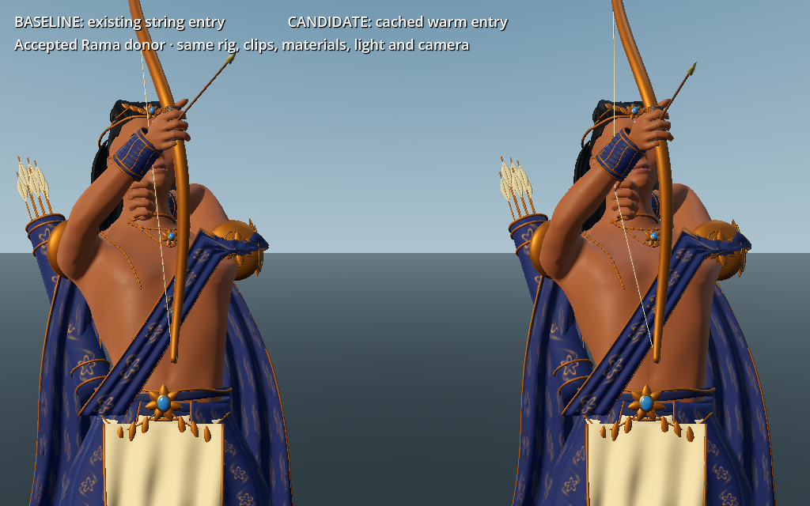

# W5 — Reused Rama motion: warm-draw string continuity

This pass fixes one reproduced defect in the existing Rama controller. Starting a primary draw while already aiming reset the bowstring to its rest position before drawing it back to the hand. The correction begins from the outgoing nock position in its actual parent, `wrist.R`, using the controller's existing per-request pose snapshot. It adds no animation, skeleton, mesh, release event or persistent cache.

The accepted Rama GLB remains `db4b2ec7a14cad72299d462c1265374f615d5e9d8b8852c4669e1f960f78245e`. This is the accepted 164-bone donor and existing 23 runtime clips. The generated Rama source, both rejected rebindings, and the isolated hair artist candidate are not used here. This pass creates no finished Arjuna or new roster hero.

## Three bounded milestones

1. **Reproduce on the existing implementation.** `motion_continuity_probe.gd` advances idle, run and aimed strafe through draw, release, hit interrupt, death, respawn and cancel at 30/60/120 Hz. `warm_draw_contact_probe.gd` then measures ten actual RamaBow vertices with positive bowstring weights and 2,382 distal draw-hand skin vertices across six entry/reset modes at each rate. Original sources and failed observations remain retained.
2. **Repair and challenge one cause.** [The exact patch](warm-entry.patch) changes only warm-entry interpolation. The candidate passes 113 comparison assertions, the existing motion suites pass 39 + 22 + 40 = 101 checks, and the integrated shared-family template passes 13 checks. Independent W1 black-box tests pass 9/9 for the candidate; the baseline passes 2/9 and fails 7/9. That independent fixture measures a different public/nock witness from the actual skin sample here; their values are not pooled.
3. **Capture real advancing native motion.** [The comparison clip](views/warm-entry-comparison.mp4) contains 36 consecutive Forward+ frames, two 60 Hz pose updates per 30 fps frame. Both actors use the identical accepted mesh, rig, clips, materials, lights and camera. The left controller is the preserved baseline; the right is the fixed candidate, now byte-identical to the integrated controller. Frame 5 starts the draw, frame 17 releases it. Source pins, actual rendered-frame counters and pose signatures before/after each draw are checked. This is a software Vulkan witness, not a physical-GPU performance or human-play test.



## Results and limits

Values below are the maximum movement of an actual bowstring-weighted skin sample during the first simulation step after the request. They are not socket gaps or total arm movement.

| Primed warm draw | Baseline | Fixed |
| --- | ---: | ---: |
| 30 Hz | 0.1930566 m | 0.000007808 m |
| 60 Hz | 0.1930847 m | 0.000000522 m |
| 120 Hz | 0.1930849 m | 0.000000299 m |

Cold and reset-to-cold recorded traces remain exactly equal. Retrigger entry does not worsen. Cancel/re-aim improves under the same gate. Respawn/re-aim improves from roughly 18–19 cm to **1.20–1.94 cm** in this skin fixture; that residual is explicitly open. Held string socket error stays below 0.00000013 m and the nearest sampled distal-finger skin is approximately 1.055 mm from the nock.

The nine normal continuous sequences keep action, stage, locomotion, nock and release-count traces unchanged and finite. Their largest event-step values are unchanged because these occur at other events, including the authored fast string release and later `piercing_dawn` entry. This narrow repair does not establish smoothness of every transition, full-body foot contact, perfect bow/arrow grip, cloth behavior, LOD motion, multiplayer authority, or finished art quality.

The rendered frame-5 hand/nock gap is a different two-step visual witness: 0.235459 m baseline versus 0.053859 m candidate. Both converge during draw; after release the trajectories match again. The bow's authored fast return is preserved.

## Frozen sources and receipts

| Resource | Before | Integrated |
| --- | --- | --- |
| `scripts/rama_motion.gd` | `d5550b25044ea97c9ce482a130ac73f012c313e96f2029a555abb590e1375b0e` | `6261a692308e84863dbac4ff049fb7855cc8c5ebf70d8ec844b1dfb2225e53c1` |
| Family manifest | `33b3b93522849761204fd9b68c57e0a311f487969089dce61bd4b9c3077116b1` | `ec0c42cf47014698af5d1d47b5ab93c4793ee386d1638d8f3b4551003b1d9b9b` |
| Arjuna template JSON | `f456301901c26d42f519df6849d3722e459fcec3a489f85e5f33d8b9ab586a72` | `ccc5e980b31ce3b5a38fc98fd2ee2518acc0bd7648104b1816c0ec4f2cf3747a` |

The manifest and template change only their intentional motion-source reference and the resulting source-contract hash. Their original versions are in [source/](source/); the prior independent family receipt is historical and has not been rewritten. [reports/repair-comparison.json](reports/repair-comparison.json) contains the 113 individual assertions and raw input hashes. [reports/archived-inputs.json](reports/archived-inputs.json) pins the exact decompressed bytes of the six compressed source traces. The compressed traces total approximately 531 KB; no raw GLB is duplicated.

[reports/capture.json](reports/capture.json) pins all 36 actual PNGs, source files, camera, counters and contact rows. The full original frames remain in `/workspace/scratch/reuse-next-ten/W5/render-r2/`; the compact MP4 and entry frame are retained here. Qualified native Godot SHA: `e69af4f6f07876a83e49a02a86928db00993f88594c05ae589e4021d6916d54e`.

The first display launch used an obsolete runtime path and failed before launch. The corrected launch successfully rendered all 36 frames and encoded the video, then its Python runner failed while writing metadata because the reused hash helper received a string instead of a Path. The exact faulty runner and traceback are retained. The bounded correction was verified with `--verify-existing`, rechecking all images, source pins and the existing video's frame count without rendering or overwriting images. [capture-run.json](reports/capture-run.json) explicitly records that re-verification; the original runner exit is not presented as success.

`baseline-motion-r1` is an early diagnostic that deliberately evaluates pose once more without advancing its clock. `baseline-motion-normal` is the first normal run but retains an old misleading `zero_time` metric label; its events themselves state `no_clock_advanced: false`. Neither is used as a zero-time runtime claim. Only the matched reports with `event_sampling: normal_next_update_once_per_frame` feed the comparison.

## Reproduce

Run from `games/yuga-native`. Use fresh absolute output files and an imported canonical project. `godot` below is the installed headless Godot 4.6.3. Each probe applies one update/evaluation per simulation step; do not add diagnostic event resampling to the accepted run.

```sh
godot --headless --path . --script res://tools/hero-family-reuse/warm_draw_contact_probe.gd -- --output=/workspace/scratch/w5-replay-baseline-contact.json --motion-source=res://docs/research/reuse-next-ten/W5/source/rama_motion.baseline.gd
godot --headless --path . --script res://tools/hero-family-reuse/warm_draw_contact_probe.gd -- --output=/workspace/scratch/w5-replay-fixed-contact.json --motion-source=res://scripts/rama_motion.gd
godot --headless --path . --script res://tools/hero-family-reuse/motion_continuity_probe.gd -- --output=/workspace/scratch/w5-replay-baseline-motion.json --motion-source=res://docs/research/reuse-next-ten/W5/source/rama_motion.baseline.gd
godot --headless --path . --script res://tools/hero-family-reuse/motion_continuity_probe.gd -- --output=/workspace/scratch/w5-replay-fixed-motion.json --motion-source=res://scripts/rama_motion.gd
python3 tools/hero-family-reuse/verify_motion_repair.py --baseline-contact /workspace/scratch/w5-replay-baseline-contact.json --candidate-contact /workspace/scratch/w5-replay-fixed-contact.json --baseline-motion /workspace/scratch/w5-replay-baseline-motion.json --candidate-motion /workspace/scratch/w5-replay-fixed-motion.json --output /workspace/scratch/w5-replay-comparison.json
python3 tools/hero-family-reuse/run_motion_regressions.py --output /workspace/scratch/w5-replay-existing --motion-source res://scripts/rama_motion.gd
```

For a new actual display capture, reuse the existing native runtime and supply the qualified executable explicitly when paths differ. This consumes the shared renderer slot; coordinate first. There is no headless fallback that fabricates screenshots.

```sh
python3 tools/hero-family-reuse/run_motion_capture.py --output /workspace/scratch/w5-new-native-capture --display 165 --runtime /workspace/scratch/ten-rounds-oct23/runtime/runtime --godot /workspace/scratch/ten-rounds-oct23/runtime-release/restored/godot
```

Next measured work is full-body interrupt/respawn foot-contact localization, followed by actual textured bow/hand and cloth inspection at runtime LODs. Alternate generated meshes still require the independent correspondence/art gates documented in the earlier rejected-rig packet. Reusing this accepted rig does not clear those gates.
